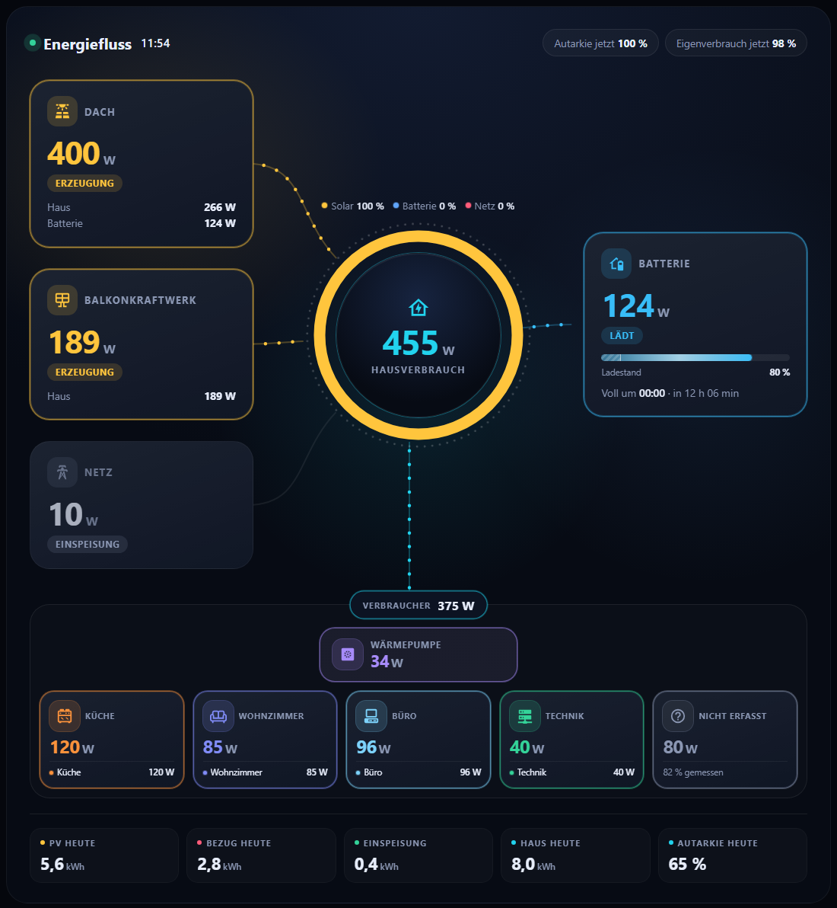
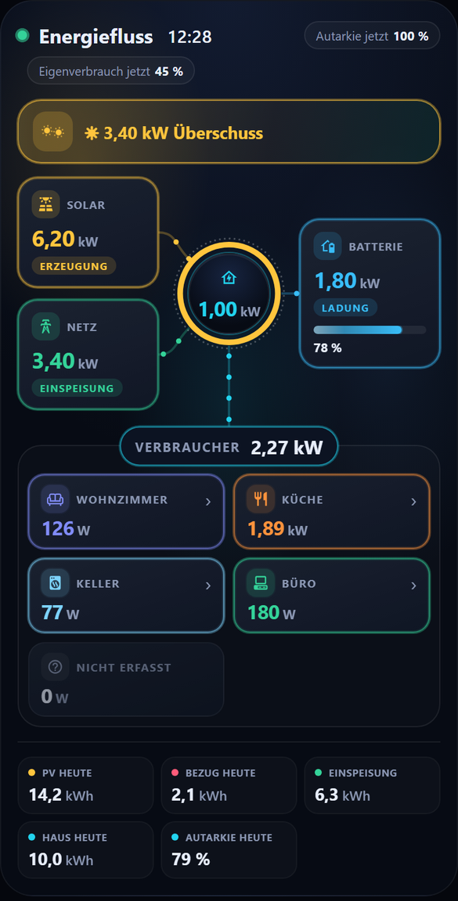

# Entwurf: Beitrag für die Home Assistant Community (nur Deutsch)

Nicht Teil des Releases. Zum Kopieren in das Forum. Vor dem Posten die Regeln der Kategorie prüfen.

---

**Titel:** Energy-Cockpit: Energiefluss, Geräte, Statistik und Raum-Abrechnung als HACS-Karten (komplett deutsch, mit Einrichtungsassistent)

**Text:**

Hallo zusammen,

ich habe vier Dashboard-Karten für Home Assistant gebaut und veröffentliche sie kostenlos unter MIT-Lizenz: **Energy-Cockpit**. Alles ist **komplett auf Deutsch**, die Sensoren sind frei wählbar, und ein **Einrichtungsassistent** schlägt passende Sensoren vor, du brauchst kein YAML.

*Beispieldaten.*

**Die vier Karten**

- **Energiefluss:** animierter Fluss zwischen Solar (auch eine zweite Anlage, zum Beispiel ein Balkonkraftwerk), Netz, einem oder mehreren Speichern und dem Haus, dazu Verbraucher und Gruppen, Überschuss-Hinweis und Akku-Prognose. Auch für Speicher, an denen die Module direkt hängen (z. B. Marstek B2500).
- **Geräte & Verbrauch:** Raum-Kacheln mit Live-Leistung, Schalten, Kosten pro Gerät und Standby-Detektiv.
- **Statistik:** Ersparnis, Einspeiseerlös, Autarkie, Amortisation, Grundlast und Monatsvergleich.
- **Raum-Abrechnung:** Verbrauch und Kosten eines Raums (zum Beispiel ein vermietetes Büro) mit Abschlag, Hochrechnung und Herkunft des Stroms (Netz, Batterie, PV).

**Außerdem**

- **Kurzansicht fürs Handy** und gleichbleibende Textgröße in jedem Browser.
- **Zählerkaskade** (zum Beispiel Wärmepumpe = Z1 − Z2) als Option, mit eigenem Tarif für einen Bereich.
- Farbschemen, mehrere Speicher, Entladegrenzen.

**Installation**

1. HACS öffnen, oben rechts Menü (⋮), **Benutzerdefinierte Repositories**.
2. `https://github.com/msucimaker3112/energy-cockpit` eintragen, Kategorie **Dashboard**.
3. Herunterladen, Browser-Cache leeren, Karte im Dashboard hinzufügen.

Ein Antrag für die HACS-Standardliste läuft, bis dahin geht es über „Benutzerdefinierte Repositories".

**Ehrlich dazu**

- Die Karten sind **nur auf Deutsch**. Eine englische Oberfläche ist nicht geplant, kann sich aber ändern.
- Ich teste mit meiner eigenen Anlage und mit den Rückmeldungen aus der Facebook-Gruppe. Nicht jede Konstellation habe ich selbst. Wenn bei dir etwas nicht passt, hilft mir ein Screenshot und die Karten-Konfiguration.

**Links**

- GitHub: https://github.com/msucimaker3112/energy-cockpit
- Anleitung und Optionen: https://github.com/msucimaker3112/energy-cockpit/blob/main/docs/KONFIGURATION.md
- Fehler und Wünsche: https://github.com/msucimaker3112/energy-cockpit/issues

Ich freue mich über Rückmeldungen, Wünsche und Fehlermeldungen. Viel Spaß damit!

Florian
