# Energy-Cockpit

**Energiefluss, Geräte, Statistik und Raum-Abrechnung für Home Assistant.** Komplett deutsch, kostenlos, mit Einrichtungsassistent. Du brauchst kein YAML. **Neu:** [eine Karte, zwei Ansichten](#handy-und-tablet-eine-karte-zwei-ansichten): kompakt auf dem Handy, ausführlich auf dem Tablet.

[](https://my.home-assistant.io/redirect/hacs_repository/?owner=msucimaker3112&repository=energy-cockpit&category=plugin)

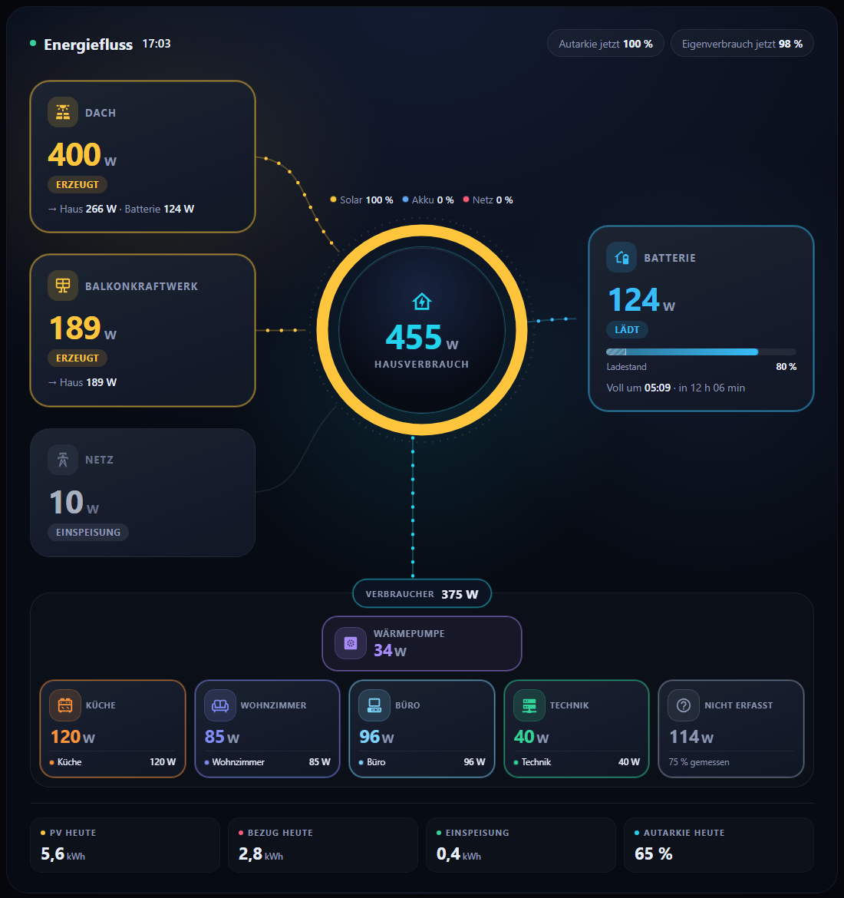

*Beispieldaten.* Vier Karten, die zusammen ein **Energie-Cockpit** für das Haus ergeben. Alle Sensoren sind frei wählbar, es gibt keine festen Gerätenamen im Code. Die Währung kommt aus Home Assistant.

| Karte | Zeigt |
|---|---|
| `energy-cockpit-flow-card` | Animierter **Energiefluss**: Solar, Netz, Batterie mit Entladegrenze, Haus, Verbraucher (eine Linie je Gerät oder eine Sammel-Linie), Überschuss-Hinweis, Akku-Prognose |
| `energy-cockpit-devices-card` | **Geräte & Verbrauch**: Raum-Kacheln mit Live-Leistung, Schalten, Kosten pro Gerät, Standby-Detektiv |
| `energy-cockpit-stats-card` | **Statistik**: Ersparnis, Einspeiseerlös, Autarkie, Amortisation (mit Anschaffungskosten), Grundlast, Monatsvergleich, Akku |
| `energy-cockpit-room-card` | **Raum-Abrechnung**: Verbrauch und Kosten eines Raums mit Abschlag, Hochrechnung, Live-Leistung, Herkunft (Netz, Batterie, PV), Grundlast, Betriebszeiten und Monatsarchiv |

**Morgens, wenig Sonne** (Beispieldaten): 81 W PV gehen komplett ins Haus, der Rest von 189 W kommt aus dem Netz.


**Mittags, viel Sonne** (Beispieldaten): Die PV-Kachel zeigt, wohin die Leistung geht. Hier 6,2 kW = 1,0 kW Haus + 1,8 kW Batterie + 3,4 kW ins Netz.


## Handy und Tablet: eine Karte, zwei Ansichten

Die Energiefluss-Karte erkennt, wie breit der Bildschirm ist, und zeigt automatisch die passende Ansicht. Du brauchst **kein zweites Dashboard**.

- **Handy (z. B. iPhone): Kurzansicht.** Alles auf einen Blick: Solar, Netz und Batterie direkt neben dem Hausverbrauch, die Räume nur mit ihrer Summe, keine Zusatztexte. Die Karte ist etwa halb so hoch.
- **Raum antippen:** Ein Tipp auf eine Gruppe (Pfeil „›“) öffnet ein Fenster mit allen Geräten des Raums, ihren aktuellen Werten und der Summe. Ein Tipp auf ein Gerät zeigt dessen Verlauf.
- **Tablet und PC (z. B. iPad): ausführliche Ansicht** mit jedem Gerät, Prognosen und der Aufteilung des Solarstroms.

| Handy: Kurzansicht | Handy: Raum angetippt | Tablet: ausführlich |
|---|---|---|
|  |  |  |

**Einschalten:** im Assistenten Schritt *Aussehen* → *Kurzansicht* → **Nur auf dem Handy**, oder im YAML:

```yaml
compact: auto    # Kurzansicht nur auf dem Handy (unter 600 px Breite)
# compact: true  # Kurzansicht überall
```

Die Umschaltung richtet sich nach der Breite, nicht nach dem Gerätetyp. Sie funktioniert also genauso mit Android-Handys und -Tablets. Ohne `compact` bleibt alles wie bisher.

## Der Einrichtungsassistent

Nach dem Hinzufügen einer Karte öffnet sich der Editor im Reiter **Assistent**. Er führt Schritt für Schritt durch die Karte, schlägt passende Sensoren aus deinen vorhandenen Entitäten vor und zeigt zu jeder Auswahl den **aktuellen Wert**, damit du sofort siehst, ob es der richtige Sensor ist. Alles wird sofort gespeichert. Im Reiter **Alle Felder** stehen danach alle Optionen für Feinheiten.

| 1. Schritt wählen und Vorschlag übernehmen | 2. Verbraucher hinzufügen | 3. Farbschema wählen |
|---|---|---|
|  |  | 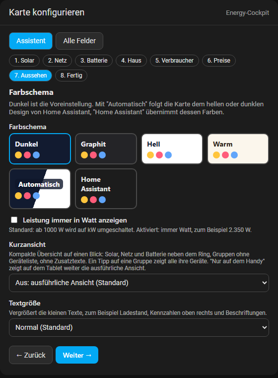 |

Bei **Geräte & Verbrauch** legt der Assistent auf Wunsch Räume und Geräte aus den **Bereichen** von Home Assistant an:


Die Schritte der einzelnen Karten sind in der [Installationsanleitung](docs/INSTALLATION.md#5-einrichtungsassistent) mit Bildern erklärt.

## Strompreis, Batterie und Linien

| Thema | Was du einstellen kannst |
|---|---|
| **Strompreis** | Fester Preis in Cent pro kWh (`grid_price_ct`, `feed_in_ct`) oder ein Sensor bzw. `input_number` (`grid_price`, `feed_in`). Es gibt keinen voreingestellten Preis. |
| **Batterie** | Entladegrenze und Maximalladung als Sensor/Helfer oder fester Prozentwert. Die Grenzen erscheinen schraffiert auf dem Ladebalken, die nutzbare Kapazität fließt in die Prognose ein. Optional zeigt `battery.soc_display: nutzbar` den Ladestand relativ zum nutzbaren Bereich. |
| **Linien zu den Verbrauchern** | `groups_lines: direkt` (Standard) zeichnet eine Linie je Gerät oder Gruppe, `groups_lines: sammel` nur eine Linie zum ganzen Verbraucherbereich mit der Summe. |
| **Zweite Solaranlage** | `pv2` (z. B. Balkonkraftwerk): eigene Kachel und Linie, Autarkie, Eigenverbrauch und Herkunft rechnen mit der Summe. Die zweite Anlage deckt zuerst das Haus, die erste lädt danach die Batterie. |
| **Unterposten in der Raum-Abrechnung** | `devices[].items` weist einzelne Geräte innerhalb eines Bereichs aus (zum Beispiel einen Kühlschrank in der Chillecke) mit eigenen kWh, Quellen und Kosten, plus "übrige Geräte". Die Abrechnung des Bereichs bleibt unverändert. |
| **Textgröße** | `text_size: gross` oder `sehr_gross` vergrößert Ladestand, Kennzahlen oben rechts und Beschriftungen. Gedacht für Handy und Tablet. |
| **Kachel "Nicht erfasst"** | `hide_rest: true` blendet sie aus, `rest_min: 10` zeigt sie erst, wenn mindestens 10 % des Hausverbrauchs keiner Gruppe zugeordnet sind. |
| **Anschaffungskosten** | `investment_eur` (fester Betrag) oder `investment` (Sensor) für die Amortisation in der Statistik. Mit `earned_before_eur` zählt auch, was die Anlage vor Beginn der Home-Assistant-Zähler schon erwirtschaftet hat. |
| **Gruppen pro Reihe** | `groups_columns: 1` stellt jede Gruppe in eine eigene Reihe über die volle Breite. Die Gerätenamen sind dann auch auf dem Handy vollständig lesbar. Standard: alle Gruppen nebeneinander. |
| **Kurzansicht** | `compact: auto`: kompakt auf dem Handy, ausführlich auf Tablet und PC, Raum antippen zeigt alle Geräte. Siehe [Handy und Tablet](#handy-und-tablet-eine-karte-zwei-ansichten). |
| **Nur Watt** | `watt_only: true` zeigt alle Leistungen in Watt (zum Beispiel 6.200 W) statt ab 1000 W in kW. |
| **Aktiv ab** | `on_w` je Verbraucher oder Gruppe: ab welcher Leistung Rahmen und Linie erscheinen (Standard 10 W). Gut für kleine Verbraucher wie eine Zirkulationspumpe. |
| **Haus heute** | Kachel mit dem Hausverbrauch des Tages in kWh, berechnet oder aus einem eigenen Sensor (`home.daily`). |

| Batterie mit Entladegrenze | Sammel-Linie zu den Verbrauchern |
|---|---|
| 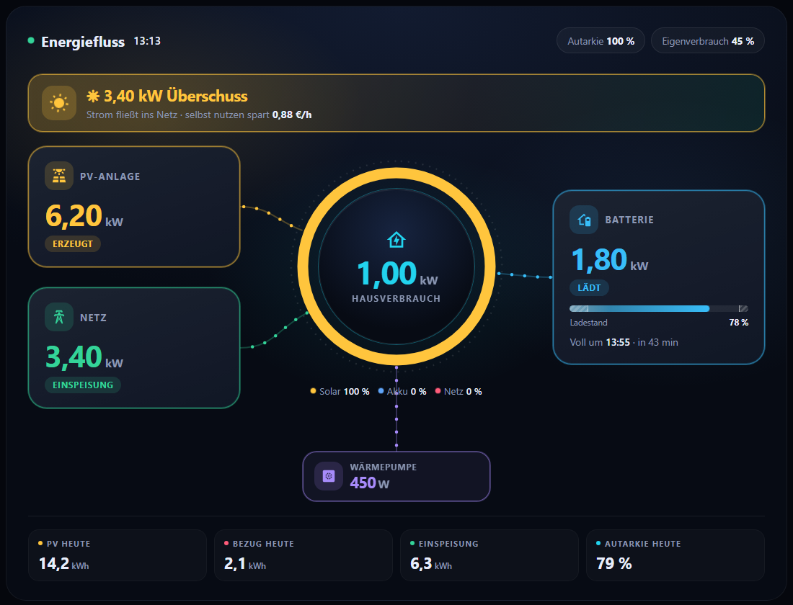 |  |

| Zwei PV-Anlagen | Mit Verbrauchern und Sammel-Linie |
|---|---|
| 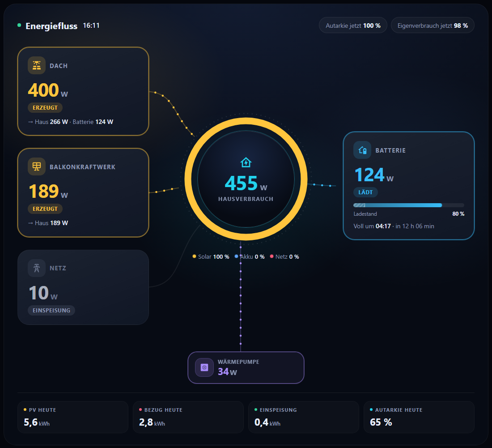 |  |

| Handy: Gruppen nebeneinander (Standard) | Handy: `groups_columns: 1` |
|---|---|
|  |  |

| `watt_only: true` und Kachel "Haus heute" | `groups_columns: 1` auf dem Tablet |
|---|---|
| 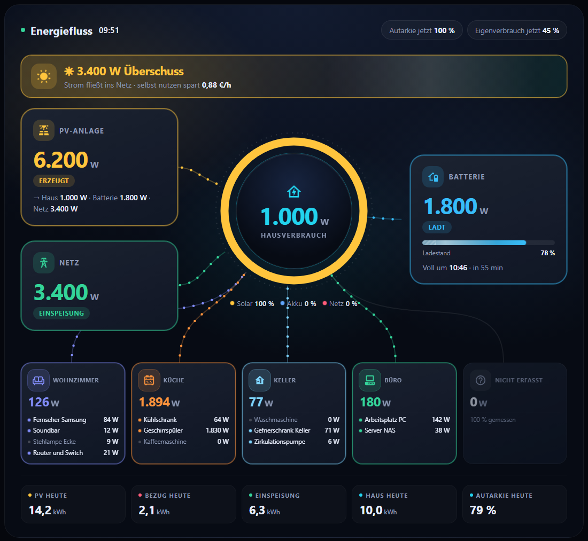 | 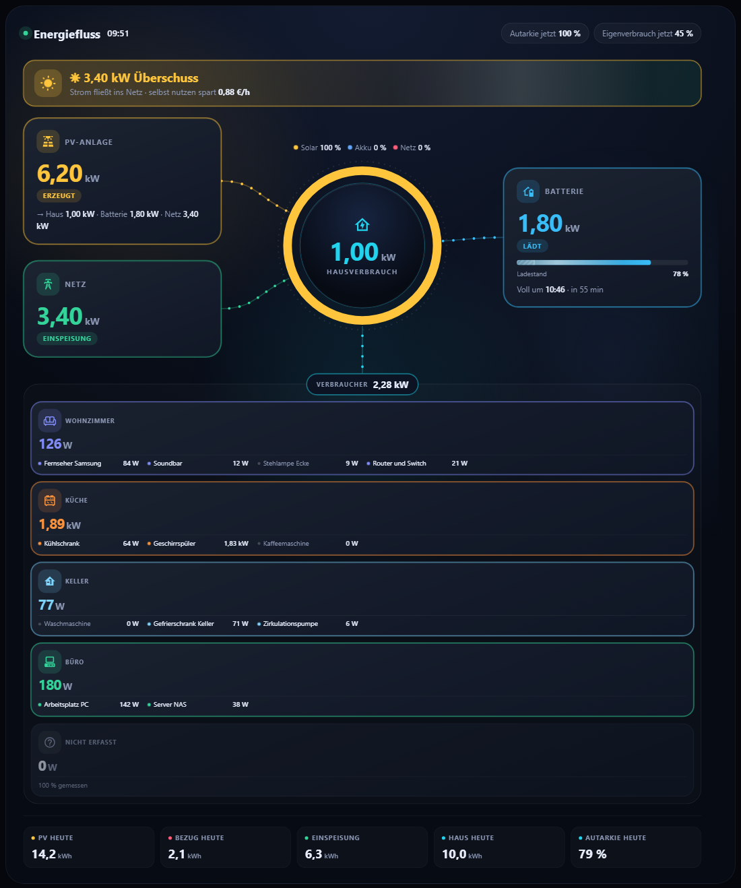 |

| Textgröße normal | Textgröße `gross` | Textgröße `sehr_gross` |
|---|---|---|
| 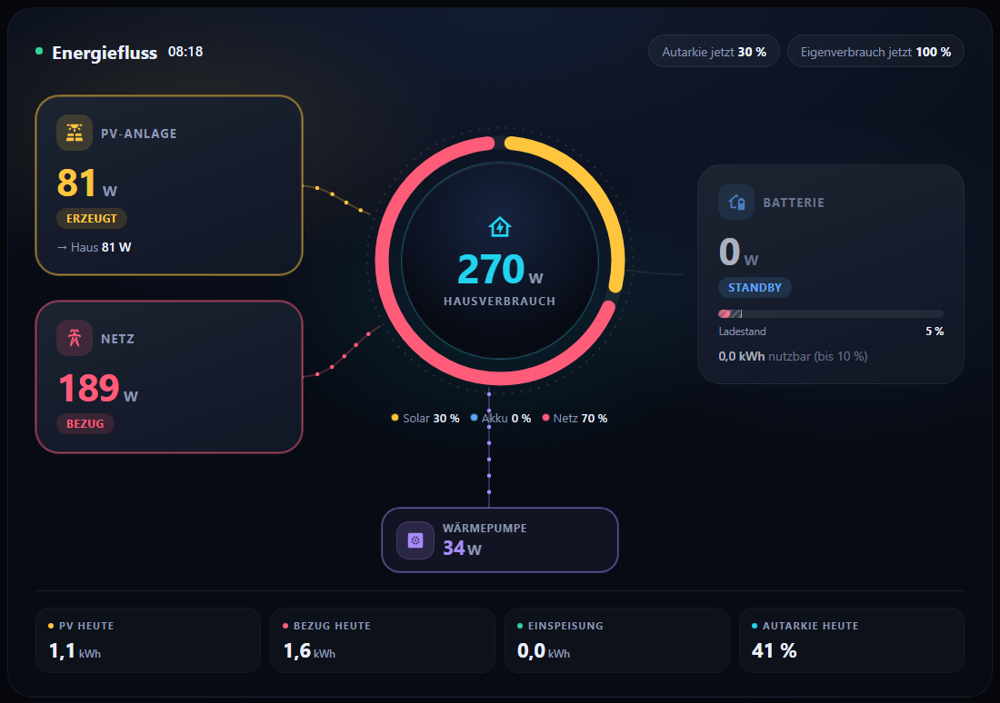 | 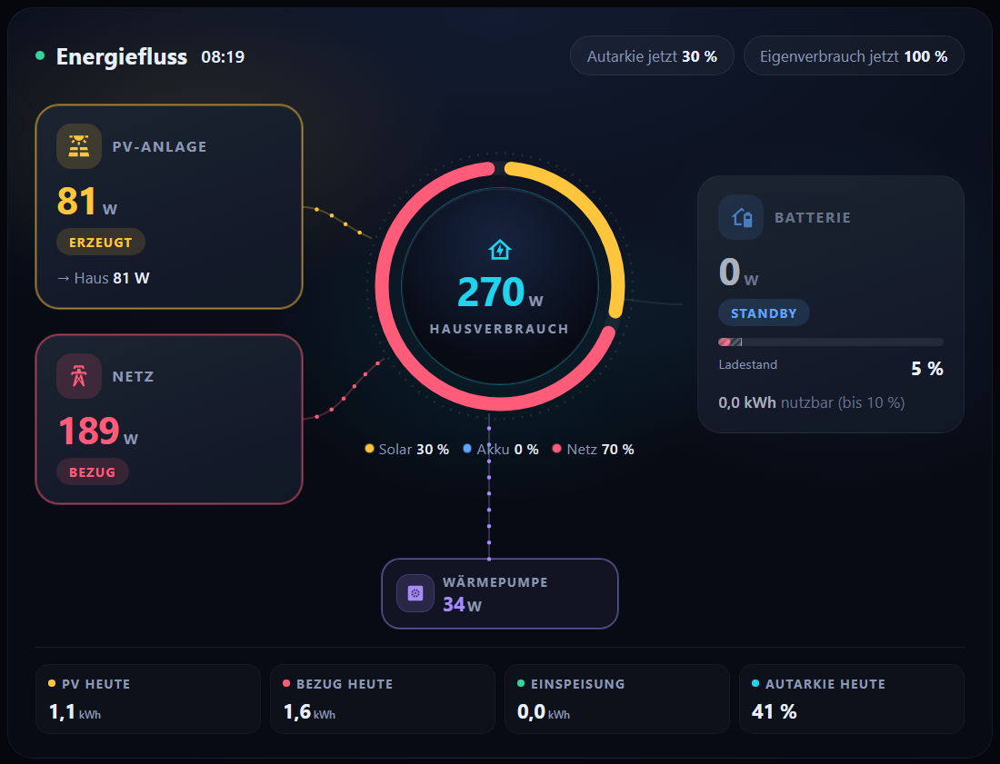 | 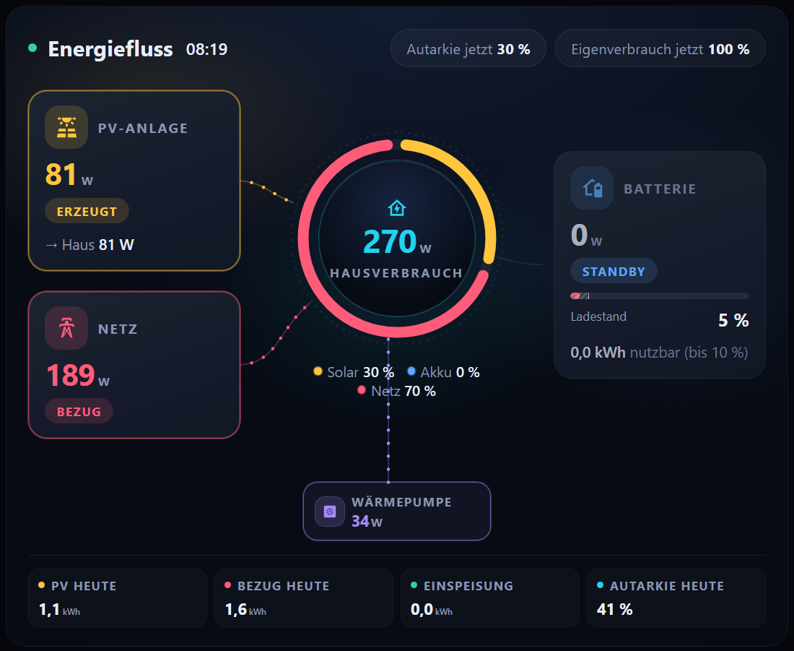 |

Die Netz-Kachel zeigt **Bezug** oder **Einspeisung** ab 0,5 W. "Ausgeglichen" steht nur, wenn praktisch nichts fließt.

Alle Optionen mit Beispielen: [docs/KONFIGURATION.md](docs/KONFIGURATION.md). Die Änderungen je Version: [CHANGELOG.md](CHANGELOG.md).

## Farbschemen

Alle vier Karten gibt es in mehreren Farbschemen. Gewählt wird im Assistenten (Schritt *Aussehen*) oder mit `theme` im YAML. Ohne Angabe bleibt das dunkle Standarddesign.

| `theme` | Aussehen |
|---|---|
| `dunkel` | Mitternachtsblau (Standard) |
| `graphit` | Neutrales Dunkelgrau |
| `hell` | Weiß mit kühlem Grau |
| `warm` | Helles Papier |
| `auto` | Folgt dem hellen oder dunklen Design von Home Assistant |
| `ha` | Übernimmt die Farben deines Home-Assistant-Designs |

| Hell | Warm | Graphit |
|---|---|---|
| 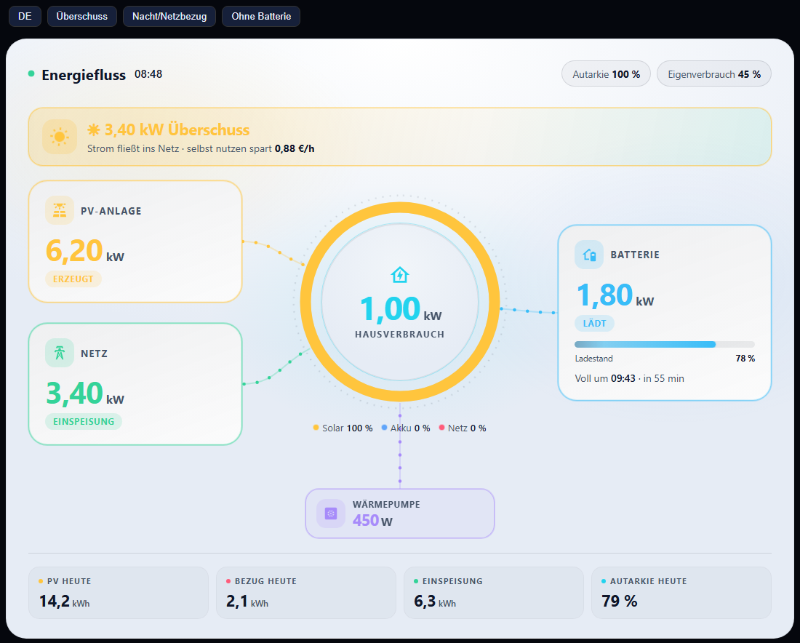 | 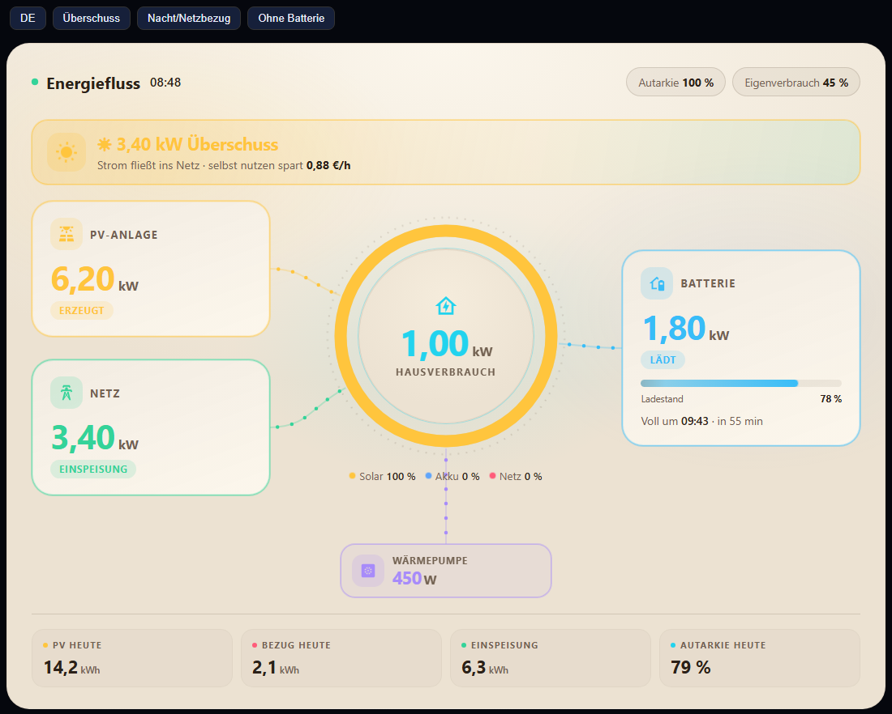 | 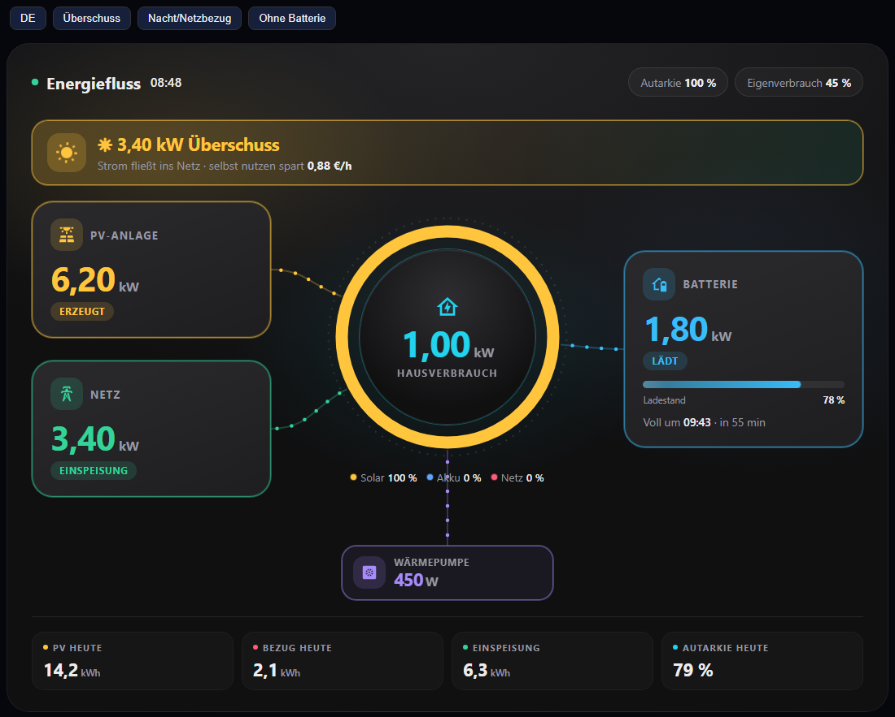 |

Die Raum-Abrechnung kennt zusätzlich `accent` (Akzentfarbe, etwa `34,197,94` oder `#22c55e`). Die Farben der Quellen (Netz rot, Batterie blau, PV gelb) bleiben in allen Schemen gleich.

## Neu: Raum-Abrechnung

Für einen Raum mit eigenen Zählern, zum Beispiel ein vermietetes Büro oder eine Werkstatt. Die Karte rechnet nach der **Herkunft** der Energie (Netz, Batterie, PV) und bewertet nach dem **entgangenen Nutzen**: PV-Strom, den das Haus selbst gebraucht hätte, kostet so viel wie Netzstrom.


| Bereich | Bild |
|---|---|
| **Abrechnung und Hochrechnung:** Kosten gegen Abschlag, Hochrechnung bis Monatsende, Saldo, Vergleich mit Vormonat und Vorjahr |  |
| **Jetzt und heute:** aktuelle Leistung je Bereich mit Ampelfarbe und Tageskurve |  |
| **Herkunft heute:** Anteile Netz, Batterie, PV und das Zeitfenster mit dem geringsten Netzanteil |  |
| **Grundlast nachts:** Leerlauf zwischen 0 und 5 Uhr, hochgerechnet auf kWh und Kosten pro Monat |  |
| **Betriebszeiten:** aktive Stunden und Heatmap Wochentag × Stunde |  |
| **Monatsarchiv:** eingefrorene Monatswerte mit Zählerständen |  |

Einrichtung der Raum-Karte, der Mitteilung am Monatsersten und der Standby-Warnung: [docs/ABRECHNUNG.md](docs/ABRECHNUNG.md).

## Schnellstart (mit HACS)

1. HACS öffnen → Menü (⋮) oben rechts → **Benutzerdefinierte Repositories**.
2. Repository `https://github.com/msucimaker3112/energy-cockpit` eintragen, Kategorie **Dashboard** wählen, **Hinzufügen**.
3. "Energy-Cockpit" in HACS suchen, **Herunterladen**, Browser-Cache leeren (Strg+F5).
4. Im Dashboard eine Karte hinzufügen: **Energy-Cockpit Energiefluss**, **… Geräte & Verbrauch**, **… Statistik** oder **… Raum-Abrechnung**. Der Assistent führt dich durch die Einrichtung.

Ausführlich, mit manueller Installation und Fehlerbehebung: [docs/INSTALLATION.md](docs/INSTALLATION.md).
Alle Optionen mit Beispielen: [docs/KONFIGURATION.md](docs/KONFIGURATION.md).
Zum Ausdrucken: [docs/Energy-Cockpit-Handout.pdf](docs/Energy-Cockpit-Handout.pdf).

## Minimalbeispiele

```yaml
type: custom:energy-cockpit-flow-card
pv:
  entity: sensor.pv_leistung
grid:
  entity: sensor.netz_leistung
battery:
  power: sensor.batterie_leistung
  soc: sensor.batterie_ladestand
```

```yaml
type: custom:energy-cockpit-room-card
title: Büro
devices:
  - name: Arbeitsplätze
    energy: sensor.buero_1_energie
    power: sensor.buero_1_leistung
price_ct: 34
advance: 35
```

Die meisten Einstellungen erledigt der grafische Editor. Drei optionale Zusatzfunktionen gibt es nur im YAML-Editor: ein **Müllabfuhr-Hinweis** aus einem HA-Kalender, **Überschuss-Vorschläge** (zum Beispiel "jetzt Waschmaschine starten") und ein **Netzalarm** bei hohem Bezug. Beispiele stehen in der [Konfigurationsanleitung](docs/KONFIGURATION.md).

## Voraussetzungen

- Home Assistant mit Lovelace-Dashboards. Die Karten brauchen Platz: Ansichtstyp **Panel** (eine Karte, volle Breite) ist empfohlen. In *Abschnitte*-Ansichten füllt die Karte nur die Breite des Abschnitts.
- Leistungssensoren in W oder kW, Energiesensoren in kWh.
- Für Verlauf, Kosten und die Raum-Abrechnung: Energiezähler mit Langzeitstatistik (`state_class: total_increasing`).

## Hinweise

- Kosten werden nur angezeigt, wenn ein Strompreis konfiguriert ist.
- Die Karten skalieren sich auf die sichtbare Bildschirmhöhe (Wandtablet-Betrieb). Abschaltbar mit `fit_screen: false`.
- Die Raum-Abrechnung braucht ein bis zwei volle Stunden Daten, bevor Betriebszeiten und Grundlast Werte zeigen. Für die Hochrechnung ist mindestens ein ganzer Messtag nötig.
- Getestet mit Chromium-basierten Browsern und dem Silk-Browser des Echo Show (ältere Browser: keine Container-Queries, kein `color-mix`).

## Gefällt dir das Projekt?

Ein ⭐ oben rechts hilft anderen, es zu finden. Fehlt dir etwas oder passt etwas bei dir nicht? Schreib ein [Issue](https://github.com/msucimaker3112/energy-cockpit/issues), viele Funktionen (zweite PV-Anlage, Textgröße, Batteriegrenzen) sind genau so entstanden.

## Lizenz

MIT, siehe [LICENSE](LICENSE).
