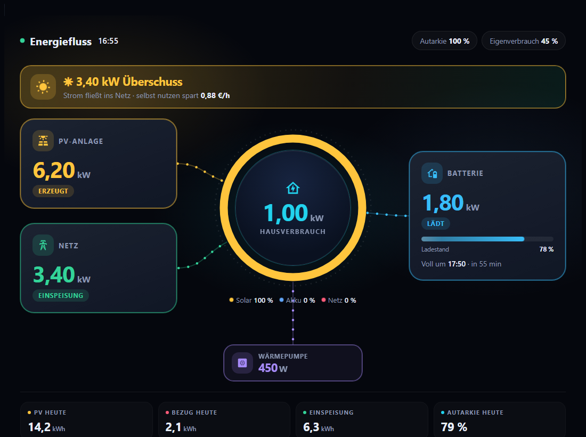
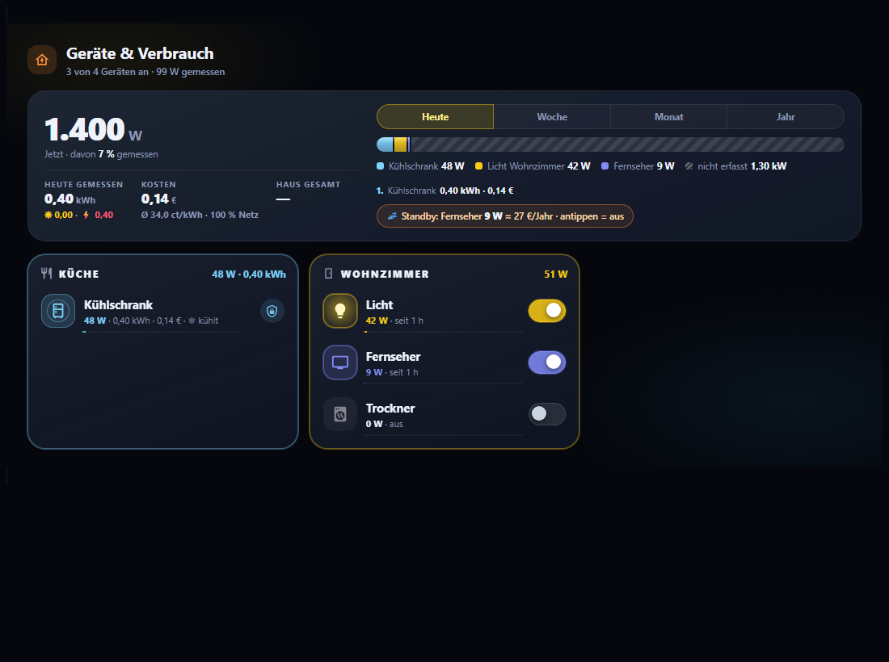
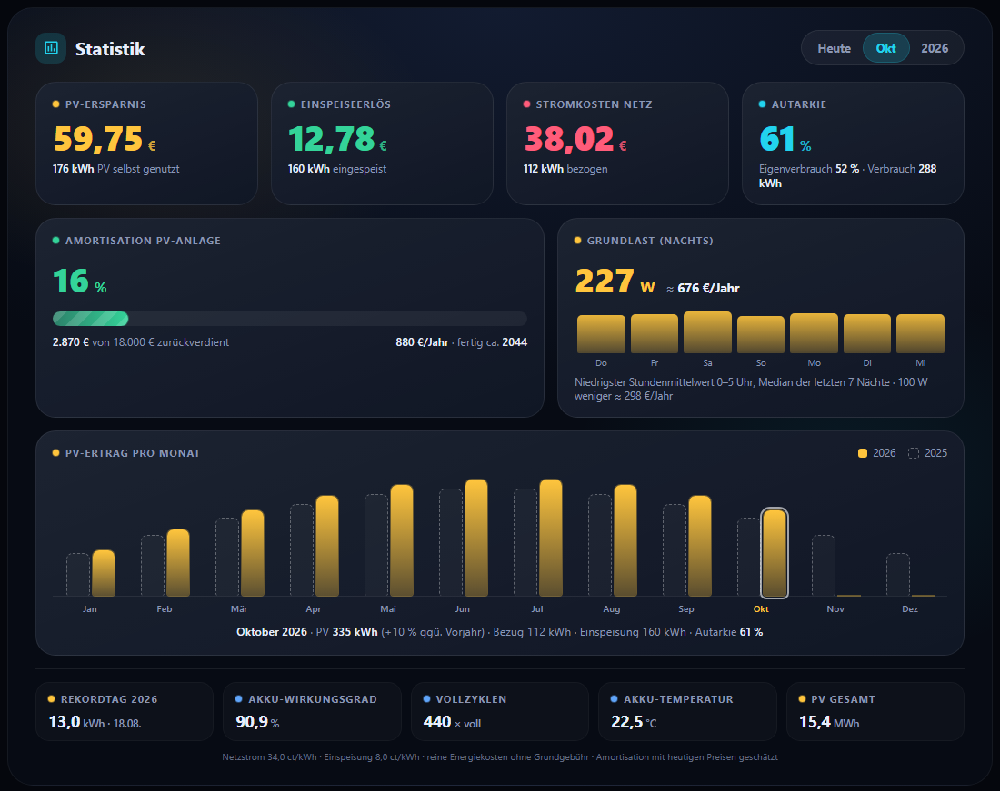

# Energy-Cockpit

Vier Karten für Home Assistant, die zusammen ein **Energie-Cockpit** für das Haus ergeben:

| Karte | Zeigt |
|---|---|
| `energy-cockpit-flow-card` | Animierter **Energiefluss**: Solar, Netz, Batterie, Haus, Verbraucher, Überschuss-Hinweis, Akku-Prognose |
| `energy-cockpit-devices-card` | **Geräte & Verbrauch**: Raum-Kacheln mit Live-Leistung, Schalten, Kosten pro Gerät, Standby-Detektiv |
| `energy-cockpit-stats-card` | **Statistik**: Ersparnis, Einspeiseerlös, Autarkie, Amortisation, Grundlast, Monatsvergleich, Akku |
| `energy-cockpit-room-card` | **Raum-Abrechnung**: Verbrauch und Kosten eines Raums je Woche, Monat, Jahr und Vorjahr, getrennt nach Geräten (z. B. für die Strommiete), mit CSV-Export |

Alle Sensoren sind frei wählbar. Es gibt keinen festen Gerätenamen im Code. Die Texte sind komplett deutsch, die Währung kommt aus Home Assistant.

**Einrichtungsassistent:** Nach dem Hinzufügen einer Karte öffnet sich der Editor im Reiter *Assistent*. Er führt Schritt für Schritt durch Solar, Netz, Batterie, Verbraucher und Preise, macht Sensor-Vorschläge aus deinen vorhandenen Entitäten und zeigt jeweils den aktuellen Wert. Bei *Geräte & Verbrauch* legt er Räume und Geräte auf Wunsch aus den Bereichen von Home Assistant an.







## Schnellstart (mit HACS)

1. HACS öffnen → Menü (⋮) oben rechts → **Benutzerdefinierte Repositories**.
2. Repository `https://github.com/msucimaker3112/energy-cockpit` eintragen, Kategorie **Dashboard** wählen, **Hinzufügen**.
3. "Energy-Cockpit" in HACS suchen, **Herunterladen**, Browser-Cache leeren (Strg+F5).
4. Im Dashboard eine Karte hinzufügen: **Energy-Cockpit Energiefluss**, **… Geräte & Verbrauch** oder **… Statistik**.

Ausführlich, mit manueller Installation und Fehlerbehebung: [docs/INSTALLATION.md](docs/INSTALLATION.md).
Alle Optionen mit Beispielen: [docs/KONFIGURATION.md](docs/KONFIGURATION.md).
Zum Ausdrucken: [docs/Energy-Cockpit-Handout.pdf](docs/Energy-Cockpit-Handout.pdf).

## Minimalbeispiel

```yaml
type: custom:energy-cockpit-flow-card
pv:
  entity: sensor.pv_leistung
grid:
  entity: sensor.netz_leistung
battery:
  power: sensor.batterie_leistung
  soc: sensor.batterie_ladestand
```

Die meisten Einstellungen erledigt der grafische Editor, auch Einzelverbraucher und Gruppen. Abfallkalender, Überschussvorschläge und Netzalarm stellst du im YAML-Editor ein.

## Voraussetzungen

- Home Assistant mit Lovelace-Dashboards. Die Karten brauchen Platz: Ansichtstyp **Panel** (eine Karte, volle Breite) ist empfohlen. In *Abschnitte*-Ansichten füllt die Karte nur die Breite des Abschnitts.
- Leistungssensoren in W oder kW, Energiesensoren in kWh.
- Für Verlauf und Kosten pro Gerät: Energiezähler mit Langzeitstatistik (`state_class: total_increasing`).

## Hinweise

- Kosten werden nur angezeigt, wenn Strompreis (`grid_price`) konfiguriert ist.
- Die Karten skalieren sich auf die sichtbare Bildschirmhöhe (Wandtablet-Betrieb). Abschaltbar mit `fit_screen: false`.
- Getestet mit Chromium-basierten Browsern und dem Silk-Browser des Echo Show (ältere Browser: keine Container-Queries, kein `color-mix`).

## Lizenz

MIT, siehe [LICENSE](LICENSE).
