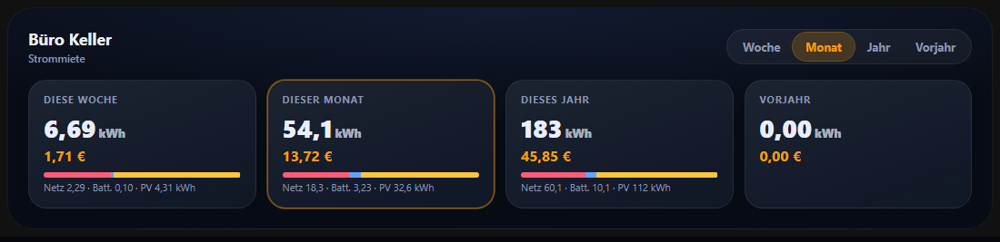
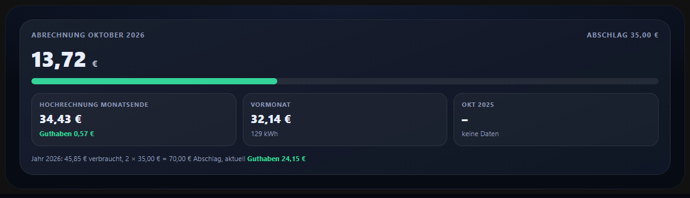
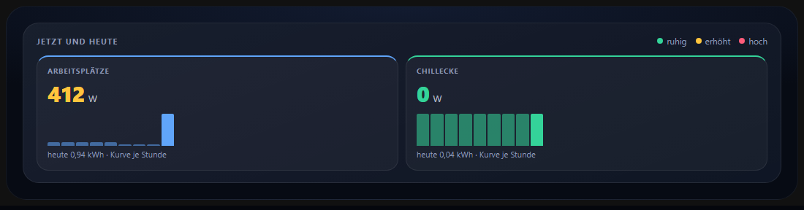
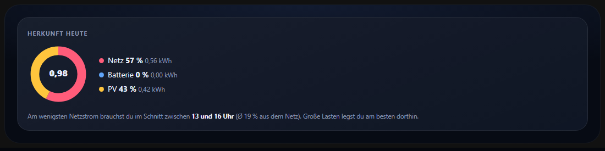
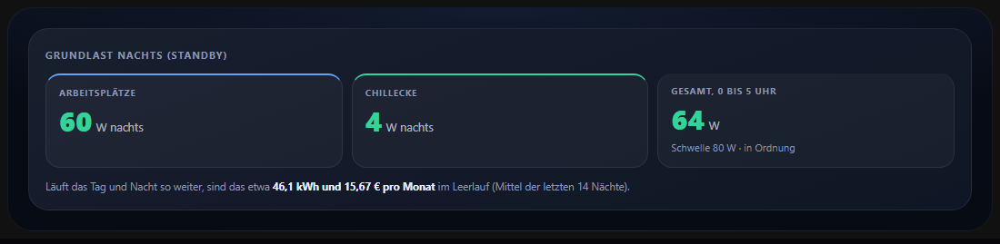
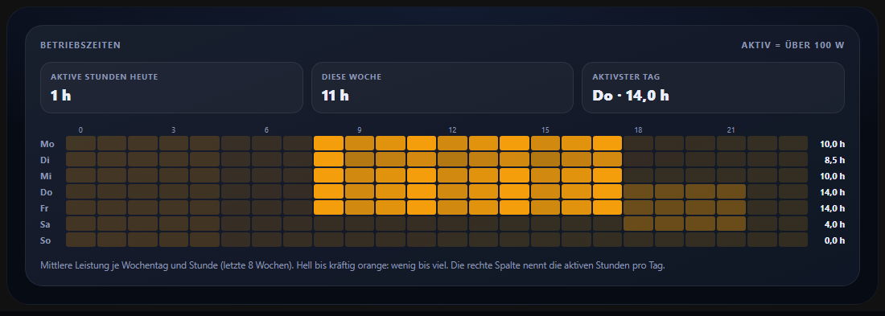
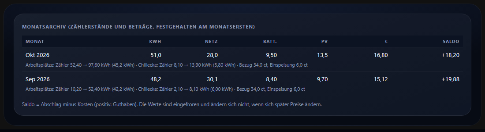

# Raum-Abrechnung einrichten

Die Karte `energy-cockpit-room-card` rechnet Verbrauch und Kosten eines Raums ab, zum Beispiel für ein vermietetes Büro. Diese Anleitung führt von der Karte bis zur automatischen Monatsabrechnung.



## 1. Karte anlegen

1. Dashboard → **Bearbeiten** → **Karte hinzufügen** → **Energy-Cockpit Raum-Abrechnung**.
2. Im **Assistenten** (7 Schritte, siehe [INSTALLATION.md](INSTALLATION.md#raum-abrechnung-7-schritte)):
   - **Zähler:** die Energiezähler (kWh) der Bereiche, etwa *Arbeitsplätze* und *Chillecke*.
   - **Herkunft:** die Zähler des ganzen Hauses (PV-Ertrag, Netzbezug, Einspeisung, Batterie geladen, Batterie entladen). Ohne sie wird alles zum Bezugspreis abgerechnet.
   - **Preis:** Bezugspreis und Einspeisevergütung als Sensor, `input_number` oder fester Wert (Cent).
   - **Auswertung:** Abschlag, Standby-Schwelle, Aktiv-Schwelle, Archiv-Sensor.
3. Im Reiter **Alle Felder** je Bereich einen **Leistungssensor** (W) eintragen. Er speist die Live-Anzeige.

## 2. Was die Karte zeigt

| Bereich | Erklärung |
|---|---|
| **Abrechnung und Hochrechnung** | Kosten des laufenden Monats gegen den Abschlag, Fortschrittsbalken (grün, ab 80 % gelb, ab 100 % rot). Hochrechnung bis Monatsende aus dem bisherigen Tagesdurchschnitt (ab dem zweiten Messtag). Saldo als Guthaben oder Nachzahlung. Vergleich mit Vormonat und gleichem Monat des Vorjahres. Darunter die Jahresbilanz: Kosten gegen Abschläge seit dem ersten Messwert. |
| **Jetzt und heute** | Aktuelle Leistung je Bereich, Farbe nach Last (ruhig, erhöht ab `watt_warn`, hoch ab `watt_high`) und die Tageskurve je Stunde. |
| **Herkunft heute** | Ring aus Netz, Batterie und PV für heute. Der Tipp nennt das Drei-Stunden-Fenster der letzten 30 Tage, in dem das Haus im Mittel am wenigsten Netzstrom bezieht. |
| **Grundlast nachts** | Mittlere Leistung zwischen 0 und 5 Uhr über die letzten 14 Nächte, je Bereich und gesamt, verglichen mit der Standby-Schwelle und hochgerechnet auf kWh und Kosten pro Monat. |
| **Betriebszeiten** | Aktive Stunden (Leistung über `active_w`) heute, in dieser Woche und im Mittel je Wochentag. Die Heatmap zeigt die mittlere Leistung je Wochentag und Stunde der letzten 8 Wochen. |
| **Verlauf, Tabellen, CSV** | Balken und Tabellen je Woche, Monat, Jahr und Vorjahr, Tabelle je Bereich, CSV in die Zwischenablage. |
| **Monatsarchiv** | Festgehaltene Monate mit Zählerständen (Anfang und Ende), Mengen, Preisen, Betrag und Saldo. |













## 3. Die Bewertung

Die Standardbewertung `opportunity` (**entgangener Nutzen**) fragt: Was hätte das Haus ohne den Verbrauch des Raums gehabt?

- **Netz:** kostet den Bezugspreis.
- **Batterie:** kostet den Bezugspreis, denn der Strom wäre sonst für das Haus verfügbar gewesen.
- **PV in Stunden ohne Einspeisung:** kostet den Bezugspreis, das Haus hätte ihn selbst verbraucht.
- **PV in Stunden mit Einspeisung:** kostet nur die Einspeisevergütung, denn sonst wäre er eingespeist worden.

Alternativen sind `mix` (feste Preise je Quelle) und `grid` (alles zum Bezugspreis). Die Herkunft wird stündlich aus dem Haus-Mix bestimmt: Jeder Verbraucher bekommt in jeder Stunde den gleichen Anteil aus Netz, Batterie und PV wie das ganze Haus. Details und Formeln: [KONFIGURATION.md](KONFIGURATION.md#raum-abrechnung-customenergy-cockpit-room-card).

## 4. Monatsarchiv und Mitteilung am Monatsersten

Das Archiv ist ein Sensor, dessen Attribut `monate` die festgehaltenen Monate enthält. So bleiben Beträge unverändert, auch wenn sich später Preise ändern. Du brauchst dafür die MQTT-Integration (alternativ ein beliebiger Sensor, der das Attribut `monate` liefert).

### 4.1 Sensor per MQTT-Discovery anlegen (einmalig)

In *Entwicklerwerkzeuge → Aktionen* zwei Aktionen `mqtt.publish` ausführen:

```yaml
action: mqtt.publish
data:
  topic: homeassistant/sensor/buro_abrechnung_archiv/config
  retain: true
  payload: >-
    {"name": "Büro Abrechnung Archiv", "unique_id": "buro_abrechnung_archiv",
     "object_id": "buro_abrechnung_archiv", "state_topic": "buro/abrechnung/archiv",
     "value_template": "{{ value_json.n }}", "json_attributes_topic": "buro/abrechnung/archiv",
     "icon": "mdi:archive-outline"}
```

```yaml
action: mqtt.publish
data:
  topic: buro/abrechnung/archiv
  retain: true
  payload: '{"n": 0, "monate": []}'
```

In der Karte trägst du bei **Monatsarchiv (Sensor)** `sensor.buro_abrechnung_archiv` ein.

### 4.2 Automation am 1. des Monats

Das Beispiel hält den Vormonat fest. Es bewertet vereinfacht **alles zum Bezugspreis** (Sensor `input_number.strompreis`). Wer die Herkunft (Netz, Batterie, PV) im Archiv braucht, rechnet sie wie die Karte stündlich aus den Haus-Zählern.

```yaml
alias: Büro Monatsarchiv
triggers:
  - trigger: time
    at: "07:00:00"
conditions:
  - condition: template
    value_template: "{{ now().day == 1 }}"
actions:
  - action: recorder.get_statistics
    data:
      start_time: "{{ (now().replace(hour=0, minute=0, second=0, microsecond=0) - timedelta(days=1)).replace(day=1).isoformat() }}"
      end_time: "{{ now().replace(hour=0, minute=0, second=0, microsecond=0).isoformat() }}"
      period: month
      types: [change, state]
      statistic_ids:
        - sensor.buero_1_energie
        - sensor.buero_2_energie
    response_variable: st
  - variables:
      preis: "{{ states('input_number.strompreis') | float(0) }}"
      namen: {"sensor.buero_1_energie": "Arbeitsplätze", "sensor.buero_2_energie": "Chillecke"}
      monat: "{{ (now().replace(day=1) - timedelta(days=1)).strftime('%Y-%m') }}"
      eintrag: >-
        
        
          
          
          
          
        
        {{ {'k': monat, 'kwh': ns.kwh | round(3), 'g': ns.kwh | round(3), 'b': 0, 'p': 0,
            'cost': (ns.kwh * preis) | round(2), 'full': (ns.kwh * preis) | round(2),
            'pg': preis, 'pf': 0, 'ab': states('input_number.buro_abschlag') | float(0), 'dev': ns.dev} }}
  - action: mqtt.publish
    data:
      topic: buro/abrechnung/archiv
      retain: true
      payload: >-
        
        
        {{ {'n': neu | length, 'monate': neu} | tojson }}
  - action: notify.notify
    data:
      title: "Büro: Stromabrechnung {{ monat }}"
      message: >-
        {{ eintrag.kwh }} kWh, {{ eintrag.cost }} €. Abschlag {{ eintrag.ab }} €,
        Saldo {{ (eintrag.ab - eintrag.cost) | round(2) }} €.
      data:
        url: /lovelace/buero
mode: single
```

Passe `notify.notify`, den Dashboard-Pfad und die Entitäten an. Mit `url` öffnet ein Tipp auf die Mitteilung in der Companion-App direkt die Büro-Ansicht (Android: `clickAction`).

Eintragsformat des Archivs (Liste `monate`):

| Schlüssel | Bedeutung |
|---|---|
| `k` | Monat als `JJJJ-MM` |
| `kwh`, `g`, `b`, `p` | Gesamtmenge sowie Anteile Netz, Batterie, PV in kWh |
| `cost`, `full` | Betrag nach Bewertung, Vergleich alles zum Bezugspreis (Euro) |
| `pg`, `pf` | Bezugspreis und Einspeisevergütung (Euro pro kWh) |
| `ab` | Abschlag des Monats (Euro) |
| `dev` | Liste je Bereich: `n` Name, `a` Zählerstand Anfang, `e` Zählerstand Ende, `kwh` |

## 5. Standby-Warnung bei hoher Nachtlast

Die Karte zeigt die Grundlast, eine Automation meldet sie aktiv. Beispiel mit einem Helfer `input_number.buro_standby_schwelle` (Watt):

```yaml
alias: Büro: Standby nachts zu hoch
triggers:
  - trigger: numeric_state
    entity_id:
      - sensor.buero_1_leistung
      - sensor.buero_2_leistung
    above: input_number.buro_standby_schwelle
    for: "00:30:00"
conditions:
  - condition: time
    after: "22:00:00"
    before: "05:00:00"
actions:
  - action: notify.notify
    data:
      title: "Büro: Standby zu hoch"
      message: >-
        {{ trigger.to_state.name }} zieht nachts {{ trigger.to_state.state | float(0) | round(0) | int }} W.
        Sind PCs oder Monitore noch an?
mode: single
```

Trage denselben Helfer bei der Karte als **Standby-Schwelle** ein, dann stimmen Anzeige und Warnung überein.

## 6. Richtig abrechnen: Hinweise

- Die Kosten der Karte rechnen mit den **aktuellen** Preisen. Für verbindliche Monatswerte das **Archiv** verwenden.
- Der Zähler muss `state_class: total_increasing` haben und Langzeitstatistik liefern. Neue Zähler füllen die Statistik erst nach der ersten vollen Stunde.
- Vereinbare die Bewertungsregel (entgangener Nutzen, feste Preise oder Bezugspreis) schriftlich mit dem Nutzer des Raums.
- Der Abschlag steht auf der Karte als Zahl oder `input_number`. Mit dem Helfer änderst du ihn ohne Karten-Bearbeitung.
