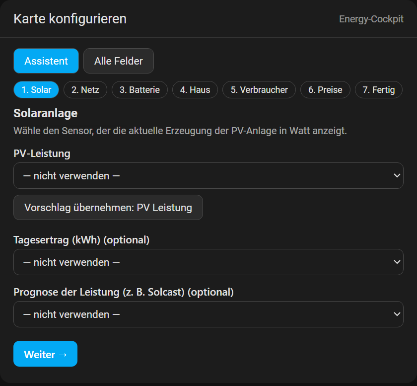
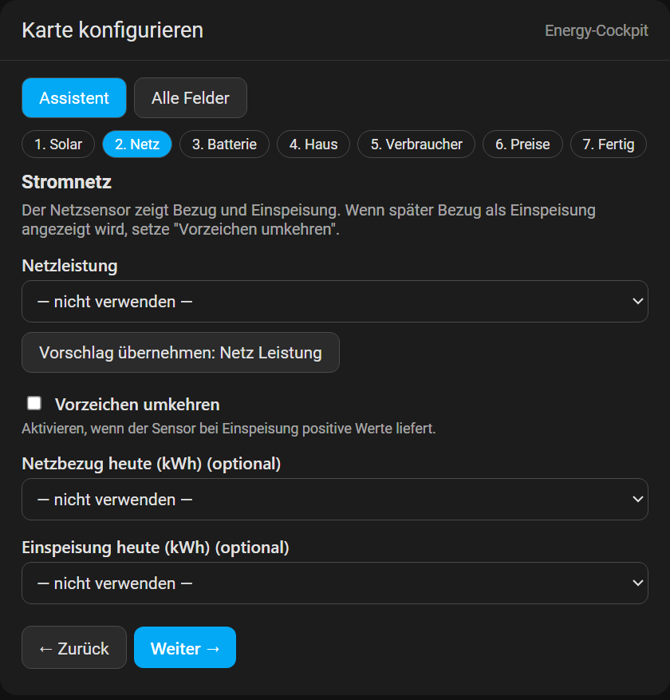
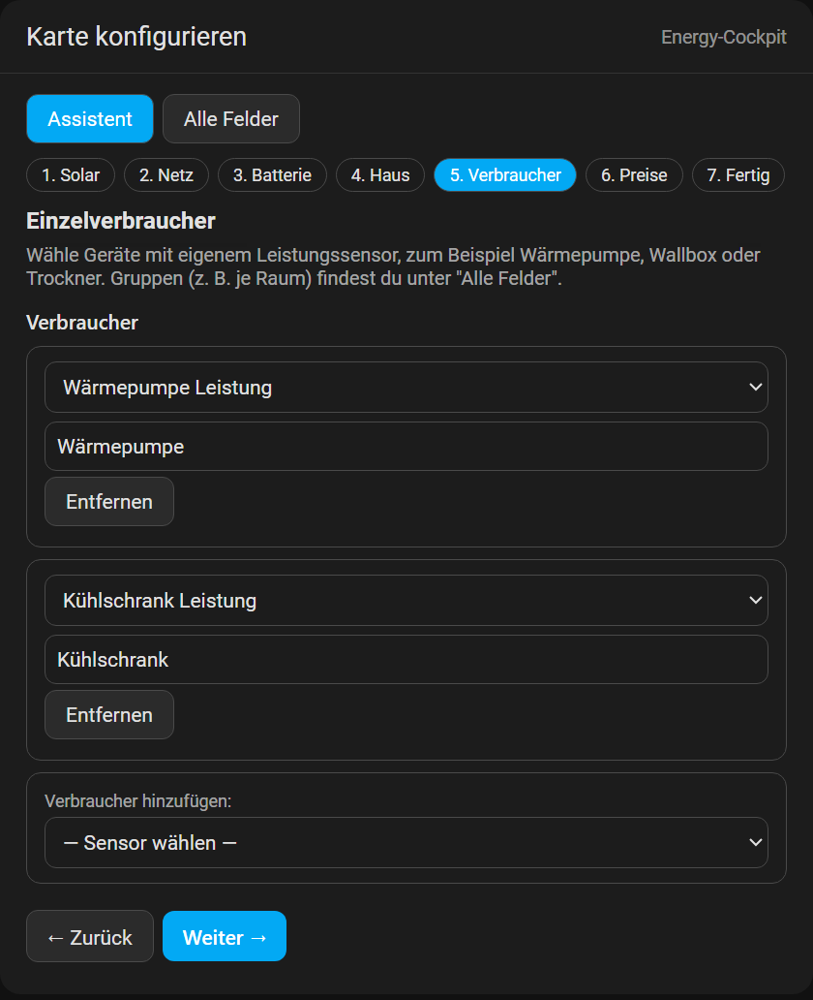
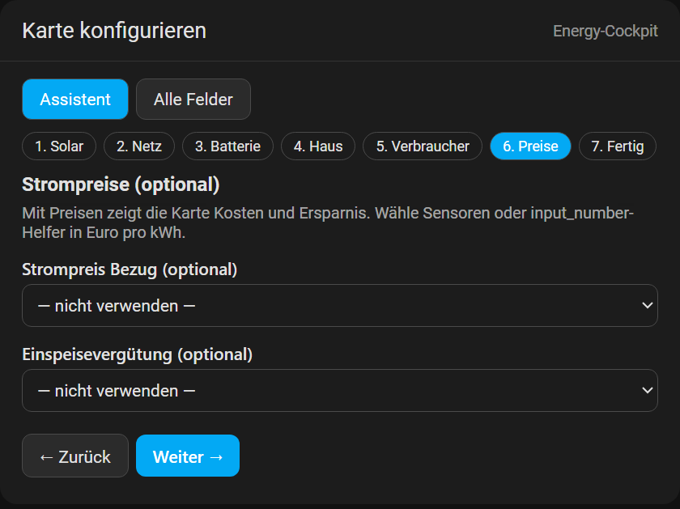
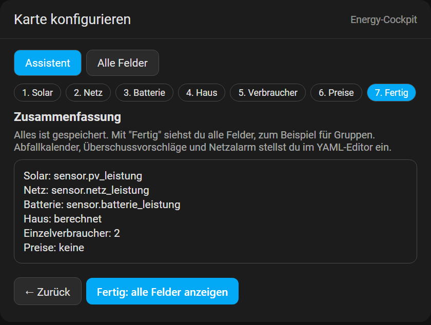
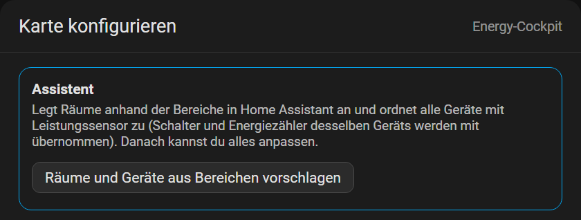
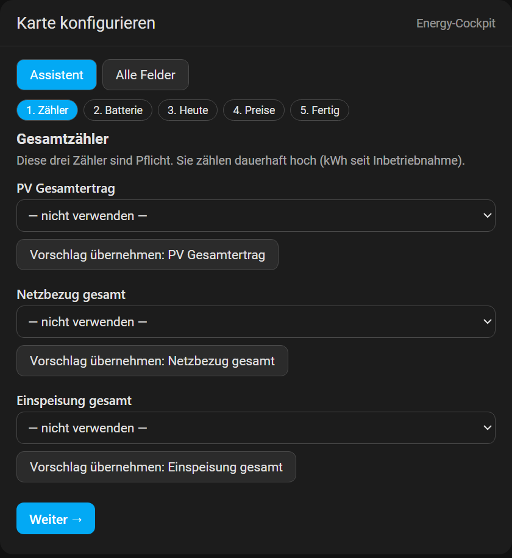
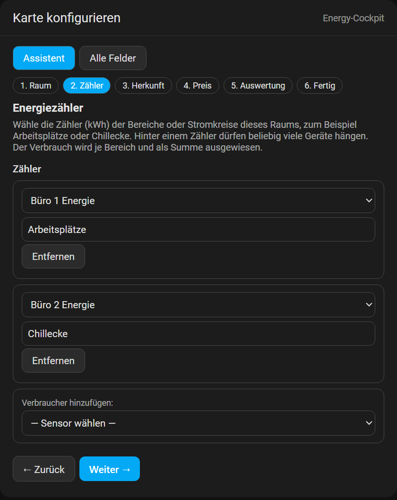
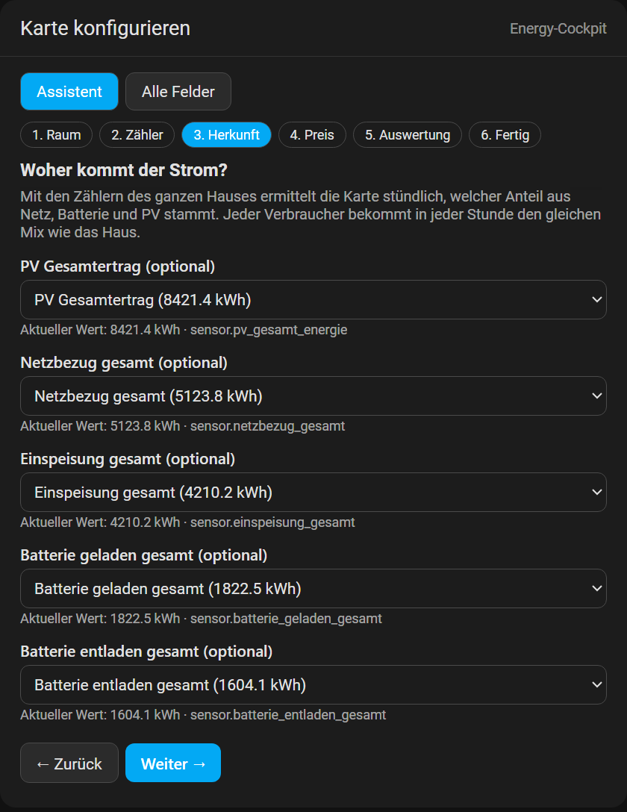
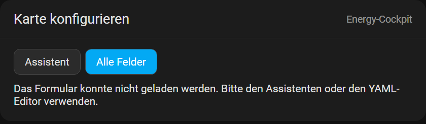

# Installationsanleitung

Dauer: etwa 10 Minuten. Du brauchst Administratorrechte in Home Assistant.

## 1. Voraussetzungen prüfen

- **Home Assistant** in einer aktuellen Version (Karten sind auf aktuellen Versionen entwickelt und getestet).
- **HACS** ist installiert (https://hacs.xyz). Ohne HACS gehe zu "Manuelle Installation".
- Ein **Dashboard**, in dem du Karten hinzufügen darfst.

## 2. Installation mit HACS (empfohlen)

1. In Home Assistant **HACS** öffnen.
2. Oben rechts auf die drei Punkte (⋮) → **Benutzerdefinierte Repositories**.
3. Eintragen:
   - **Repository:** `https://github.com/msucimaker3112/energy-cockpit`
   - **Kategorie:** `Dashboard` (in älteren HACS-Versionen "Lovelace")
4. **Hinzufügen** klicken.
5. In der HACS-Suche nach **Energy-Cockpit** suchen und öffnen.
6. **Herunterladen** (unten rechts) und bestätigen.
7. Browser-Cache leeren: **Strg + F5** (Mac: Cmd + Shift + R). Bei der Home-Assistant-App: App-Einstellungen → Cache leeren oder App neu starten.

HACS legt die Ressource automatisch an. Du kannst sie prüfen unter *Einstellungen → Dashboards → ⋮ → Ressourcen*. Dort steht `/hacsfiles/energy-cockpit/energy-cockpit.js` als **JavaScript-Modul**.

## 3. Manuelle Installation (ohne HACS)

1. Datei `energy-cockpit.js` aus dem neuesten Release herunterladen: https://github.com/msucimaker3112/energy-cockpit/releases
2. In den Ordner `config/www/` deiner Home-Assistant-Installation kopieren (über Samba, SSH oder das *File editor*-Add-on). Der Ordner `www` wird unter `/local/` bereitgestellt.
3. *Einstellungen → Dashboards → ⋮ → Ressourcen → Ressource hinzufügen*:
   - **URL:** `/local/energy-cockpit.js`
   - **Typ:** `JavaScript-Modul`
4. Browser-Cache leeren (Strg + F5).

Falls der Menüpunkt "Ressourcen" fehlt: In deinem Profil den **erweiterten Modus** einschalten.

## 4. Karte hinzufügen

1. Dashboard öffnen → **Bearbeiten** (Stift) → **Karte hinzufügen**.
2. Nach **Energy-Cockpit** suchen. Es gibt vier Karten:
   - **Energy-Cockpit Energiefluss**
   - **Energy-Cockpit Geräte & Verbrauch**
   - **Energy-Cockpit Statistik**
   - **Energy-Cockpit Raum-Abrechnung**
3. Der Editor öffnet sich im **Assistenten** (siehe nächster Abschnitt). Sensoren auswählen und speichern.

**Tipp:** Für Wandtablets die Ansicht auf den Typ **Panel** (eine Karte, volle Breite) stellen. Die Karten füllen dann die ganze Bildschirmhöhe.

## 5. Einrichtungsassistent

Beim ersten Hinzufügen einer Karte (oder über **Bearbeiten** an einer noch leeren Karte) öffnet sich der Editor im Reiter **Assistent**. Oben stehen die Schritte der Karte als Knöpfe, du kannst jederzeit springen. Jede Änderung wird sofort gespeichert.

**Was du in jedem Schritt siehst:**

- Eine Auswahlliste mit **Vorschlägen** (passende Sensoren zuerst) und darunter allen übrigen passenden Sensoren.
- Direkt unter der Auswahl den **aktuellen Wert** und die Entität-ID. So prüfst du sofort, ob es der richtige Sensor ist.
- Einen Knopf **Vorschlag übernehmen**, der den wahrscheinlichsten Sensor mit einem Klick einträgt.
- Unten **Zurück** und **Weiter**, im letzten Schritt **Fertig: alle Felder anzeigen**.

### Energiefluss (7 Schritte)

| Schritt | Aufgabe |
|---|---|
| 1. Solar | PV-Leistung wählen (W oder kW). Tagesertrag und Prognose sind optional. |
| 2. Netz | Netzleistung wählen. Wird Bezug als Einspeisung angezeigt: **Vorzeichen umkehren**. |
| 3. Batterie | Leistung und Ladestand wählen. Ohne Batterie überspringen. |
| 4. Haus | Optional. Ohne Angabe wird der Hausverbrauch berechnet. |
| 5. Verbraucher | Einzelverbraucher mit eigenem Leistungssensor hinzufügen (Wärmepumpe, Wallbox, ...). |
| 6. Preise | Strompreis und Einspeisevergütung für Kosten und Ersparnis. |
| 7. Fertig | Zusammenfassung. Gruppen stehen danach unter *Alle Felder*. |

### Geräte & Verbrauch

Der **Assistent** legt Räume und Geräte aus den Bereichen von Home Assistant an: Jedes Gerät mit Leistungssensor kommt in den Raum seines Bereichs, Schalter und Energiezähler desselben Geräts werden mit übernommen. Danach passt du Namen, Symbole und Logos im Formular darunter an.

### Statistik

Die drei Gesamtzähler (PV-Ertrag, Netzbezug, Einspeisung) sind Pflicht, Batterie, Tageswerte, Preise und Anlagenkosten sind optional.

### Raum-Abrechnung (6 Schritte)

| Schritt | Aufgabe |
|---|---|
| 1. Raum | Titel, Untertitel und Logo. |
| 2. Zähler | Energiezähler (kWh) der Bereiche, bis zu 8. Hinter einem Zähler dürfen beliebig viele Geräte hängen. |
| 3. Herkunft | Haus-Zähler für PV, Bezug, Einspeisung und Batterie, damit die Karte den Netz-, Batterie- und PV-Anteil ermittelt. |
| 4. Preis | Bezugspreis, Einspeisevergütung, Bewertung und Grundgebühr. |
| 5. Auswertung | Abschlag, Standby-Schwelle, Aktiv-Schwelle und Archiv-Sensor (alles optional). |
| 6. Fertig | Zusammenfassung. Die Leistungssensoren je Bereich stehen unter *Alle Felder*. |

Solange eine Karte nicht eingerichtet ist, zeigt sie einen Hinweis statt einer Fehlermeldung. Wie du Mitteilung, Archiv und Standby-Warnung einrichtest, steht in [ABRECHNUNG.md](ABRECHNUNG.md).

## 6. Konfiguration im Detail (Energiefluss)

Mindestens einen der Sensoren **PV** oder **Netz** auswählen:

| Feld | Bedeutung | Einheit |
|---|---|---|
| PV | Aktuelle Erzeugung | W oder kW |
| Netz | Netzleistung (Bezug positiv, Einspeisung negativ). Ist es umgekehrt: **Vorzeichen umkehren** | W oder kW |
| Batterie: Leistung | Laden positiv, Entladen negativ (sonst umkehren) | W oder kW |
| Batterie: Ladestand | Ladezustand | % |
| Hausverbrauch | optional; fehlt er, wird er aus PV + Netz + Batterie berechnet | W oder kW |

Der **Strompreis** (`grid_price`) schaltet Kostenangaben frei, die **Einspeisevergütung** (`feed_in`) die Ersparnisrechnung.

## 7. Aktualisieren

- **HACS:** Bei einer neuen Version erscheint unter *HACS* ein Hinweis, **Aktualisieren** klicken, danach Strg + F5.
- **Manuell:** Datei in `www` ersetzen, Strg + F5. Falls der Browser die alte Datei zeigt, an die Ressourcen-URL `?v=2` anhängen.

## 8. Deinstallation

HACS: Eintrag öffnen → ⋮ → **Entfernen**. Manuell: Ressource löschen und Datei aus `www` entfernen. Danach die Karten aus den Dashboards entfernen.

## Fehlerbehebung

| Problem | Ursache und Lösung |
|---|---|
| Karte erscheint nicht in der Auswahl | Ressource fehlt oder Cache. Ressourcen prüfen, Strg + F5, ggf. App neu starten |
| "Benutzerdefiniertes Element existiert nicht: energy-cockpit-…" | Ressource nicht geladen: Typ muss *JavaScript-Modul* sein, URL exakt prüfen |
| Karte zeigt "—" statt Werten | Sensor nicht verfügbar oder falsche Einheit. Sensor in den Entwicklerwerkzeugen prüfen |
| Netz zeigt Bezug als Einspeisung | **Vorzeichen umkehren** beim Netz einschalten |
| Batterie lädt, zeigt aber "Entlädt" | **Vorzeichen umkehren** bei der Batterie |
| Keine Kosten sichtbar | `grid_price` (und `feed_in`) konfigurieren |
| Statistik-Balken leer | Zähler brauchen Langzeitstatistik (`state_class`), mindestens einen vollen Tag |
| Fehlermeldung "Mindestens pv oder grid konfigurieren" | Beim Energiefluss muss PV oder Netz gesetzt sein |
| Fehlermeldung "rooms fehlt" | Bei der Geräte-Karte mindestens einen Raum anlegen |
| Raum-Abrechnung zeigt bei Betriebszeiten und Grundlast nichts | Die Zähler brauchen erst ein bis zwei volle Stunden Langzeitstatistik. Für die Hochrechnung ist ein ganzer Messtag nötig |
| Live-Leistung zeigt "–" | Im Reiter *Alle Felder* je Bereich einen Leistungssensor (W) eintragen |
| Monatsarchiv bleibt leer | Es wird nur von der Automation am Monatsersten gefüllt, siehe [ABRECHNUNG.md](ABRECHNUNG.md) |
| Karte füllt nur eine halbe oder Drittel-Breite | Die Ansicht ist vom Typ *Abschnitte* (Kacheln). Ansicht auf **Panel** stellen (Ansicht bearbeiten → Ansichtstyp), oder den Abschnitt über mehrere Spalten spannen (`column_span`) und der Karte `grid_options: {columns: full}` geben |
| Karte ist zu klein oder zu groß | `fit_screen: false` setzen und die Kartenhöhe im Dashboard anpassen |
| Echo Show schaltet den Bildschirm aus | `keep_awake: true` setzen, einmal tippen (nur Silk-Browser) |

## Hilfe

Fehler und Wünsche bitte als Issue melden: https://github.com/msucimaker3112/energy-cockpit/issues
Bitte Home-Assistant-Version, Browser, die Karten-YAML (ohne Zugangsdaten) und einen Screenshot beifügen.
