# Konfiguration

Alle Karten lassen sich im grafischen Editor einstellen. Erweiterte Optionen stehen nur im YAML-Editor. Beim Speichern aus dem Editor bleiben unbekannte YAML-Schlüssel erhalten.

Konventionen: `entity` = Sensor-ID (z. B. `sensor.pv_leistung`). Leistung in W, kW oder MW, Energie in Wh, kWh oder MWh: Die Karten lesen die Einheit des Sensors und rechnen selbst in W und kWh um. Sensoren ohne Einheit gelten als W bzw. kWh.

`energy_unit` (alle Karten, Standard `auto`): Mit `energy_unit: kwh` nimmt die Karte Energiewerte ungeprüft als kWh, wie vor Version 0.12.2. Nur nötig, wenn ein Sensor eine falsche Einheit meldet.

---

## Energiefluss: `custom:energy-cockpit-flow-card`

Mindestens `pv` **oder** `grid` ist nötig.

### Quellen

| Schlüssel | Typ | Beschreibung |
|---|---|---|
| `title` | Text | Überschrift (Standard "Energiefluss") |
| `pv.entity` | Sensor | PV-Leistung |
| `pv.name`, `pv.icon` | Text | Anzeigename, Symbol (`mdi:…`) |
| `pv.invert`, `pv2.invert` | `true` / `false` (Standard) | Vorzeichen umkehren, wenn der Zähler die Erzeugung als **negativen** Wert meldet (zum Beispiel manche Zweirichtungszähler). Ohne die Option bleibt alles wie bisher |
| `pv.daily` | Sensor | Tagesertrag in kWh |
| `pv.daily_ac` | `true` / `false` (Standard) | Für Hybrid-Wechselrichter, deren Tagesertrag nur die Abgabe des Wechselrichters zählt: Was direkt aus den Modulen in den Batterie geht, fehlt darin. Die Karte rechnet dann "Solar heute" als Tagesertrag + Geladen heute − Entladen heute, und auch "Haus heute" und "Autarkie heute" stimmen. Zeichen für diesen Fall: "Autarkie heute" steht bei 0 % und "Haus heute" ist viel zu niedrig. Braucht `daily_charge` und `daily_discharge` beim Speicher und gilt für alle Speicher ohne `behind_meter` |
| `pv.forecast` | Sensor | Prognose für heute: Leistung in W/kW oder Tagesprognose in kWh (z. B. Solcast, Forecast.Solar "Energie Produktion heute"). Im Assistenten wählbar |
| `pv.forecast_tomorrow`, `pv.forecast_day_after` | Sensor (kWh) | Erwartete Produktion für morgen und übermorgen, siehe [PV-Prognose](#pv-prognose-für-morgen-und-übermorgen) |
| `pv.strings` | Liste | Teilstränge `{entity, name}` |
| `grid.entity` | Sensor | Netzleistung (Bezug positiv) |
| `grid.invert` | Ja/Nein | Vorzeichen umkehren |
| `grid.daily_import`, `grid.daily_export` | Sensor | Bezug / Einspeisung heute (kWh) |
| `daily_from_total` | `true` / `false` (Standard) | Alle Tageswerte (`pv.daily`, `pv2.daily`, `grid.daily_import`, `grid.daily_export`, `daily_charge`, `daily_discharge`, `home.daily`) kommen aus **Gesamtzählern**, auch in Wh. Die Karte berechnet den Wert von heute aus der Langzeitstatistik, wie das Energie-Dashboard. Die Sensoren brauchen `state_class: total_increasing` (oder `total`). Ohne Statistik zeigt die Kachel "—". Fällt die Abfrage ganz aus, gilt der Sensorwert wie bisher |
| `batteries` | Liste von Speichern | Weitere Speicher: `battery` ist der erste Speicher, `batteries` enthält die weiteren (zweiter, dritter …). Wer alle Speicher in `batteries` führen will, lässt `battery` weg. Jeder Eintrag hat dieselben Felder wie `battery` (`name`, `power` oder `power_charge`/`power_discharge`, `soc`, `capacity_kwh`, `reserve_pct`/`max_pct`, `daily_charge`, `daily_discharge`, `invert`, `tap`, `soc_display`). Es erscheint **eine Kachel je Speicher** mit eigenem Status, Ladebalken und eigener Prognose. Ring, Autarkie, Banner und Tageswerte rechnen mit der Summe (Ladestand als nach Kapazität gewichteter Mittelwert). Ohne `batteries` gilt der einzelne Eintrag `battery` wie bisher. Im Assistenten (Schritt "Weitere Speicher") und im Formular (Alle Felder) einstellbar. Auf dem Handy: `compact: auto` zeigt die Speicher in der Kurzansicht übersichtlich |
| `battery.tap` | `power` (Standard) / `soc` | Was ein Klick auf die Kachel öffnet: Verlauf der Leistung oder des Ladestands. Ein Klick auf Balken und Prozentzahl öffnet immer den Ladestand |
| `battery.power` | Sensor | Laden positiv, Entladen negativ |
| `battery.power_charge`, `battery.power_discharge` | Sensoren | Statt `power`: zwei getrennte Sensoren für Laden und Entladen (beide positiv). Die Karte rechnet Laden minus Entladen |
| `pv_to_battery` | `direkt` / `aus` (Standard) | Speicher vor dem Wechselrichter (z. B. Marstek B2500): Die Solarmodule hängen am Speicher, der Strom läuft immer durch ihn. Siehe [Speicher vor dem Wechselrichter](#speicher-vor-dem-wechselrichter) |
| `battery.power_out` | Sensor | Nur mit `pv_to_battery: direkt`: Leistung, die der erste Speicher ans Haus abgibt |
| `pv.forecast` | Sensor | Prognose in W/kW (zeigt "Prognose 6,0 kW") oder Tagesprognose in kWh (zeigt "Prognose heute 6,0 kWh"), z. B. Solcast |
| `battery.soc` | Sensor | Ladestand in % |
| `battery.invert` | Ja/Nein | Vorzeichen umkehren |
| `battery.capacity_kwh` | Zahl | Kapazität für die Prognose "voll um / reicht bis" |
| `battery.reserve_soc`, `battery.max_soc` | Sensor oder Helfer (Zahl-Entität) | Entladegrenze und Maximalladung der Batterie in %. Der Sensor heißt bei jedem Wechselrichter anders, deshalb frei wählbar (zum Beispiel "Entlade-Ende-Ladestand") |
| `battery.reserve_pct`, `battery.max_pct` | Zahl | Alternative ohne Sensor: fester Wert in %, zum Beispiel `10`, wenn die Batterie nur bis 10 % entladen wird. Ein Sensor hat Vorrang |
| `animations` | `auto` (Standard), `always` | `auto`: Ist am Gerät "Bewegung reduzieren" eingeschaltet, stehen Linien, Ring und das Leuchten von Kacheln und Symbolen still, und die Zahlen zählen nicht hoch. `always`: immer animieren. Unabhängig davon rechnet die Karte höchstens einmal pro Sekunde neu, und Zahlen zählen nur bei großen Sprüngen hoch |
| `style` | `flach` (Standard), `3d` | `3d`: Haus, Solar, Netz und Speicher erscheinen als Objekte. Die Werte und Kennzahlen bleiben gleich, siehe [3D-Ansicht](#3d-ansicht-style-3d) |
| `house_style` | `sattel` (Standard), `flach` | Dachform des Hauses in der 3D-Ansicht |
| `home_icon_color` | `standard` (Standard), `autarkie` | `autarkie`: Das Haus-Symbol im Ring ist grün bei 100 % Autarkie (kein Netzbezug), gelb von 50 bis 99 %, rot darunter. Ohne Verbrauch bleibt es türkis. Siehe [Farbe des Haus-Symbols](#farbe-des-haus-symbols-home_icon_color-autarkie) |
| `home_color` | `standard` (Standard), `source` | `source`: Die Zahl über dem Haus nimmt die Farbe der Quelle mit dem größten Anteil im Ring an (PV gelb, Speicher blau, Netz rot). Die Farbe wechselt erst, wenn eine andere Quelle mindestens 5 Prozentpunkte vorn liegt |
| `grid2` | Objekt | Zweiter Netzzähler mit eigenem Tarif, der nur Strom bezieht, zum Beispiel eine Wärmepumpe. Siehe [Zweiter Netzzähler](#zweiter-netzzähler-grid2) |
| `text_size` | `normal` (Standard), `gross`, `sehr_gross` oder eine Zahl (0,5 bis 4) | `gross` und `sehr_gross` vergrößern die kleinen Texte (Ladestand, Kennzahlen oben rechts, Beschriftungen). Eine Zahl, zum Beispiel `2`, vergrößert alle Texte **und die Zahlen in den Kacheln** auf das Doppelte. Gut für Handy und Tablet |
| `rest_min` | Zahl in % | Zeigt die Kachel "Nicht erfasst" erst, wenn mindestens so viel Prozent des Hausverbrauchs keiner Gruppe zugeordnet sind (zum Beispiel `10`). Standard: immer anzeigen |
| `hide_rest` | `true` / `false` | Blendet die Kachel "Nicht erfasst" unter den Gruppen aus. Sie zeigt den Hausverbrauch, der keiner Gruppe zugeordnet ist (Hausverbrauch minus Summe der Gruppen). Mit `rest.name` lässt sich ihre Beschriftung ändern | Wer nur einzelne Verbraucher (`consumers`) ohne Gruppen hat, schaltet die Kachel mit `show_rest: true` ein (im grafischen Editor: „Kachel "Nicht erfasst" zeigen“, `hide_rest: false` geht weiterhin). Sie zeigt dann den Hausverbrauch minus Summe der Verbraucher, `rest_min` gilt auch dort
| `show_rest` | `true` / `false` (Standard) | Zeigt die Kachel "Nicht erfasst" auch bei einzelnen Verbrauchern (`consumers`) ohne Gruppen: Hausverbrauch minus Summe der Verbraucher. Bei Gruppen erscheint sie ohnehin. `hide_rest: true` hat Vorrang |
| `consumers_top` | Zahl, z. B. `8` | Zeigt von den Einzelverbrauchern (`consumers`) nur die mit der höchsten Leistung, nach Leistung absteigend. So lassen sich viele Geräte eintragen (bis zu 30 im Editor, per YAML beliebig viele), ohne dass die Karte voll wird. Ausgeblendete Geräte zählen weiter zum Hausverbrauch und zu "Nicht erfasst". Damit die Kacheln nicht ständig springen, wechselt die Reihenfolge erst, wenn sie 30 Sekunden anders bleibt, sofort dagegen, wenn ein ausgeblendetes Gerät das kleinste sichtbare deutlich übertrifft (mehr als doppelt so viel und mindestens 100 W mehr). Gilt nicht für Geräte in Gruppen (dafür `consumer_groups_sort`). Standard: alle zeigen |
| `hide_zero` | `true` | Blendet ruhende Einzelverbraucher, Gruppen und Geräte in Gruppen aus, die unter ihrer Schwelle liegen (`on_w`, Standard 10 W), und zeigt sie sofort wieder, sobald sie laufen. Sie zählen weiter zum Hausverbrauch und zu „Nicht erfasst“. Ruhende Einträge ohne Leistungssensor (nur Zusatzwert) bleiben. Passt zu vielen Geräten |
| `hide_zero_delay` | Sekunden, Standard `30` | Wie lange ein Eintrag unter der Schwelle bleiben muss, bevor `hide_zero` ihn ausblendet. Beim Laden der Seite verschwinden ruhende Einträge sofort. `0` blendet sofort aus |
| `consumers_top_delay` | Sekunden, Standard `30` | Wie lange eine neue Reihenfolge bestehen muss, bevor `consumers_top` umsortiert. `0` sortiert sofort |
| `groups_columns` | Zahl | Gruppen pro Reihe. Standard: alle Gruppen nebeneinander in einer Reihe (auf dem Handy drei). `1` stellt jede Gruppe in eine eigene Reihe über die volle Breite, die Einträge verteilen sich dann auf mehrere Spalten und die Namen bleiben lesbar. Stehen Gruppen untereinander und ist `groups_lines` nicht gesetzt, zeichnet die Karte die Sammel-Linie, damit keine Linie durch andere Gruppen läuft |
| `groups_lines` | `direkt` (Standard) oder `sammel` | Linien zu Einzelverbrauchern und Gruppen. `sammel` zeichnet nur **eine** Linie vom Ring zu einer Plakette "Verbraucher" mit der Summe und fasst den Bereich in einem Rahmen zusammen. Die Kacheln zeigen ihre Aktivität weiter mit Farbrand und Wert, bekommen aber keine eigene Linie. Gut bei vielen Geräten, auch auf dem Handy |
| `battery.soc_display` | `brutto` (Standard) oder `nutzbar` | `nutzbar` zeigt den Ladestand relativ zum nutzbaren Bereich (0 % = Entladegrenze, 100 % = Maximalladung). Mit `brutto` bleibt die Anzeige wie die Batterie, die Grenzen erscheinen als schraffierte Bereiche auf dem Balken |
| Gemeinsamer Sensor (gestapelte Batterien) | gleicher Sensor bei mehreren Speichern | Trage bei allen Speichern denselben Sensor ein, jeder mit eigenem `soc` und `capacity_kwh`. Die Leistung zählt nur einmal und steht beim ersten Speicher, die übrigen zeigen `—` und denselben Status. Die Prognose teilt die Leistung nach Kapazität auf, das ist eine Schätzung |
| `battery.daily_charge`, `battery.daily_discharge` | Sensor | geladen / entladen heute (kWh). Ohne diese Werte zählt der Batterie bei "Autarkie heute" nicht als eigener Strom |
| `temp` (in `battery` oder je Eintrag in `batteries`) | Sensor | Temperatur des Speichers, frei wählbar. Steht in der Kachel unter dem Ladestand, ein Tipp öffnet den Verlauf. Ohne Eintrag erscheint keine Zeile |
| `behind_meter` (in `battery` oder je Eintrag in `batteries`) | `true` / `false` (Standard) | Speicher hinter dem Zähler, den der Wechselrichter oder Netzzähler nicht kennt, zum Beispiel an der Steckdose. Er behält seine Kachel. Seine Ladung zählt als Verbrauch. Seine Abgabe zählt als Quelle: Der Hausverbrauch bleibt gleich, und der Ring zeigt den Anteil des Speichers. Weil seine Leistung oft früher da ist als Netz- und Wechselrichterwerte, kann der Hausverbrauch direkt nach dem Umschalten kurz zu hoch stehen. Mit eigenem `home.entity` bleiben Zahl und Ring beim Wert des Sensors, der Speicher zählt dort nicht als Quelle. Die Tageswerte für Autarkie und Haus rechnen ohne ihn. Nicht zusammen mit `pv_to_battery: direkt` gedacht |
| `home.entity`, `home.name` | Sensor, Text | Hausverbrauch (sonst berechnet). Bei einem negativen Sensorwert rechnet die Karte den Verbrauch selbst |
| `home.daily` | Sensor | Hausverbrauch heute (kWh) für die Kachel "Haus heute". Ohne Angabe berechnet die Karte ihn aus PV-Ertrag, Bezug, Einspeisung und Batterie heute (sobald `pv.daily` und `grid.daily_import` gesetzt sind) |
| `grid_price`, `feed_in` | Sensor, `input_number` oder Zahl | Preis je kWh (Euro) für Kostenangaben |
| `language` | Text | Sprache der Karte: `auto` (Standard, folgt der Sprache in deinem Home-Assistant-Profil), `de`, `en`, `nl`, `fr` oder `fi`. Andere Sprachen zeigen Deutsch. Gilt für alle vier Karten, die Editoren bleiben deutsch |
| `theme` | Text | Farbschema: `dunkel` (Standard), `graphit`, `hell`, `warm`, `auto` (folgt dem Home-Assistant-Design hell/dunkel) oder `ha` (Farben des HA-Designs). Gilt für alle vier Karten |
| `accent` | Text | Nur Raum-Abrechnung: Akzentfarbe als `R,G,B` oder `#rrggbb` |
| `grid_base_fee` | Zahl | Nur Statistik: Grundpreis Strom in Euro pro Monat, zählt anteilig in „Stromkosten Netz“ mit (siehe Abschnitt Statistik), mit `grid_base_fee_history` auch für frühere Grundpreise |
| `grid_price_ct`, `feed_in_ct` | Zahl | Alternative ohne Sensor: fester Preis in **Cent** pro kWh, zum Beispiel `34`. Gilt, wenn `grid_price` oder `feed_in` nicht gesetzt ist (Energiefluss, Geräte & Verbrauch, Statistik) |

### PV-Prognose für morgen und übermorgen

Zwei Kacheln unten in der Karte zeigen die erwartete Produktion, direkt neben "Solar heute". Ein hohler Punkt kennzeichnet sie als Prognose, ein Tipp öffnet den Verlauf des Sensors.

```yaml
pv:
  entity: sensor.pv_leistung
  forecast_tomorrow: sensor.energy_production_tomorrow     # z. B. Forecast.Solar
  forecast_day_after: sensor.solcast_prognose_uebermorgen  # optional, z. B. Solcast
```

- Die Sensoren liefern kWh, Wh oder MWh. Die Karte rechnet in kWh um.
- **Forecast.Solar** hat einen Sensor für morgen, aber keinen für übermorgen. **Solcast** liefert auch weitere Tage. Die genaue Sensor-ID steht bei der Integration unter den Entitäten.
- Einstellbar im Assistenten (Schritt *Solar*) und unter "Alle Felder". Ohne Eintrag erscheinen die Kacheln nicht.
- `pv.forecast` bleibt wie bisher: die Prognose für jetzt oder für heute in der Solar-Kachel.
- **Prognosen nebeneinander (`forecast_swap: true`):** Liefert `pv.forecast` eine Tagesprognose in kWh (zum Beispiel Solcast „heute“), stehen unten „Prognose heute“, „Prognose morgen“ und „Prognose übermorgen“ in einer Reihe. Der bisherige Ertrag „Solar heute“ erscheint dann als Zeile in der Solar-Kachel. So liest sich die Reihe nicht mehr wie eine Dreitagesprognose mit „Solar heute“ vorne. Ist `pv.forecast` eine Leistung (W), bleibt alles wie bisher. Im Editor unter „Alle Felder“ und im Assistenten (Schritt *Solar*). Wunsch aus [#80](https://github.com/msucimaker3112/energy-cockpit/issues/80).

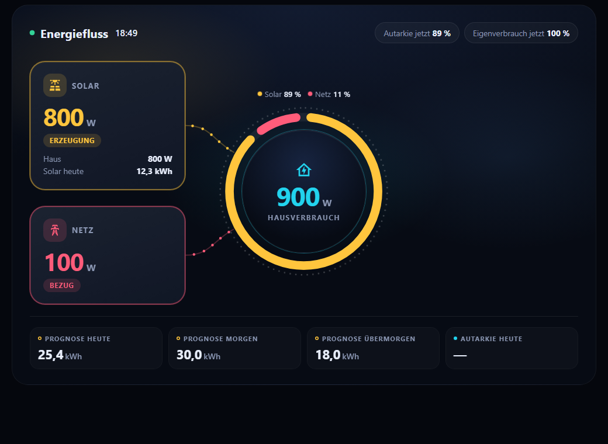

### Tagesertrag von Hybrid-Wechselrichtern

Manche Hybrid-Wechselrichter zählen im Tagesertrag nur, was sie abgeben. Was direkt aus den Modulen in den Batterie geht, fehlt darin. Standardmäßig zieht die Karte die Batterie-Ladung vom Tagesertrag ab, bei diesen Anlagen also doppelt.

So erkennst du den Fall:

- "Autarkie heute" steht bei 0 % oder ist viel zu niedrig, obwohl die Anlage heute viel erzeugt hat.
- "Haus heute" ist viel zu niedrig, oft sogar kleiner als "Bezug heute", obwohl der Batterie nicht aus dem Netz lädt.
- Der Tagesertrag ist kleiner als "Einspeisung" und "Geladen heute" zusammen.

Dann hilft diese Einstellung, im Assistenten im Schritt "Solar" unter "Tagesertrag zählt ohne Batterie-Ladung":

```yaml
pv:
  entity: sensor.pv_leistung
  daily: sensor.pv_tagesertrag
  daily_ac: true
battery:
  daily_charge: sensor.akku_geladen_heute
  daily_discharge: sensor.akku_entladen_heute
```

Die Karte rechnet damit so:

| Kachel | Rechnung mit `daily_ac: true` |
|---|---|
| Solar heute | Tagesertrag + Geladen heute − Entladen heute |
| Haus heute | Tagesertrag + Bezug heute − Einspeisung heute |
| Autarkie heute | 1 − Bezug heute / Haus heute |

Beispiel: Tagesertrag 7,2 kWh, Bezug 6,0 kWh, Einspeisung 3,3 kWh, Batterie geladen 6,8 kWh. Ohne die Einstellung ergibt das 3,1 kWh im Haus und 0 % Autarkie. Mit ihr sind es 14,0 kWh PV, 9,9 kWh im Haus und 39 % Autarkie.

Die Einstellung gilt für alle Speicher ohne `behind_meter`. Ein weiterer Speicher mit eigenem Wechselrichter wird dabei nicht getrennt betrachtet. Ein eigener Sensor `home.daily` ersetzt nur die Kachel "Haus heute", nicht die Rechnung für die Autarkie.

### Speicher vor dem Wechselrichter

**Wofür:** Bei Balkonkraftwerken mit Speicher (zum Beispiel Marstek B2500 oder Anker Solarbank) hängen die Solarmodule direkt am Speicher. Der Solarstrom geht immer zuerst durch den Speicher und von dort ins Haus, auch wenn er voll ist (Durchleitung). Mit `pv_to_battery: direkt` zeichnet die Karte den Weg **Solar → Speicher → Haus**. Ohne die Option bleibt alles wie bisher.

```yaml
type: custom:energy-cockpit-flow-card
pv_to_battery: direkt
pv:
  entity: sensor.speicher_solar_eingang      # Leistung der Module am Speicher
grid:
  entity: sensor.zaehler_wirkleistung        # Shelly, Bitshake o. Ä. im Zählerschrank
battery:
  name: Marstek B2500
  power_out: sensor.speicher_ausgangsleistung # was der Speicher ans Haus abgibt
  soc: sensor.speicher_ladestand
  capacity_kwh: 2.24
```

**Was die Karte daraus rechnet** (nur aus Solar-Eingang und Ausgang des Speichers):

- Laden = Solar-Eingang minus Ausgang, Entladen = Ausgang minus Solar-Eingang. Einen eigenen Leistungssensor (`power`) brauchst du nicht, du kannst ihn aber angeben, dann gilt er.
- Der Hausverbrauch ergibt sich ohne eigenen Sensor aus Netz plus Ausgang des Speichers.
- Die Herkunft des Hausstroms zählt als **Solar**, soweit der Ausgang vom Solar-Eingang gedeckt ist, den Rest als Batterie. Bei vollem Speicher mit Durchleitung steht dort also Solar und nicht null Prozent.
- Die Solar-Kachel zeigt `Speicher`, weil der ganze Solarstrom zuerst in den Speicher geht. Der Speicher zeigt Eingang und Ausgang, bei Einspeisung auch die Aufteilung des Ausgangs auf Haus und Netz, und `Durchleitung`, wenn er weder lädt noch entlädt.

**Wichtig:** Die Option gilt für den **ersten** Speicher (`battery`). Ohne `power_out` oder ohne `pv.entity` bleibt die normale Darstellung. Fehlt nur `power_out`, steht in der Batterie-Kachel ein Hinweis darauf. Bei der **Anker Solarbank** heißt der Sensor zum Beispiel „AC-Hausabgabe“ (`sensor.solarbank_…_ac_hausabgabe`). Auf dem Handy ist die Kurzansicht (`compact: auto`) am übersichtlichsten. Die Annahme "Solar zuerst ins Haus, der Rest lädt" entspricht Speichern mit Durchleitung. Sie wurde an echten Anlagen mit Balkonkraftwerk und Speicher getestet ([#15](https://github.com/msucimaker3112/energy-cockpit/issues/15)). Trag `power` und `power_charge` nur ein, wenn die Sensoren wirklich Laden und Entladen messen: `power` hat Vorrang vor der Rechnung aus Eingang und Ausgang.

**Große Zahl und Eigenbedarf (Zendure Hyper 2000 und ähnliche):** Ohne getrennte Lade- und Entladesensoren rechnet die Karte „Laden = Eingang − Ausgang“. Bei Speichern, die selbst Strom verbrauchen, ist diese Differenz der **Eigenbedarf**, nicht die Ladung. Trag dann `power_charge` und `power_discharge` ein, falls es sie gibt. Zwei Optionen helfen zusätzlich, beide sind aus und ändern nichts, solange du sie nicht setzt (gelten nur mit `pv_to_battery: direkt`):

```yaml
battery:
  big_value: out              # große Zahl = Ausgang ins Haus (bei Durchleitung und Entladung); bei Ladung bleibt es die Ladeleistung
  self_consumption: sensor.hyper_eigenbedarf   # oder true: Karte rechnet Eingang + Entladung − Ausgang − Ladung
```

Bei `big_value: out` steht die Entladeleistung des Speichers in einer eigenen Zeile „Entladung“. Der Eigenbedarf erscheint als Zeile „Eigenbedarf“, sobald er mindestens 1 W beträgt. **Laden aus dem Netz:** Lädt der Speicher aus dem Netz, steht in der Kachel die Zeile „Laden vom Netz“ und die Linie zwischen Haus und Batterie läuft zum Speicher. Mit `battery.power_in` (AC-Eingangsleistung des Speichers) gilt dessen Wert, ohne ihn schätzt die Karte aus dem Ladesensor (`power` oder `power_charge`): Ladung minus Solar-Überschuss ([#94](https://github.com/msucimaker3112/energy-cockpit/issues/94)).

Im Editor unter „Batterie“ ([#92](https://github.com/msucimaker3112/energy-cockpit/issues/92)).

### Zweite Anlage durch einen Speicher: `pv2.to_battery`

**Wofür:** Für Speicher, die eigene Solarmodule haben **und** zusätzlich per AC aus dem Haus laden können, zum Beispiel die **Anker SOLIX Solarbank**. Der Strom der Module läuft zuerst in den Speicher und von dort ins Haus. `pv_to_battery: direkt` (siehe oben) gilt nur für `pv` und den ersten Speicher, mit `pv2.to_battery` geht das auch für die zweite Anlage und jeden weiteren Speicher.

```yaml
pv:
  entity: sensor.solaredge_modulleistung        # Hauptanlage, speist das Haus direkt
pv2:
  entity: sensor.anker_solarstrom               # Leistung der Module an der Solarbank
  name: Anker Solar
  to_battery: 2                                 # läuft durch Speicher Nr. 2
battery:                                        # Speicher Nr. 1, zum Beispiel der Akku am Hybrid-Wechselrichter
  power: sensor.solaredge_batterie_leistung
  soc: sensor.solaredge_batterie_ladestand
  capacity_kwh: 9.8
batteries:                                      # ab Speicher Nr. 2
  - name: Anker Solarbank
    power_charge: sensor.anker_batterieladeleistung      # DC-Seite, nur zur Anzeige
    power_discharge: sensor.anker_batterieentladeleistung
    power_out: sensor.anker_ac_ausgang          # AC-Abgabe ins Haus, Pflicht
    power_in: sensor.anker_netzbezugsleistung   # AC-Ladung aus dem Haus, optional
    soc: sensor.anker_soc
    capacity_kwh: 10
    behind_meter: true
```

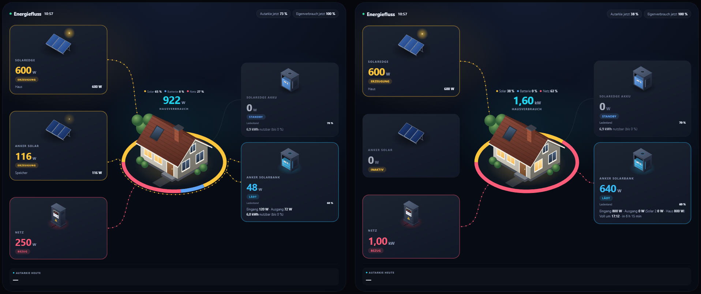

**Nummer des Speichers:** Gezählt wird wie in den Kacheln. `battery` ist Nr. 1, der erste Eintrag unter `batteries` ist Nr. 2, der zweite Nr. 3 und so weiter. Im Beispiel läuft Solar 2 deshalb durch `batteries[0]`, also `to_battery: 2`.

**Was die Karte daraus rechnet**

- Solar 2 speist **nicht** mehr direkt das Haus, sondern den Speicher.
- Fürs Haus zählt, was netzseitig (AC) passiert: die **AC-Abgabe** (`power_out`) ist eine Quelle, die **AC-Ladung** (`power_in`) ein Verbrauch, wie ein Gerät im Haus. Ohne `power_in` gilt die AC-Ladung als 0.
- Hausverbrauch ohne eigenen Sensor = Hauptanlage + Netz + AC-Abgabe (minus Ladung des normalen Speichers).
- Ring und „Solar / Batterie / Netz“ rechnen mit denselben AC-Werten. Der Anteil der Solarbank im Ring ist ihre AC-Abgabe.
- Die Lade- und Entladeleistung auf der DC-Seite zeigt die Kachel an, sie gleichen sich wegen der Wandlungsverluste (bei der Anker etwa 20 %) nicht mit den AC-Werten aus. Das ist gewollt und kein Fehler.
- Die Kachel der Solarbank zeigt Eingang und Ausgang, bei AC-Ladung die Aufteilung auf Solar 2 und Haus. Die Linie zwischen Speicher und Haus läuft bei Abgabe zum Haus und bei AC-Ladung zurück.

**Wichtig**

- `power_out` ist Pflicht. Ohne diesen Sensor, bei einer ungültigen Nummer oder bei einem Speicher, den es nicht gibt, bleibt die normale Darstellung.
- Der Speicher gilt automatisch als **hinter dem Zähler** (`behind_meter: true`), du kannst es zur Klarheit eintragen.
- Die Nummer 1 ist nur möglich, wenn `pv_to_battery` nicht schon `pv` durch denselben Speicher führt.
- Im grafischen Editor: bei der zweiten Solaranlage „Läuft durch Speicher Nr.“, beim Speicher „Ausgangsleistung ins Haus“ und „AC-Ladung aus dem Haus“. Der Assistent fragt beides ebenfalls ab.

### Verbraucher

Im grafischen Editor findest du die Abschnitte **Einzelverbraucher** (bis zu 8) und **Gruppen** (bis zu 6 mit je bis zu 8 Verbrauchern). Gespeichert werden sie als Liste oder als nummerierte Einträge, beides funktioniert. Mehr Einträge sind im YAML-Editor möglich.

```yaml
consumers:
  - entity: sensor.waermepumpe_leistung
    name: Wärmepumpe
    icon: mdi:heat-pump
    color: "#a78bfa"
    secondary: sensor.waermepumpe_temperatur   # Zusatzwert
    secondary_decimals: 1
    secondary_name: Vorlauf                    # optional: Name vor dem Zusatzwert, z. B. "SoC eAuto"
    on_w: 3                                    # aktiv (Rahmen, Linie) ab 3 W, Standard 10 W
```

`on_w` gibt es auch für Gruppen und ihre Einträge. Damit bekommt zum Beispiel eine Zirkulationspumpe mit 6 W einen Rahmen.

`secondary_name` setzt einen Namen vor den Zusatzwert, zum Beispiel bei der Wallbox `secondary: sensor.eauto_soc` mit `secondary_name: SoC eAuto` → „SoC eAuto 80 %“. Das geht auch für Einträge in Gruppen. Wunsch aus [#83](https://github.com/msucimaker3112/energy-cockpit/issues/83).

**Große Kacheln (optional, `size: gross`):** Große Verbraucher wie Wärmepumpe oder Wallbox erscheinen als breite, hervorgehobene Kachel mit großer Zahl. Das geht für beliebig viele Verbraucher gleichzeitig.

```yaml
consumers:
  - { entity: sensor.waermepumpe_leistung, name: Wärmepumpe, size: gross }
  - { entity: sensor.wallbox_1, name: Wallbox 1, size: gross }
  - { entity: sensor.wallbox_2, name: Wallbox 2, size: gross }
  - { entity: sensor.licht, name: Licht }          # normale Kachel
text_size: 1.6                                      # optional: alle Zahlen größer
```

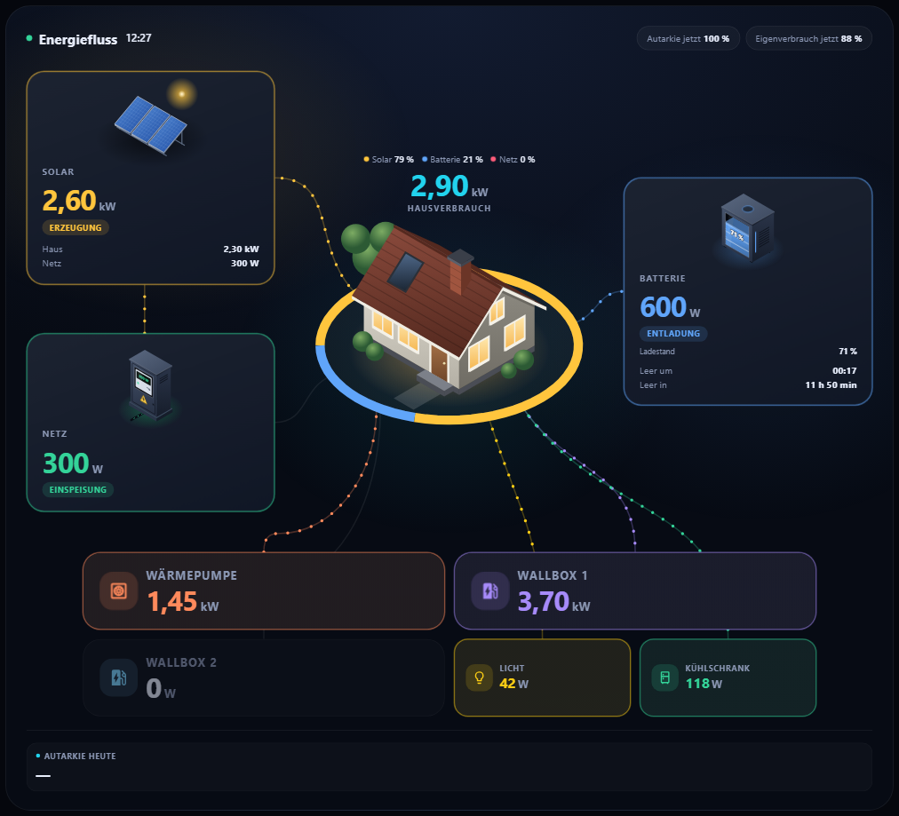

Es gibt drei Stufen: normal (ohne Angabe), `size: mittel` (eine Spalte breit, aber mit größerer Zahl und größerem Namen, so passen vier nebeneinander. Kommt eine mittlere Kachel vor, sind die Spalten der Verbraucher etwas breiter) und `size: gross` (zwei Spalten breit, mit sehr großer Zahl).

Die große Kachel belegt zwei Spalten. In der Kurzansicht (`compact`) und auf schmalen Bildschirmen bleibt sie einspaltig, die Zahl ist aber größer. Im Editor findest du das Feld „Größe der Kachel“ bei jedem Einzelverbraucher. Die Linien zu den Verbrauchern laufen hinter den Kacheln.

**Geräte in Gruppen nach Leistung sortieren (optional, `consumer_groups_sort: leistung`):** Die gerade aktiven Geräte stehen oben, das stärkste zuerst. Geräte unter `on_w` folgen in der eingetragenen Reihenfolge. Damit die Liste bei schwankenden Werten nicht springt, ordnet die Karte höchstens alle 10 Sekunden neu, und ein Gerät überholt ein anderes erst mit deutlich mehr Leistung (mehr als 10 % und 20 W). Das Fenster der Kurzansicht zeigt dieselbe Reihenfolge. Ohne Eintrag (oder mit `konfiguriert`) bleibt alles wie eingetragen. Die Gruppen selbst behalten ihren Platz.

```yaml
consumer_groups_sort: leistung
```

**Differenz-Verbraucher (optional, z. B. Zählerkaskade):** Mit `minus` rechnet die Karte `entity − minus`, nie negativ. `minus` darf auch eine **Liste** sein (mehrere Unterzähler). Mit `plus` (ebenfalls Sensor oder Liste) wird noch etwas dazugerechnet. `minus` und `plus` gibt es für Einzelverbraucher und für Einträge in Gruppen, im Assistenten als "Davon abziehen". Ohne `minus` ändert sich nichts. Beschreibung mit Aufbauten und Beispiel: [Zähler in Reihe](ZWEI-ZAEHLER.md#direkt-in-der-karte-option).

Zweite Solaranlage, zum Beispiel ein Balkonkraftwerk mit eigenem Sensor:

```yaml
pv:
  entity: sensor.pv_leistung        # große Anlage (lädt die Batterie)
  name: Dach
pv2:
  entity: sensor.bkw_leistung       # Balkonkraftwerk (speist direkt ins Hausnetz)
  name: Balkonkraftwerk
  daily: sensor.bkw_heute           # optional, wird zum Tagesertrag addiert
  add_to_home: false                # true, wenn dein Hausverbrauchs-Sensor das BKW NICHT enthält
```

Die Karte zeigt eine eigene Kachel mit eigener Linie. Autarkie, Eigenverbrauch und die Herkunft im Ring rechnen mit der Summe beider Anlagen. Die zweite Anlage deckt zuerst das Haus, die erste lädt danach die Batterie und speist ein.

Gruppen (mehrere Verbraucher je Raum) und der Rest "nicht erfasst":

```yaml
consumer_groups:
  - name: Keller
    icon: mdi:pipe-valve
    color: "#f87171"
    items:
      - entity: sensor.umwaelzpumpe_leistung
        name: Umwälzpumpe
      - name: Warmwasser            # nur Zusatzwert
        secondary: sensor.boiler_temperatur
rest:                               # false = ausblenden
  name: Nicht erfasst
```

**Gesamtsensor je Gruppe (optional, `entity` an der Gruppe):** Misst ein Zwischenzähler die ganze Gruppe, trägst du ihn als `entity` der Gruppe ein. Die Gruppe zeigt dann dessen Wert, und unter den Geräten steht als letzte Zeile „Rest“: Messwert minus Summe der Geräte, nie unter 0 W. Die Leistung zählt dabei nur einmal, auch bei „Nicht erfasst“. Mit `rest_name` lässt sich die Zeile umbenennen. Ist der Sensor nicht verfügbar, zeigt die Gruppe wie bisher die Summe. Ein eigener Template-Sensor je Gruppe ist damit nicht nötig. Wunsch aus [#79](https://github.com/msucimaker3112/energy-cockpit/issues/79).

```yaml
consumer_groups:
  - name: Keller
    entity: sensor.zwischenzaehler_keller_leistung   # misst 500 W
    rest_name: Rest                                  # optional
    items:
      - { entity: sensor.waschmaschine_leistung, name: Waschmaschine }   # 250 W
      - { entity: sensor.gefrierschrank_leistung, name: Gefrierschrank } # 70 W
# Gruppe: 500 W, darunter „Rest 180 W“
```

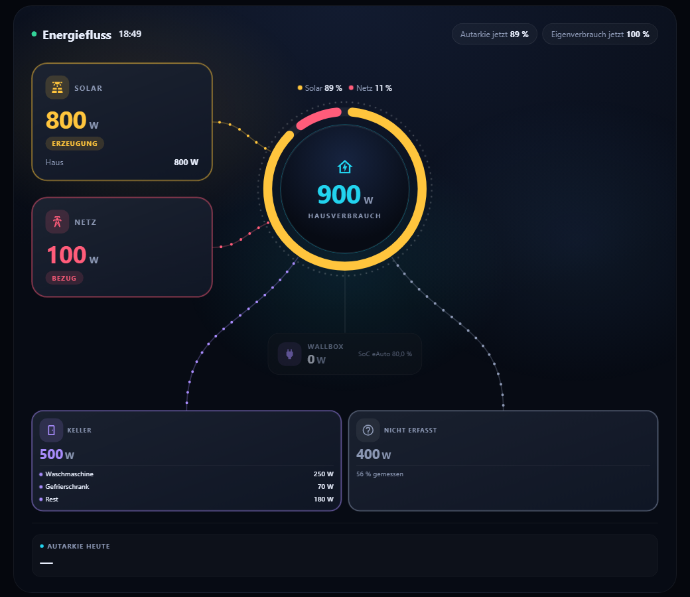

Gruppen untereinander, eine pro Reihe (`groups_columns: 1`):

```yaml
groups_columns: 1      # 2 = zwei Gruppen pro Reihe; ohne Angabe alle nebeneinander
```

| Standard | `groups_columns: 1` |
|---|---|
| 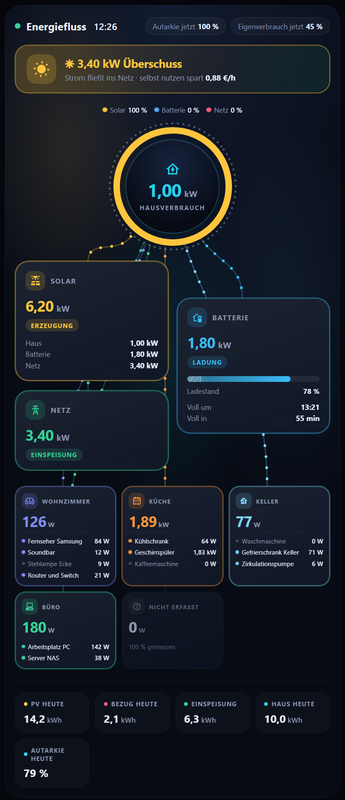 | 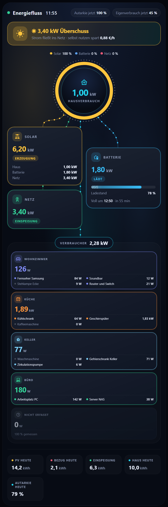 |

Textgröße und Kachel "Nicht erfasst" (Bilder: `docs/img/text-*.png`, `docs/img/rest-ab-10.png`):

```yaml
text_size: gross       # normal | gross | sehr_gross | eine Zahl, z. B. 2 (vergrößert auch die Zahlen)
rest_min: 10           # "Nicht erfasst" erst ab 10 % des Hausverbrauchs
show_rest: true        # "Nicht erfasst" auch bei einzelnen Verbrauchern ohne Gruppen
hide_rest: false       # true blendet die Kachel immer aus
```

Viele Einzelverbraucher, aber nur die größten zeigen (`consumers_top`, Bild: `docs/img/consumers-top.png`):

```yaml
consumers_top: 4       # nur die 4 Geräte mit der höchsten Leistung, absteigend
consumers_top_delay: 30 # Reihenfolge wechselt erst nach 30 s (Standard)
hide_zero: true         # ruhende Verbraucher, Gruppen und Geräte ausblenden (unter on_w, 10 W)
consumers:
  - entity: sensor.wallbox_leistung
    name: Wallbox
  - entity: sensor.waermepumpe_leistung
    name: Wärmepumpe
  # … beliebig viele weitere
```

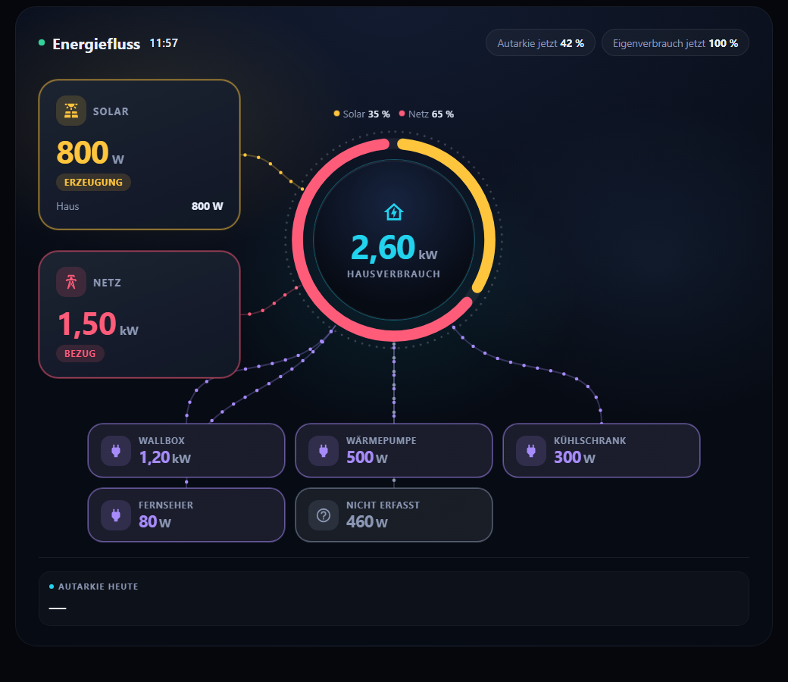

Die Netz-Kachel zeigt "Bezug" oder "Einspeisung" ab 0,5 W Leistung und "Ausgeglichen" nur, wenn praktisch nichts fließt.

### Überschuss und Netzalarm

```yaml
surplus:
  enabled: true
  threshold: 1500      # W Überschuss, ab dem das Banner erscheint
  delay: 60            # Sekunden stabil, bevor es erscheint
  suggestions:
    - name: Waschmaschine
      icon: mdi:washing-machine
      power: 2000      # nur anzeigen, wenn genug Überschuss
    - name: Auto laden
      icon: mdi:car-electric
      entity: sensor.wallbox_leistung
      running: Auto lädt
grid_alert:
  enabled: true
  threshold: 1000
  delay: 120
```

### Warum?-Erklärung: `why`

Optional. Mit `why: true` erscheint an der **Netz-, der Solar- und der Batterie-Kachel** ein kleines „?“. Ein Tipp darauf öffnet ein Fenster, das in einfachem Deutsch erklärt, woher der Netzbezug oder die Einspeisung kommt, warum Solar gerade so viel oder so wenig liefert und was die Batterie tut.

```yaml
why: true
# nur an einzelnen Kacheln: why: [grid]  oder  why: [pv, battery]
```

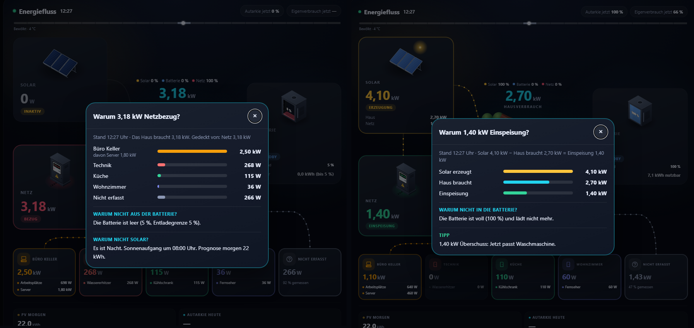

**Am Netz** (Fenster erklärt Netzbezug, Einspeisung und ausgeglichenes Netz, siehe unten), **an Solar** und **an der Batterie** (siehe nach den Abschnitten zum Netz).

**Bei Netzbezug**
- **Wer braucht den Strom?** Balken zeigen die Verbraucher und Gruppen nach Leistung, der größte zuerst. Bei einer Gruppe steht der größte Eintrag darunter, zum Beispiel „davon Server 1,80 kW“. Der Rest, den kein Verbraucher erklärt, heißt „Nicht erfasst“. Lädt ein Speicher hinter dem Zähler, steht er als „Speicher lädt“ dabei.
- **Gedeckt von:** Solar, Batterie und Netz mit ihren Anteilen.
- **Warum nicht aus der Batterie?** Die Batterie ist leer (mit Ladestand und Entladegrenze), oder sie hat Ladung und gibt trotzdem nichts ab („Betriebsart oder Sperrzeit im Speicher prüfen“), oder sie liefert schon.
- **Warum nicht Solar?** In der Nacht mit Sonnenaufgang und der Prognose für morgen (wenn `pv.forecast_tomorrow` gesetzt ist). Tagsüber mit der aktuellen Leistung und dem Wetter (wenn `weather` gesetzt ist).
- **Hinweis:** Ist ein großer Teil keinem Verbraucher zugeordnet (mindestens 150 W und ein Viertel des Hausverbrauchs), schlägt die Karte vor, weitere Verbraucher einzutragen.

**Bei Einspeisung**
- Die Rechnung: Solar minus Haus (minus Batterie lädt) gleich Einspeisung.
- **Warum nicht in die Batterie?** Sie ist voll, oder lädt gerade nicht, obwohl noch Platz ist, oder lädt schon.
- **Tipp:** Aus den Überschuss-Vorschlägen (`surplus.suggestions`) nennt die Karte, was in die Einspeisung passt.

**Bei ausgeglichenem Netz** (Bezug und Einspeisung unter 10 W) zeigt das Fenster dieselbe Aufstellung wie beim Netzbezug und erklärt, warum kein Netz nötig ist:
- „Gedeckt von“ nennt Solar, Batterie und (falls vorhanden) das Netz.
- **Warum kein Netzbezug?** Solar deckt das Haus allein, oder Solar und Batterie zusammen, oder die Batterie allein (mit Ladestand), oder das Haus braucht kaum Strom.
- **Warum entlädt die Batterie?** Wenn Solar allein nicht reicht und die Batterie den Rest liefert.
- **Warum lädt die Batterie?** Wenn Solar mehr liefert, als das Haus braucht.

**An der Solar-Kachel** („Solar liefert gerade 2,40 kW“)
- Balken zeigen, wohin der Solarstrom geht: ins Haus, in die Batterie, ins Netz.
- **Warum so wenig?** In der Nacht mit Sonnenaufgang und der Prognose für morgen. Tagsüber mit der Sonnenhöhe (unter 10° steht die Sonne tief), dem Wetter und der Bewölkung (wenn `weather` gesetzt ist).
- **Wie viel ist das heute?** „Heute bisher … kWh“, mit der Prognose für den ganzen Tag, wenn `pv.daily` und `pv.forecast` gesetzt sind.
- **Warum geht Solar ins Netz?** Bei Einspeisung: Das Haus braucht weniger, und die Batterie ist voll oder nicht vorhanden.

**An der Batterie-Kachel** („Hausspeicher lädt mit 2,00 kW“). Bei mehreren Speichern hat jede Kachel ihr „?“.
- **Lädt:** Balken „aus Solar“ und „aus dem Netz“ und der Hinweis, ob die Batterie auch aus dem Netz lädt (das passt, wenn du im Speicher eine Netzladung oder einen günstigen Tarif eingestellt hast).
- **Liefert:** Balken mit den Verbrauchern, die sie gerade versorgt.
- **Inaktiv:** Warum sie nichts tut: leer (Entladegrenze), voll, oder sie lädt trotz Überschuss nicht oder gibt trotz Netzbezug nichts ab (Betriebsart oder Sperrzeit im Speicher prüfen).
- Die Zeile darüber nennt Ladestand, Entladegrenze und Maximalladung.
- Auch hier steht „Nicht erfasst“ als Rest, mit dem Hinweis, weitere Verbraucher einzutragen, wenn ein großer Teil keinem Verbraucher zugeordnet ist.

**Gut zu wissen**
- Die Erklärung entsteht aus den Werten, die die Karte ohnehin hat. Es gibt keine KI, keine Cloud und keine zusätzlichen Abfragen.
- Je mehr Verbraucher oder Gruppen du einträgst, desto genauer ist sie. Bei wenigen steht vor allem „Nicht erfasst“, und die Karte sagt das ehrlich.
- Das Fenster aktualisiert sich live, solange es offen ist, und schließt mit dem × oder einem Tipp neben das Fenster.
- Im Editor und im Assistenten (Schritt „Aussehen“) einschaltbar. Das „?“ funktioniert in 3D, flach und in der Kurzansicht, auch mit der Tastatur (Tab, Enter).

### Zusatzwerte und Alarm: `extra`, `alarm`

Optional. An **Solar** (`pv`), der **zweiten Anlage** (`pv2`), dem **Netz** (`grid`) und jedem **Speicher** (`battery`, `batteries`) kannst du frei wählbare Zusatzwerte anzeigen, zum Beispiel Spannung, Strom und Temperatur eines Wechselrichters. Mit `alarm` meldet die Kachel einen Fehler.

```yaml
pv:
  entity: sensor.wechselrichter_leistung
  extra:
    - { entity: sensor.wr_spannung, name: Spannung }
    - { entity: sensor.wr_strom, name: Strom }
    - { entity: sensor.wr_temperatur, name: Temperatur, warn_above: 60 }
    - { entity: sensor.wr_eigenverbrauch, name: Eigenverbrauch, decimals: 1 }
  alarm: sensor.wr_alarm
```

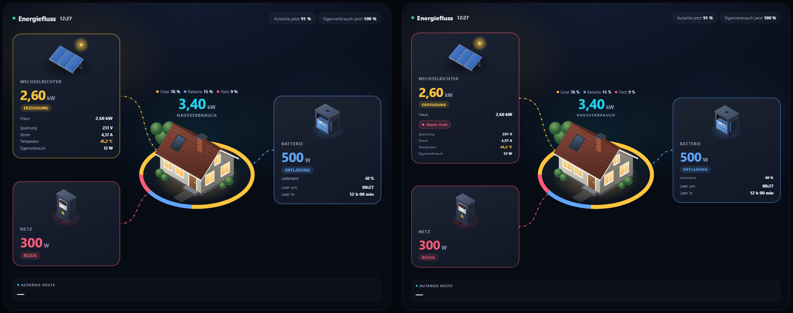

**Zeilen (`extra`)**

| Schlüssel | Beschreibung |
|---|---|
| `entity` | Sensor (auch `binary_sensor`, `input_number`). Nur dieser Eintrag ist Pflicht. Es genügt auch der Sensor-Name allein: `extra: [sensor.wr_spannung]`. |
| `name` | Beschriftung. Ohne Angabe steht der Name des Sensors in Home Assistant. |
| `unit` | Einheit. Ohne Angabe die Einheit des Sensors. |
| `decimals` | Nachkommastellen (0 bis 6). Ohne Angabe wählt die Karte sinnvoll: 231 V, 4,37 A, 45,2 °C. |
| `icon` | Optionales Symbol vor der Beschriftung, zum Beispiel `mdi:thermometer`. |
| `warn_above`, `warn_below` | Liegt der Wert darüber oder darunter, wird er gelb. |

Bis zu 8 Zeilen je Kachel. Ist ein Sensor nicht verfügbar, steht ein Strich. Text-Zustände wie „MPPT“ werden unverändert angezeigt. Ein Tipp auf eine Zeile öffnet den Verlauf des Sensors.

**Alarm (`alarm`)**

`alarm: sensor.wr_alarm` genügt. Die Karte meldet einen Alarm, sobald der Zustand **nicht** eines von `off`, `ok`, `normal`, `none`, `false`, `idle`, `0` oder leer ist. Nicht verfügbare Sensoren zählen nicht als Alarm. Bei einem Alarm erscheint in der Kachel ein roter Hinweis (bei Textzuständen mit dem Zustand, zum Beispiel „Alarm: fault“), und die Kachel bekommt einen roten Rahmen.

Für Sensoren mit eigenen Zuständen gibt es die ausführliche Schreibweise:

```yaml
alarm:
  entity: sensor.wr_status
  name: Störung               # Text im Hinweis, Standard "Alarm"
  ok: [producing, sleeping]   # alles andere ist ein Alarm
  # oder umgekehrt:
  # on: [error, fault]        # nur diese Zustände sind ein Alarm
```

Die ausführliche Schreibweise gibt es nur im YAML-Editor.

**Gut zu wissen**
- Die Werte kommen aus beliebigen Sensoren. Welche Sensoren dein Wechselrichter liefert, hängt von der Integration ab (zum Beispiel SolarEdge, Fronius, Huawei, Victron).
- In der Kurzansicht (`compact`) bleiben die Zeilen ausgeblendet, der Alarm bleibt sichtbar.
- Dieselben Optionen gibt es für `pv2`, `grid`, `battery` und jeden Eintrag unter `batteries`.

### Eigene Farben: `colors`

Optional. Du legst fest, in welcher Farbe die Batterie lädt und entlädt, und ändern kannst du auch Solar, Netz und Haus.

```yaml
colors:
  battery_charge: "#22c55e"      # Batterie lädt (grün)
  battery_discharge: "#ef4444"   # Batterie entlädt (rot)
```

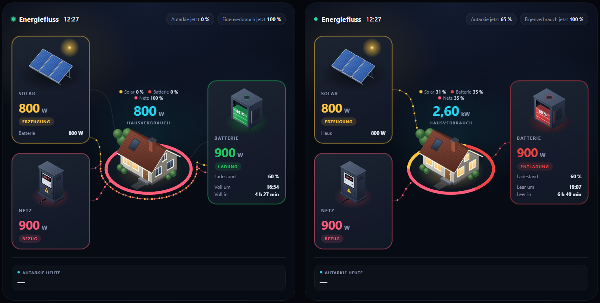

| Schlüssel | Standard | Wirkt auf |
|---|---|---|
| `pv` | gold | Solar: Kachel, Linie, Ring |
| `grid_import` | rot | Netzbezug |
| `grid_export` | grün | Einspeisung |
| `battery` | blau | Batterie im Ruhezustand, und beim Entladen, wenn `battery_discharge` fehlt |
| `battery_charge` | hellblau | Batterie lädt: Kachel, Ladebalken, Linie, 3D-Objekt |
| `battery_discharge` | wie `battery` | Batterie entlädt: Kachel, Linie, 3D-Objekt, Ring und Zeile „Solar / Batterie / Netz“ |
| `home` | türkis | Zahl beim Haus, Sammel-Linie |
| `gas` | orange | Gas-Kachel und ihre Linie |
| `water` | blau | Wasser-Kachel und ihre Linie |
| `text_muted` | grau (je nach Farbschema) | Alle grauen Beschriftungen: Kachelnamen, Zeilen wie „Ladestand“ und „Temperatur“, Zusatzwerte, Achsen. Im hellen Schema zum Beispiel `"#000000"` für mehr Kontrast |
| `text` | je nach Farbschema | Werte und Titel |

Werte sind `#hex` (zum Beispiel `#22c55e`) oder `r,g,b` (zum Beispiel `34,197,94`). Ungültige Werte werden ignoriert. Die Farben gelten nur für die Karte, in der sie stehen, andere Karten bleiben unberührt.

**Auch in Statistik und Geräte & Verbrauch:** Denselben Schlüssel `colors` verstehen auch die Statistik-Karte und die Geräte-Karte, zum Beispiel für dunklere Töne im hellen Farbschema. Trag ihn dort ebenfalls ein, die Karten übernehmen ihn nicht voneinander. In der Statistik-Karte gibt es dafür im Editor (Reiter „Alle Felder“) den Abschnitt **Farben**. Bei der Geräte-Karte geht es bisher nur im YAML-Editor.

| Karte | Schlüssel, die wirken |
|---|---|
| Statistik | `pv` (Solar), `grid_import` (Stromkosten Netz, Bezug), `grid_export` (Einspeisung), `battery` (ohne Angabe gilt `battery_charge`, so passt derselbe `colors`-Block aus dem Energiefluss), `home` (Autarkie) |
| Geräte & Verbrauch | `pv` (Solaranteil, „Jetzt mit Sonne“), `grid_import` (Netzanteil) |

`text_muted` und `text` wirken in allen Karten (Energiefluss, Statistik, Geräte & Verbrauch, Raum-Abrechnung) und in jedem Farbschema.

```yaml
theme: hell
colors:
  text_muted: "#000000"   # Beschriftungen schwarz statt grau
```

```yaml
type: custom:energy-cockpit-stats-card
theme: hell
colors:
  pv: "#b7791f"
  grid_import: "#c53030"
  grid_export: "#2f855a"
  home: "#0e7490"
```

**Tipp:** Netzbezug ist standardmäßig rot. Wer die Batterie beim Entladen ebenfalls rot färbt, kann beides im Ring verwechseln. Dann hilft eine andere Farbe für `grid_import`, zum Beispiel Orange.

### Gas, Öl und Wasser: `gas`, `water`

Optional. Gas (oder Öl) und Wasser bekommen je eine eigene Kachel mit Linie zum Haus, rechts unter der Batterie (ohne Batterie an ihrer Stelle, mit `pv_to_battery: direkt` unter dem Netz). Sie zählen **nicht** zum Strom: Hausverbrauch, Ring, Autarkie und Eigenverbrauch bleiben unverändert. In der 3D-Ansicht stehen dort eine Gastherme und ein Wasserzähler.

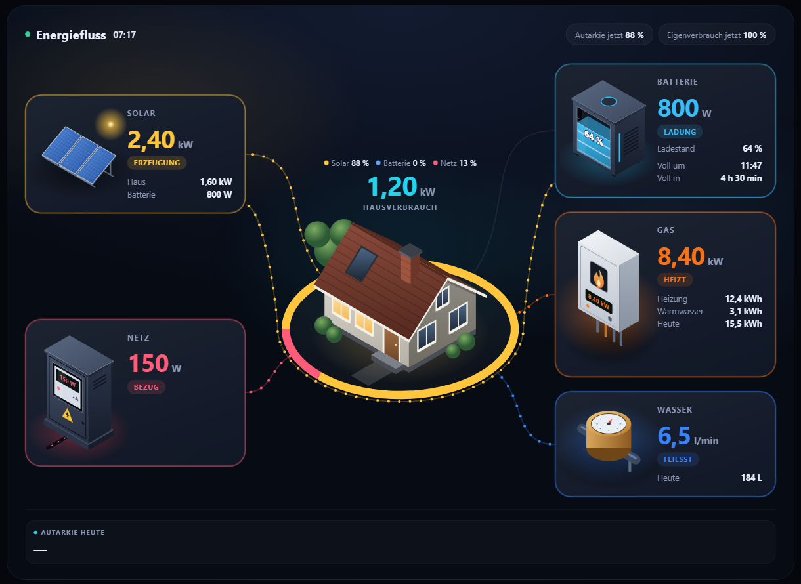

```yaml
gas:
  entity: sensor.therme_leistung        # optional: aktuelle Leistung (W oder kW)
  heating: sensor.gas_heizung_heute     # Heizung heute (kWh oder m³)
  hot_water: sensor.gas_warmwasser_heute  # Warmwasser heute (kWh oder m³)
  # daily: sensor.gas_heute             # oder nur eine Summe ohne Aufteilung
  # kwh_per_m3: 10.3                    # nur bei Sensoren in m³
water:
  entity: sensor.wasser_durchfluss      # optional: Durchfluss (l/min, L/h oder m³/h)
  daily: sensor.wasser_heute            # Verbrauch heute (Liter oder m³)
```

**Öl statt Gas:** Mit `fuel: oil` heißt die Kachel „Öl“ und zeigt Liter statt kWh oder m³. Die Sensoren dürfen kWh, Liter oder m³ zählen, kWh rechnet die Karte mit `kwh_per_l` (Standard 10, also 10 kWh je Liter) in Liter um.

```yaml
gas:
  fuel: oil
  daily: sensor.brenner_energie_heute   # kWh, Liter oder m³
  # kwh_per_l: 9.8                       # Standard 10
  extra:                                # Zusatzwerte, zum Beispiel die Kesseltemperatur
    - { entity: sensor.kessel_temperatur, no_name: true }   # nur der Wert, ohne Namen
```

**Mehrere Wasserzähler:** Mit einer Liste bekommt jeder Zähler eine eigene Kachel mit eigenem Namen (bis zu vier). Ohne Namen heißen sie „Wasser“, „Wasser 2“ und so weiter.

```yaml
water:
  - { name: Trinkwasser, daily: sensor.wasser_trinkwasser_heute }
  - { name: Zisterne, daily: sensor.wasser_zisterne_heute, entity: sensor.zisterne_durchfluss }
```

Im Editor gibt es dafür die Abschnitte „Wasser“, „Zweiter Wasserzähler“ und „Dritter Wasserzähler“ (`water`, `water2`, `water3`).

| Schlüssel | Wert | Wirkung |
|---|---|---|
| `gas.entity` | Sensor (W, kW) | Aktuelle Leistung der Therme. Dann steht sie groß in der Kachel, die Linie läuft nur beim Heizen („Heizt“), und darunter steht der Verbrauch von heute. Ohne steht groß der Verbrauch von heute, und die Linie läuft, sobald heute Gas verbraucht wurde |
| `gas.heating`, `gas.hot_water` | Sensor (kWh oder m³) | Tageswerte für Heizung und Warmwasser, je eine Zeile. Die Summe ist der Tageswert der Kachel |
| `gas.daily` | Sensor (kWh oder m³) | Gas heute gesamt, wenn es keine Aufteilung gibt |
| `gas.kwh_per_m3` | Zahl | Umrechnung von m³ in kWh, steht auf der Gasrechnung (Brennwert × Zustandszahl, meist um 10). Ohne zeigt die Kachel m³ |
| `water.entity` | Sensor (l/min, L/h, m³/h) | Durchfluss. Dann steht er groß in der Kachel („Fließt“), darunter der Verbrauch von heute |
| `water.daily` | Sensor (L oder m³) | Wasser heute. Ab 1.000 Litern in m³ |
| `gas.fuel` | `gas` (Standard) oder `oil` | `oil`: Kachel „Öl“ mit Symbol `mdi:oil` und Anzeige in Litern |
| `gas.kwh_per_l` | Zahl | Nur bei Öl: kWh je Liter (Standard 10). Rechnet kWh-Sensoren in Liter um |
| `gas.extra`, `water.extra` | Liste | Zusatzwerte in der Kachel wie bei Solar (Sensor, `name`, `unit`, `decimals`, `warn_above`, `warn_below`). Mit `no_name: true` (oder `name: ""`) steht nur der Wert da |
| `water` als Liste, `water2`, `water3` | Zähler | Mehrere Wasserzähler, je eine Kachel (höchstens vier) |
| `name`, `icon` | Text | Eigener Name und Symbol (Standard: Gas mit `mdi:fire`, Öl mit `mdi:oil`, Wasser mit `mdi:water`) |

Die Tageswerte brauchen Sensoren, die um Mitternacht neu beginnen, zum Beispiel einen Helfer „Verbrauchszähler“ (utility_meter) mit Zyklus täglich auf deinem Gas- oder Wasserzähler. Die Farben änderst du mit `colors.gas` und `colors.water`. Anlass: [#65](https://github.com/msucimaker3112/energy-cockpit/issues/65).

### Himmelsband: `weather`

Optional. Ein dünner Streifen unter der Kopfzeile zeigt das Wetter des Tages in 24 Stunden, mit einem Punkt für "jetzt". Darunter stehen Wetter, Temperatur sowie Sonnenaufgang und Sonnenuntergang. Ein Tipp auf das Band zeigt Bewölkung, Wind und die nächsten Stunden.

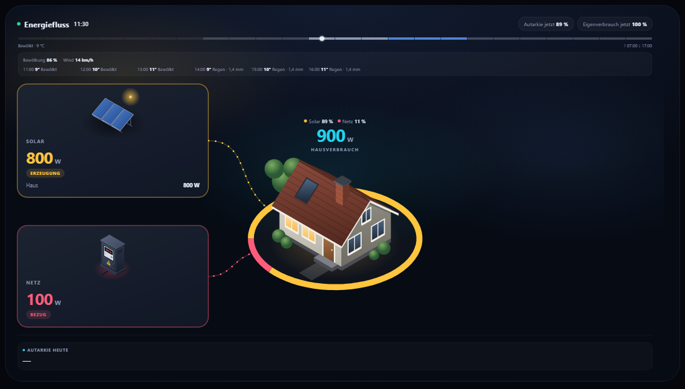

```yaml
weather: weather.forecast_home   # oder: weather: auto (erste Wetter-Entität)
```

| Farbe | Wetter |
|---|---|
| Gold | sonnig |
| Gold und Grau | teils bewölkt |
| Grau | bewölkt, Nebel, Wind |
| Blau | Regen, Starkregen |
| Hellblau | Schnee, Schneeregen |
| Violett | Gewitter |

Stunden in der Nacht sind abgedunkelt. Stunden, die schon vorbei sind, zeigen nur Tag und Nacht, weil Home Assistant keine vergangene Vorhersage liefert.

**Voraussetzungen:**
- Eine Wetter-Entität (`weather.…`), zum Beispiel von Met.no oder dem Deutschen Wetterdienst.
- Die Stundenwerte holt die Karte mit `weather.get_forecasts` (stündlich). Unterstützt die Integration das nicht, zeigt das Band nur Tageslicht und das aktuelle Wetter.
- Sonnenaufgang und -untergang kommen aus `sun.sun`. Diese Entität gibt es in Home Assistant standardmäßig.

In der Kurzansicht (`compact`) bleibt nur die Textzeile ohne Streifen. Ist die Entität nicht vorhanden, bleibt das Band einfach ausgeblendet.

### Abfallkalender-Hinweis

```yaml
waste:
  calendar: calendar.abfall
  day_switch: "10:00"     # ab dann Hinweis für morgen
  remind_from: "16:00"    # ab dann auffällig
  nav_path: /lovelace/abfall
  types:
    - { match: rest, name: Restmüll, color: "156,163,175" }
    - { match: gelb, name: Gelber Sack, color: "250,204,21" }
```

### Darstellung

| Schlüssel | Standard | Beschreibung |
|---|---|---|
| `show_clock` | `true` | Uhr im Kopf |
| `weather` | | Himmelsband mit dem Wetter des Tages, siehe [Himmelsband](#himmelsband-weather) |
| `fit_screen` | `true` | auf Bildschirmhöhe skalieren (Statistik: nicht auf dem Handy) |
| `compact` | `false` | Kurzansicht für den schnellen Blick: Solar, Netz und Batterie stehen neben dem Ring, Gruppen ohne Geräteliste, ohne Zusatztexte (Aufteilung, Prognose, Herkunft). `auto`: nur auf schmalen Bildschirmen unter 600 px (Handy), Tablet und PC zeigen weiter alles. `true` (oder `immer`): überall. Ein Tipp auf eine Gruppe öffnet ein Fenster mit allen Geräten der Gruppe und ihren aktuellen Werten. Ist `groups_lines` nicht gesetzt, zeichnet die Kurzansicht die Sammel-Linie, `groups_columns` gilt in der Kurzansicht nicht |
| `compact_forecast` | `false` | Zwei Schalter für die Prognose heute: `compact_forecast` gilt für die **Kurzansicht**, `forecast_swap` (darunter) für die **ausführliche Ansicht**. Nur mit Kurzansicht: `true` zeigt in der Solar-Kachel die Zeile „Prognose heute … kWh“ (aus `pv.forecast`), alle anderen Zusatzzeilen bleiben ausgeblendet. Gut für die Startseite auf dem Wandtablet ([#69](https://github.com/msucimaker3112/energy-cockpit/issues/69)) |
| `forecast_swap` | `false` | `true`: unten „Prognose heute / morgen / übermorgen“ nebeneinander, „Solar heute“ in der Solar-Kachel. Nur mit einer Tagesprognose in kWh als `pv.forecast`, siehe [PV-Prognose](#pv-prognose-für-morgen-und-übermorgen) |
| `label_size` | | Zahl (0,5 bis 4, zum Beispiel `1.5`): vergrößert **nur die kleinen Texte** (Namen, Zusatzwerte, Beschriftungen), die Zahlen in den Kacheln bleiben. Gut, wenn die Karte auf einen Bildschirm passen soll, die Beschriftungen aber zu klein sind. Bei den kleinen Texten gilt `label_size` vor `text_size` |
| `watt_only` | `false` | `true`: Leistung immer in Watt (zum Beispiel 2.350 W) statt ab 1000 W in kW |
| `decimals` | automatisch | Feste Nachkommastellen. Eine Zahl gilt für Energie (kWh): `decimals: 2` zeigt `10,80 kWh` und `0,00 kWh`. Einzeln: `decimals: { energy: 2, power: 1, percentage: 1 }`. `power` gilt für Werte in kW, Watt bleiben ganzzahlig. `percentage` gilt für Autarkie und Eigenverbrauch. Gibt es auch in der Statistik-Karte |
| `fit_margin` | `8` | Abstand unten in Pixel |
| `keep_awake` | `auto` | `true`/`false`/`auto`: Bildschirm wach halten (Echo Show, Silk) |
| `nav_path`, `nav_label` | | Schaltfläche zur nächsten Ansicht |

---

## Geräte & Verbrauch: `custom:energy-cockpit-devices-card`

```yaml
type: custom:energy-cockpit-devices-card
title: Geräte & Verbrauch
home: sensor.hausverbrauch
grid_price: input_number.strompreis
feed_in: input_number.einspeiseverguetung
surplus: sensor.pv_ueberschuss
standby_w: 15
# text_size: sehr_gross                     # normal | gross | sehr_gross | eine Zahl, z. B. 2 (vergrößert auch die großen Werte)
# label_size: 1.5                           # nur Raum- und Gerätenamen, Zeilen und Beschriftungen größer
home_energy:                       # für Strommix je Zeitraum
  pv: sensor.pv_gesamt_kwh
  import: sensor.netzbezug_gesamt_kwh
  export: sensor.einspeisung_gesamt_kwh
  charge: sensor.batterie_geladen_kwh
  discharge: sensor.batterie_entladen_kwh
rooms:
  - name: Küche
    icon: mdi:silverware-fork-knife
    devices:
      - name: Kühlschrank
        type: fridge
        entity: switch.kuehlschrank
        power: sensor.kuehlschrank_leistung
        energy: sensor.kuehlschrank_energie
        lock: true                 # nur Anzeige
```

**Schriftgröße:** `text_size` und `label_size` wirken wie im Energiefluss. `gross` und `sehr_gross` vergrößern die Texte (Raum- und Gerätenamen, Unterzeilen, Beschriftungen), eine Zahl wie `2` auch die großen Werte oben. `label_size` (0,5 bis 4) vergrößert nur die Texte und gilt vor `text_size`. Im Editor stehen beide unter „Allgemein“.

### Geräteoptionen

| Schlüssel | Beschreibung |
|---|---|
| `name`, `icon`, `color` | Anzeige |
| `type` | `plug` (Standard), `light`, `pump`, `fridge`, `dryer`, `ac`, `strip`, `tv`, `media`, `console`, `coffee`, `heat` |
| `entity` | Schalter (`switch`, `light`, `input_boolean`) oder Binärsensor. Optional: Fehlt `entity`, nimmt die Karte `power` (sonst `energy`), für reine Messgeräte ohne Schalter wie Shelly EM. Geräte mit einem Sensor statt eines Schalters lassen sich nicht schalten und zeigen keinen Schalter |
| `power`, `energy` | Leistungs- und Energiesensor (kWh) |
| `max_w` | Leistung für voll ausgeschlagenen Balken |
| `run_w` | ab dieser Leistung gilt das Gerät als laufend (Standard 3 W) |
| `run_state` | Sensor, dessen Zustand `run` bedeutet "läuft" |
| `lock` | `true`: nicht schaltbar |
| `shared` | `true`: nicht in die Summe aufnehmen |
| `since` | Startdatum des Zählers (ISO), falls die Steckdose früher etwas anderes maß |
| `pv_w` | Leistung, ab der "jetzt mit Sonne laufen lassen" angezeigt wird |
| `channels` | Mehrere Schalter hinter einem Gerät `[{name, entity}]` |
| `info`, `extra`, `extra_unit` | Zusatzzustände anzeigen |
| `on_w`, `toggle`, `mute`, `tv`, `players`, `ambilight` | Mediencenter-Funktionen (TV, Ambilight, Szenen) |

Zusätzliche Verbraucher ohne Kachel, die in Summe und Rangliste zählen:

```yaml
extra_consumers:
  - name: Wallbox
    entity: sensor.wallbox_leistung
    energy: sensor.wallbox_energie
    color: "167,139,250"
```

---

## Statistik: `custom:energy-cockpit-stats-card`

```yaml
type: custom:energy-cockpit-stats-card
title: Statistik
pv_total: sensor.pv_gesamt_kwh
grid_import_total: sensor.netzbezug_gesamt_kwh
grid_export_total: sensor.einspeisung_gesamt_kwh
battery_charge_total: sensor.batterie_geladen_kwh      # bei mehreren Speichern auch als Liste: [sensor.a, sensor.b]
battery_discharge_total: sensor.batterie_entladen_kwh
battery_capacity_kwh: 7.5
battery_temp: sensor.batterie_temperatur
pv_today: sensor.pv_heute
import_today: sensor.bezug_heute
export_today: sensor.einspeisung_heute
charge_today: sensor.batterie_geladen_heute
discharge_today: sensor.batterie_entladen_heute
home_power: sensor.hausverbrauch          # für die Grundlast nachts
grid_price: input_number.strompreis
feed_in: input_number.einspeiseverguetung
investment_eur: 18000                      # Anschaffungskosten in Euro für die Amortisation ...
# investment: input_number.anschaffung_pv  # ... oder aus einem Sensor oder Helfer
# earned_before_eur: 1200                  # vor Beginn der Zähler bereits erwirtschaftet (wird addiert)
# earned_before: input_number.pv_vorher     # ... oder aus einem Sensor oder Helfer
# long_term: true                           # Langzeit-Ansicht, siehe unten
# feed_in_card: pv_self_consumption         # Anlage ohne Vergütung: Eigenverbrauch statt Einspeiseerlös, oder: hidden
# hide: [monthly, footer]                  # Bereiche ausblenden: monthly, amortisation, baseload, footer, money
# start_period: day                        # Reiter beim Öffnen: day, week, month (Standard) oder year
# hourly_pricing: true                     # Geldwerte Stunde für Stunde mit dem Preis-Sensor rechnen (Standard: aus), siehe unten
# text_size: sehr_gross                     # normal | gross | sehr_gross | eine Zahl, z. B. 2 (vergrößert auch die großen Werte)
# colors: { pv: "#b7791f" }                # eigene Farben, siehe "Eigene Farben: colors"
# grid2_total: sensor.waermepumpe_energie_summe  # zweiter Zähler (kWh), z. B. Wärmepumpe mit eigenem Tarif
# grid2_price_ct: 25.45                     # eigener Preis in Cent, oder grid2_price (Sensor/Helfer); grid2_name: Wärmepumpe
# budget_kwh: 8000                         # Jahresziel für den Netzbezug in kWh (Zahl oder Sensor), siehe unten
# budget_profile: history                   # Soll gleichmäßig (linear, Standard) oder nach dem Verlauf des Vorjahres
# pv_lifetime: sensor.pv_zaehler_dauerhaft  # nur nötig, wenn pv_total täglich auf 0 geht, siehe unten
# decimals: 2                               # feste Nachkommastellen bei kWh, siehe Darstellung
```

Pflicht sind `pv_total`, `grid_import_total` und `grid_export_total`. Alles andere blendet die jeweilige Anzeige ein. Ohne Preise zeigt die Karte keine Geldwerte, ohne `investment_eur` (fester Betrag) oder `investment` (Sensor oder Helfer) keine Amortisation.

**"Heute":** Die Karte nimmt die Tagessensoren (`pv_today`, `import_today`, `export_today`, `charge_today`, `discharge_today`). Fehlt einer oder liefert er gerade keinen Wert, rechnet sie den Wert aus dem Gesamtzähler seit Mitternacht, so wie Monat und Jahr. Die Tagessensoren sind damit optional. Unter den Kacheln steht dann ein gelber Hinweis, welcher Sensor fehlt. Ebenso warnt die Karte, wenn in einem Tagesfeld offenbar ein Gesamtzähler steckt (der Wert ist viel größer als der Zuwachs des Gesamtzählers seit Mitternacht) oder wenn heute mehr eingespeist als erzeugt wurde. Ohne Statistik und ohne Tagessensor zeigt die Kachel einen Strich, nie die Werte eines anderen Zeitraums.

**Rekordtag:** Die Karte sucht den besten Tag des Jahres in der Statistik von `pv_today` und von `pv_total` und zeigt den höheren Wert. Ein neu angelegter Tagessensor mit erst wenigen Tagen Verlauf verfälscht den Rekord so nicht mehr.

**`pv_lifetime` (optional):** Geht dein PV-Zähler täglich auf 0 und gibt es keinen durchlaufenden, bleibt er bei `pv_total` (Verlauf, Monatsbalken, Autarkie funktionieren damit). Amortisation und "Solar gesamt" brauchen aber den ganzen Ertrag. Dafür trägst du bei `pv_lifetime` einen Zähler ohne Zurücksetzen ein, zum Beispiel einen Helfer "Verbrauchszähler" ohne Zyklus, der deinen Tageszähler aufsummiert. Ohne Eintrag gilt `pv_total` wie bisher.

**`feed_in_card`:** Für Anlagen ohne Einspeisevergütung, bei denen die Kachel "Einspeiseerlös" nur einen Strich zeigt. `pv_self_consumption` zeigt stattdessen den Solar-Eigenverbrauch mit Quote und selbst genutzten kWh, `hidden` blendet die Kachel aus. Ohne Eintrag bleibt alles wie bisher. Einstellbar auch unter "Alle Felder".

**`start_period`:** Mit welchem Reiter die Karte startet. Ohne Angabe ist es der Monat. `day` zeigt „Heute“, `week` die Woche (nur mit Kosten pro Verbraucher), `year` das laufende Jahr. Bei jedem Öffnen der Karte gilt wieder dieser Reiter.

**Geldwerte Stunde für Stunde: `hourly_pricing`.** Mit `hourly_pricing: true` und einem `grid_price`-Sensor mit Langzeitstatistik, etwa bei einem Zeittarif oder dynamischen Tarif, rechnet die Karte **Stromkosten Netz**, **Solar-Ersparnis** und **Einspeiseerlös** je Stunde: Bezug und selbst genutzter Solarstrom der Stunde mal dem Strompreis dieser Stunde, Einspeisung mal der Vergütung dieser Stunde (Stundenmittel, wenn `feed_in` ein Sensor mit Statistik ist, sonst der feste Wert). Wer nachts günstig lädt, sieht so die echten Kosten statt der Menge mal dem heutigen Preis. Das gilt für Heute, Woche, Monat, Jahr und Gesamt. Standard ist aus, dann bleibt alles wie bisher. Einschalten geht auch im Editor unter „Alle Felder“.

- **Preiswechsel innerhalb einer Stunde:** Wechselt der Preis mitten in der Stunde (zum Beispiel ein Tarifwechsel um 23:30 oder 05:30), bewertet die Karte Bezug und Einspeisung dieser Stunde in 5-Minuten-Schritten. Das geht nur, solange Home Assistant die Kurzzeitstatistik noch hat (`purge_keep_days` des Recorders, Standard 10 Tage). Ältere Stunden rechnen mit dem Stundenmittel. Die Solar-Ersparnis nimmt in solchen Stunden immer das Stundenmittel.
- **Selbst genutzter Solarstrom:** zählt je Stunde (Solar minus Einspeisung dieser Stunde), und „Selbst genutzt“ in der Kachel zeigt genau diese kWh. Speist die Batterie außerhalb der Solarstunden ein, verringert das den selbst genutzten Solarstrom also nicht mehr. Der Wert kann deshalb deutlich über „Solar minus Einspeisung“ des ganzen Zeitraums liegen.
- **Ohne Preisstatistik:** Stunden ohne Statistik zählen mit `grid_price_history`, danach mit dem heutigen Preis, wie bei den Kosten pro Verbraucher. Die laufende Stunde rechnet mit dem heutigen Preis. Monate ganz ohne Preisstatistik rechnen wie bisher. Hat der Sensor gar keine Statistik (zum Beispiel ein Helfer `input_number`), bleibt alles wie bisher.
- **Preis 0 oder negativ:** Mit Stundenpreisen bleiben die Kacheln sichtbar, und die Fußzeile zeigt den Preis statt „Preise konfigurieren“. Ohne Preisstatistik zeigen die Kacheln dann wie bisher einen Strich.
- **Unverändert:** Der zweite Zähler (`grid2_total`) zählt weiter zu seinem eigenen Preis, Grundpreis und Amortisation bleiben wie bisher. Der Hinweis in der Langzeit-Ansicht nennt die Stundenpreise, sobald sie verwendet wurden.
- **Ladezeit:** Ohne `cost_consumers` lädt die Karte dafür die Stundenwerte des laufenden Jahres, mit `long_term` auch frühere Jahre ab der ersten Stunde mit Preisstatistik, dazu bei Preiswechseln in der Stunde 5-Minuten-Werte. Auf schwachen Geräten (zum Beispiel Echo Show) kann das spürbar dauern.

**`hide`:** Blendet einzelne Bereiche der Statistik aus, die du nicht brauchst. Eine Liste mit diesen Namen, auch im Editor unter „Alle Felder“ auswählbar:

| Name | Bereich |
|---|---|
| `monthly` | Diagramm „Solarertrag pro Monat“ mit der Jahresübersicht |
| `amortisation` | Kachel „Amortisation“ (ohne Anschaffungskosten ist sie ohnehin ausgeblendet) |
| `baseload` | Kachel „Grundlast (nachts)“ |
| `footer` | Fußzeile mit Rekordtag, Batterie (Wirkungsgrad), Batteriezyklen, Batterie (Temperatur) und Solar gesamt |
| `money` | Die vier Kacheln oben (Solar-Ersparnis, Einspeiseerlös, Stromkosten, Autarkie) |

```yaml
hide: [monthly, footer]
```

Die Werte werden im Hintergrund weiter berechnet. Ohne Eintrag ändert sich nichts. Das Jahresbudget und die Kosten pro Verbraucher lassen sich einfach weglassen (sie erscheinen nur mit `budget_kwh` und `cost_consumers`).

### Zweiter Netzzähler in der Statistik: `grid2_total`

Mit `grid2_total` (kWh-Zähler mit Langzeitstatistik) zählt die Statistik den Bezug des zweiten Zählers dazu. Er geht in die Stromkosten ein, zu seinem eigenen Preis (`grid2_price` als Sensor oder Helfer, oder `grid2_price_ct` fest in Cent). Ohne eigenen Preis gilt der normale Strompreis. Unter „Stromkosten Netz“ steht dann, wie viel davon auf den zweiten Zähler entfällt, mit dem Namen aus `grid2_name`. Auch „Autarkie“ und das Jahresbudget rechnen den zweiten Zähler als Netzbezug.

```yaml
grid2_total: sensor.waermepumpe_energie_summe
grid2_name: Wärmepumpe
grid2_price_ct: 25.45
```

Der Preis gilt für alle Zeiträume. Einen Preisverlauf (`grid_price_history`) gibt es für den zweiten Zähler nicht.

**Zeittarife (Hochtarif und Niedertarif):** Trage den Hochtarif-Zähler als `grid_import_total` und den Niedertarif-Zähler als `grid2_total` ein, jeweils mit eigenem Preis (`grid_price_ct` und `grid2_price_ct`). Bei „Kosten pro Verbraucher“ zählt der Niedertarif-Bezug dann zum Netzbezug, und die Kosten rechnen mit dem Mischpreis aus beiden Zählern, je Stunde nach den bezogenen kWh. Die Geldwerte oben (Netzkosten, Solar-Ersparnis) rechnen weiter mit dem aktuellen Preis. Ist `grid_price` ein Sensor, dessen Preis je Stunde wechselt, rechnen sie mit `hourly_pricing: true` Stunde für Stunde, siehe `hourly_pricing`.

### Jahresbudget (optional): `budget_kwh`

Wer sich für das Jahr ein Ziel für den Netzbezug setzt, zum Beispiel 8.000 kWh, sieht auf einen Blick, wie weit er damit ist. Die Kachel „Jahresbudget Netzbezug“ erscheint nur, wenn `budget_kwh` eingetragen ist, und gilt immer für das laufende Jahr, egal welcher Reiter offen ist.

```yaml
budget_kwh: 8000          # Jahresziel für den Netzbezug (kWh), auch als Sensor oder Helfer möglich
budget_profile: history   # optional: linear (Standard) oder history
```

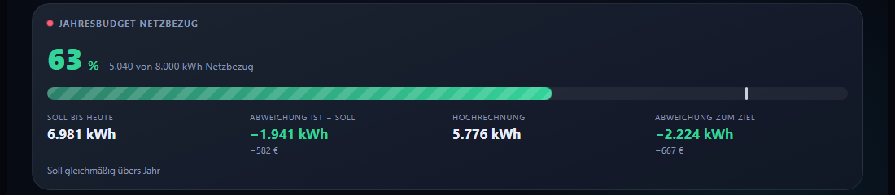

| Wert | Bedeutung |
|---|---|
| Prozent und Balken | Netzbezug seit 1. Januar im Verhältnis zum Jahresziel. Der Strich im Balken zeigt das Soll bis heute |
| Soll bis heute | Wie viel du bis heute verbrauchen dürftest, um im Ziel zu bleiben |
| Abweichung Ist − Soll | Ist minus Soll in kWh und, wenn ein Strompreis eingetragen ist, in Euro. Negativ heißt: du liegst unter dem Soll |
| Hochrechnung | Netzbezug bis heute, auf das ganze Jahr hochgerechnet (Ist geteilt durch den Anteil des Jahres, der vergangen ist) |
| Abweichung zum Ziel | Hochrechnung minus Jahresziel in kWh und Euro |

- **Farbe:** Im Soll grün, bis 10 % darüber gelb, darüber rot.
- **`budget_profile: linear`** (Standard): Das Soll läuft gleichmäßig übers Jahr, am 1. Juli sind es etwa die Hälfte des Ziels.
- **`budget_profile: history`:** Das Soll folgt dem Verlauf deines Netzbezugs im letzten vollen Jahr. Wer im Winter viel aus dem Netz bezieht und im Sommer wenig (mit PV-Anlage), bekommt im Winter ein höheres Soll. Dafür braucht die Karte die Monatswerte aller 12 Monate des Vorjahres. Fehlen sie, rechnet sie gleichmäßig. Welche Rechnung gilt, steht unter der Kachel.
- **Zähler erst später im Jahr eingerichtet:** Beginnen die Messdaten des Netzbezugs erst nach dem 1. Januar (zum Beispiel am 10. Oktober), rechnen Soll und Hochrechnung nur für den erfassten Zeitraum, und unter der Kachel steht „Messdaten erst seit …“. Die Werte sind dann vorläufig, weil sie auf wenigen Wochen beruhen (im Winter höher als im Jahresmittel). Ab dem nächsten Jahr gilt das ganze Jahr.
- Grundlage ist `grid_import_total`. Der Wert hinkt wie die anderen Monatswerte bis zu einer Stunde hinterher.

**Amortisation:** Ohne `investment` oder `investment_eur` blendet die Karte die Kachel „Amortisation“ aus, die Grundlast nimmt dann die ganze Breite.

### Kosten pro Verbraucher (optional)

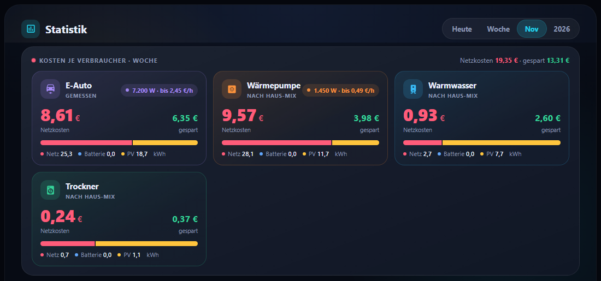

Zeigt je Verbraucher die Netzkosten und was Solar und Batterie gespart haben, in den Reitern Heute, Woche, Monat und Jahr. Einrichten geht im Assistenten im Schritt *Kosten* (bis zu vier Verbraucher), unter "Alle Felder" oder in YAML. Ohne Eintrag erscheinen weder der Bereich noch der Reiter Woche.

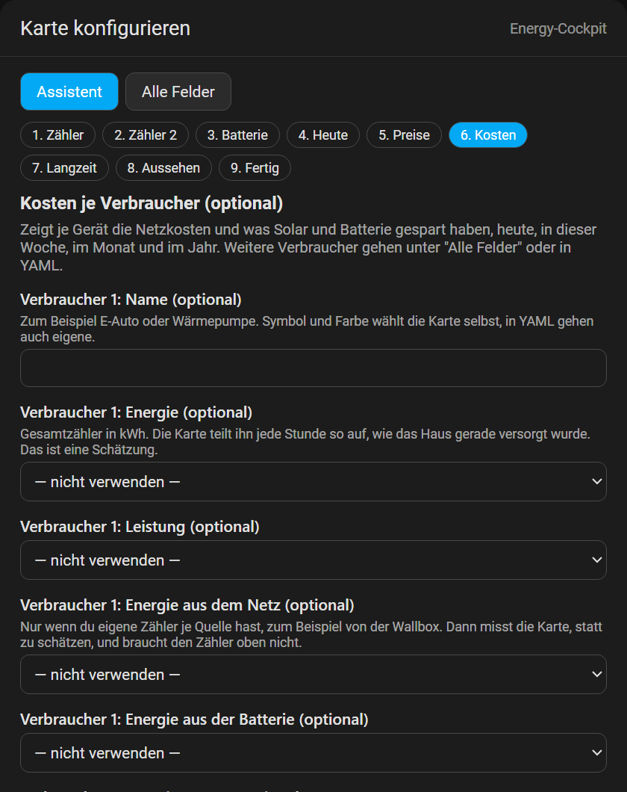

```yaml
pv_ac: true                     # nur bei Hybrid-Wechselrichtern, siehe unten
cost_consumers:
  - name: E-Auto
    icon: mdi:car-electric
    color: "#a78bfa"
    power: sensor.wallbox_leistung     # optional: zeigt die Leistung und die Kosten pro Stunde
    grid: sensor.ev_energie_netz       # gemessen: je ein Zähler für Netz, Batterie und PV
    battery: sensor.ev_energie_akku
    pv: sensor.ev_energie_pv
  - name: Warmwasser
    icon: mdi:water-boiler
    color: "#38bdf8"
    power: sensor.boiler_leistung
    energy: sensor.boiler_energie      # ein Zähler: Aufteilung nach dem Mix des Hauses
```

| Feld | Bedeutung |
|---|---|
| `energy` | Zähler in kWh. Die Karte teilt den Verbrauch jeder Stunde so auf, wie das Haus in dieser Stunde versorgt wurde. Das ist eine Schätzung: Ein Gerät, das gezielt mit Überschuss läuft, hat in Wahrheit mehr PV-Anteil. Auch eine Liste mehrerer Zähler ist möglich, siehe unten |
| `grid`, `battery`, `pv` | Eigene Zähler je Quelle in kWh. Dann misst die Karte statt zu schätzen |
| `power` | Leistung. Läuft das Gerät, steht dort die Leistung und "bis x €/h": die Kosten pro Stunde, wenn alles aus dem Netz käme |
| `on_w` | Ab welcher Leistung das Gerät als laufend gilt (Standard 10 W) |
| `name`, `icon`, `color` | Anzeige. Ohne `icon` und `color` wählt die Karte sie selbst, das Symbol nach dem Namen |

- **Mehrere Zähler als ein Eintrag:** Bei `energy` darf auch eine Liste stehen, zum Beispiel für vier Klimaanlagen. Die Kachel zeigt oben Verbrauch und Kosten aller Zähler zusammen und darunter jeden Zähler mit Namen, kWh und Kosten. Ohne `name` nimmt die Karte den Namen aus Home Assistant:

  ```yaml
  cost_consumers:
    - name: Klimaanlagen
      energy:
        - entity: sensor.klima_buero_energie
          name: Büro
        - entity: sensor.klima_schlafzimmer_energie
          name: Schlafzimmer
        - sensor.klima_kinderzimmer_energie   # Kurzform ohne eigenen Namen
  ```

  Die Liste geht nur in YAML (Code-Editor), der grafische Editor zeigt je Verbraucher einen Zähler.
- **Netzkosten** = Anteil aus dem Netz × Strompreis (`grid_price` oder `grid_price_ct`). **Gespart** = Anteil aus Solar und Batterie × Strompreis. Entgangene Einspeisevergütung ist darin nicht abgezogen.
- Der Reiter **Woche** zählt ab Montag. Er zeigt auch die Geldwerte und die Autarkie oben für diese Woche.
- **Preis je Stunde:** Hat der Sensor `grid_price` eine Langzeitstatistik, etwa bei einem dynamischen Tarif, nimmt die Karte den Mittelwert jeder Stunde. Sonst gilt `grid_price_history`, danach der heutige Preis. Ein Helfer (`input_number`) hat keine Langzeitstatistik:

  ```yaml
  grid_price_history:
    - until: 2025-12-31    # bis einschließlich, auch als 2025-12
      ct: 32.5
    - until: 2026-06-30
      ct: 36
  ```

  Der Preisverlauf gilt auch für die Geldwerte oben (**Stromkosten Netz** und **Solar-Ersparnis**) in den Reitern Monat, Jahr und Gesamt: Jeder Monat zählt mit dem Preis, der damals galt. Wechselt der Preis mitten im Monat, mittelt die Karte über die Tage. „Heute“ und „Woche“ rechnen mit dem heutigen Preis, ebenso die Amortisation. Die Einspeisevergütung hat keinen Verlauf. Mit `hourly_pricing: true` und einem Preis-Sensor mit Langzeitstatistik rechnen die Geldwerte oben dagegen Stunde für Stunde, siehe `hourly_pricing`.
- **Grundpreis (optional): `grid_base_fee`.** Trägst du den Grundpreis aus deiner Rechnung ein (Euro pro Monat, zum Beispiel `12.5`, ein Jahresbetrag geteilt durch 12), zählt er in **Stromkosten Netz** mit: anteilig je Tag für Heute, Woche (ab Montag), Monat, Jahr und Gesamt, im laufenden Monat bis heute. Unter dem Wert steht „davon Grundpreis …“. Hat sich der Grundpreis geändert, trägst du den früheren in `grid_base_fee_history` ein, wie beim Preisverlauf:

  ```yaml
  grid_base_fee: 14.9          # Euro pro Monat, heute
  grid_base_fee_history:
    - until: 2026-10-31        # bis einschließlich, auch als 2026-10
      eur: 12.5
  ```

  Einmalige Anschlusskosten und Wechselboni gehören bewusst nicht dazu, sie würden die Monats- und Jahreswerte verzerren. Der Grundpreis ändert weder die Solar-Ersparnis noch die Amortisation, und er steht nicht in „Kosten pro Verbraucher“. Ohne Eintrag ändert sich nichts.
- **Hinweis bei falschem Sensor:** Statt still 0 € zu zeigen, nennt das Kärtchen in Gelb den Grund: wenn ein Sensor Leistung misst (W statt kWh), wenn es zu ihm keine kWh-Statistik gibt oder wenn es ihn nicht gibt. Gebraucht wird ein Zähler in kWh mit `state_class: total_increasing`. Gibt es nur einen Leistungssensor, macht der Helfer **Integral** (Riemann-Summenintegral) daraus einen kWh-Zähler. Er zählt ab dem Einrichten, frühere Tage fehlen dann.
- Grundlage sind die Stundenwerte der Statistik: "Heute" hinkt deshalb bis zu einer Stunde hinterher. Für "Gesamt" und frühere Jahre bleibt der Bereich stehen, zeigt aber keine Werte.

**`pv_ac`:** Manche Hybrid-Wechselrichter zählen im Gesamtertrag nur ihre Abgabe: ohne die Ladung des Batterien aus den Modulen, dafür mit seiner Entladung. Mit `pv_ac: true` rechnet die Karte den Hausverbrauch als PV + Bezug − Einspeisung. Das gilt für die Autarkie und für die Aufteilung nach Haus-Mix.

### Langzeit-Ansicht (optional)

**Wofür:** Die Karte zeigt sonst nur das aktuelle Jahr und das Vorjahr. Mit `long_term: true` liest sie alle Jahre, die in der Langzeitstatistik von Home Assistant liegen. Einschalten im Assistenten (Schritt *Langzeit*) oder im YAML. Ohne die Option bleibt die Karte genau wie bisher.

```yaml
long_term: true
# nur für importierte Altdaten:
pv_history: sensor:deye_ac_historisch    # Statistik-ID, auch extern importiert
pv_history_until: 2026-04                # bis einschließlich diesem Monat gilt die Historie
pv_history_name: AC-Abgabe               # Bezeichnung in der Legende, sonst "Historie"
```

| Eingeschaltet | Verhalten |
|---|---|
| Jahre blättern | ‹ › im Diagramm. Der Jahres-Reiter und die Kacheln folgen dem gewählten Jahr |
| Reiter *Gesamt* | Summen über alle Monate mit vollständigen Daten |
| Fehlende Monate | Zählen nicht als 0: Sie sind im Diagramm schraffiert und werden genannt. Summen enthalten nur Monate mit PV, Bezug und Einspeisung |
| Unverändert | Amortisation (Lebensdauer), Grundlast (letzte Nächte), Rekordtag (aktuelles Jahr), *Heute* und der Monats-Reiter |

**`pv_history`:** Füllt nur die Monatsbalken und *Solar gesamt*. Mit `pv_history_until` kommen die Monate bis einschließlich zum Stichtag aus der Historie, ohne Stichtag nur Monate, für die `pv_total` keine Werte hat. So hat jeder Monat genau eine Quelle. Historien-Balken sind blau. Geldwerte, Autarkie und Batterie rechnen weiter nur mit `pv_total`, weil für alte Monate Netz- und Speicherdaten fehlen. Für die Amortisation gibt es `earned_before_eur`. Die Statistik muss Zählerwerte (`sum`) in kWh, Wh oder MWh enthalten.

**Altdaten importieren:** Die Karte hat keinen eigenen Import. Altdaten kommen als CSV aus InfluxDB, Grafana oder der Hersteller-Cloud und werden mit der HACS-Integration *Import Statistics* in die Langzeitstatistik übernommen. Vorher ein Backup machen. Die `sum`-Werte müssen fortlaufend hochzählen, sonst entstehen Sprünge.

**Grenzen:**
- Geldwerte älterer Zeiträume rechnen mit dem **heutigen** Preis, die Karte weist darauf hin.
- Home Assistant rechnet die älteste Zeile einer Statistik gegen 0. Liegt dieser Monat mehr als fünfmal über allen abgeschlossenen Monaten, gilt er als Zählerstand und wird ausgelassen.

---

## Raum-Abrechnung: `custom:energy-cockpit-room-card`

Zeigt Verbrauch und Kosten eines Raums für **Woche, Monat, Jahr und Vorjahr**, getrennt nach **Bereichen** (jeder Zähler kann beliebig viele Geräte versorgen) und nach **Herkunft der Energie (Netz, Batterie, PV)**, mit Tagesbalken, Tabellen und CSV-Export. Gedacht für die Abrechnung der Strommiete eines vermieteten oder getrennt zu bewertenden Raums.

```yaml
type: custom:energy-cockpit-room-card
title: Büro Keller
subtitle: Strommiete
image: /local/logo.png                 # optional, Bild-URL oder Data-URI
devices:
  - name: Arbeitsplätze
    energy: sensor.buero_1_energie
  - name: Chillecke
    energy: sensor.buero_2_energie
home_energy:                           # Zähler des ganzen Hauses (für die Herkunft)
  pv: sensor.pv_gesamt_kwh
  import: sensor.netzbezug_gesamt_kwh
  export: sensor.einspeisung_gesamt_kwh
  charge: sensor.batterie_geladen_kwh
  discharge: sensor.batterie_entladen_kwh
price: input_number.strompreis         # Bezugspreis in € pro kWh (Sensor/Helfer) ...
# price_ct: 34                         # ... oder fest in Cent pro kWh
feed_in: input_number.einspeiseverguetung
valuation: opportunity                 # opportunity | mix | grid
base_fee: 0                            # optional: Grundgebühr je Monat in €
```

### Wie die Herkunft ermittelt wird

Für jede Stunde wird aus den Haus-Zählern der **Mix** bestimmt:

- Hausverbrauch = PV + Netzbezug − Einspeisung − Batterie laden + Batterie entladen
- Netzanteil = Netzbezug ÷ Hausverbrauch, Batterieanteil = Batterie entladen ÷ Hausverbrauch, PV-Anteil = Rest

**Jeder Verbraucher bekommt in jeder Stunde denselben Mix wie das Haus.** Der Verbrauch des Raums wird entsprechend aufgeteilt. Die Werte werden pro Tag, Woche, Monat und Jahr aufsummiert.

### Bewertung (`valuation`)

| Wert | Bedeutung |
|---|---|
| `opportunity` (Standard) | **Entgangener Nutzen.** Netz, Batterie und PV-Strom, den das Haus selbst hätte verbrauchen können (Stunde ohne Einspeisung), kosten den **Bezugspreis**. Nur PV-Strom aus Stunden mit Einspeisung wird zur **Einspeisevergütung** bewertet, denn sonst wäre er eingespeist worden. |
| `mix` | Feste Preise je Quelle: Netz zum Bezugspreis, PV zu `price_pv` (Standard: Einspeisevergütung), Batterie zu `price_battery` (Standard: PV-Preis). |
| `grid` | Alles zum Bezugspreis. |

Unterhalb der Tabelle zeigt die Karte zum Vergleich immer auch den Betrag für "alles zum Netzpreis".

| Schlüssel | Beschreibung |
|---|---|
| `devices` | Liste der Bereiche mit je einem Energiezähler (kWh, mit Langzeitstatistik), zum Beispiel `Arbeitsplätze` oder `Chillecke`. `name` und `color` sind optional. |
| `home_energy` | Haus-Zähler für Netz, Batterie und PV. Ohne `import` wird alles zum Bezugspreis bewertet. |
| `price` / `price_ct` | Bezugspreis je kWh als Sensor/Helfer oder fester Wert in Cent. |
| `feed_in` | Einspeisevergütung je kWh. |
| `price_pv`, `price_battery` | Nur für `valuation: mix`. |
| `base_fee` | Grundgebühr je Monat; wird für alle Monate ab dem ersten Messwert addiert. |
| `advance` | Monatlicher Abschlag in Euro (Zahl oder `input_number`). Aktiviert Fortschrittsbalken, Saldo und Jahresbilanz. |
| `devices[].items` | Optional: Unterposten des Bereichs, zum Beispiel ein einzelnes Gerät in der "Chillecke". Je Eintrag `energy` (kWh-Zähler, mit Langzeitstatistik), optional `name` und `power`. Die Summe bleibt der Zähler des Bereichs, die Unterposten erscheinen als "↳"-Zeilen in der Tabelle "Je Bereich" mit kWh, Quellen und Kosten, dazu "↳ übrige Geräte" (Bereich minus Unterposten) und die Live-Leistung in der Kachel. Nur im YAML-Editor |
| `devices[].power` | Optional: Leistungssensor (W) des Bereichs für die Live-Anzeige. |
| `devices[].energy_minus`, `devices[].energy_plus` | Optional: Differenz-Zähler (kWh, mit Langzeitstatistik), zum Beispiel für eine Zählerkaskade. Beide dürfen Listen sein. Gerechnet wird je Stunde `energy − Summe(energy_minus) + Summe(energy_plus)`, nie negativ. Im Assistenten: Schritt "Zähler", "Davon abziehen". |
| `devices[].power_minus`, `devices[].power_plus` | Optional: dasselbe für die Live-Leistung in Watt (`power − power_minus + power_plus`). |
| `devices[].price_ct` oder `devices[].price` | Optional: eigener Bezugspreis für diesen Bereich (Cent pro kWh oder Sensor/Helfer in Euro pro kWh), zum Beispiel ein Wärmestromtarif. Unterposten (`items`) übernehmen den Preis ihres Bereichs, wenn sie keinen eigenen haben. Ohne Angabe gilt der allgemeine Bezugspreis. |
| `watt_warn`, `watt_high` | Schwellen der Live-Anzeige in Watt (Standard 300 und 800). |
| `standby_w` | Schwelle für die nächtliche Grundlast (0 bis 5 Uhr) in Watt (Zahl oder `input_number`, Standard 80). |
| `active_w` | Ab dieser Leistung gilt eine Stunde als aktiv (Standard 100 W). |
| `archive` | Optional: Sensor mit dem Attribut `monate` (Monatsarchiv). Siehe unten. |

**Hinweise:** Die Kosten werden mit den **aktuellen** Preisen berechnet. Ändert sich ein Preis, ändern sich auch die Werte vergangener Zeiträume. Für eine rechtssichere Abrechnung die Monatswerte (Tabelle oder CSV) am Monatsende festhalten und die Bewertungsregel mit dem Mieter schriftlich vereinbaren.


### Zusatzfunktionen der Raum-Abrechnung

- **Abrechnung und Hochrechnung:** Kosten des laufenden Monats gegen den Abschlag, Hochrechnung bis Monatsende, Saldo (Guthaben oder Nachzahlung), Vergleich mit Vormonat und gleichem Monat im Vorjahr, Jahresbilanz.
- **Jetzt und heute:** aktuelle Leistung je Bereich mit Ampelfarbe und Tageskurve je Stunde.
- **Herkunft heute:** Ring aus Netz, Batterie und PV und das Zeitfenster mit dem im Mittel geringsten Netzanteil (letzte 30 Tage).
- **Grundlast nachts:** mittlere Leistung zwischen 0 und 5 Uhr (letzte 14 Nächte), hochgerechnet auf kWh und Kosten pro Monat.
- **Betriebszeiten:** aktive Stunden heute, Woche und je Wochentag sowie eine Heatmap Wochentag mal Stunde (letzte 8 Wochen).
- **Monatsarchiv:** zeigt festgehaltene Monate mit Zählerständen, Mengen, Preisen und Saldo. Das Archiv füllt eine Automation; die Karte liest nur das Attribut `monate` (Liste mit `k` als `JJJJ-MM`, `kwh`, `g`, `b`, `p`, `cost`, `pg`, `pf`, `ab` und `dev` mit `n`, `a`, `e`, `kwh`).


### 3D-Ansicht: `style: 3d`

Statt Kacheln und Ring zeigt die Karte Haus, Solar, Netz und Speicher als kleine 3D-Objekte. Alle Zahlen, Kacheln, Gruppen und Einstellungen bleiben, nur die Darstellung ändert sich. Ohne `style` (oder mit `flach`) ändert sich nichts.

```yaml
type: custom:energy-cockpit-flow-card
style: 3d
house_style: sattel   # oder flach (Flachdach)
roof_color: anthrazit # optional: rot (Standard), anthrazit, schwarz, grau, braun, gruen, blau oder "#hex"
```

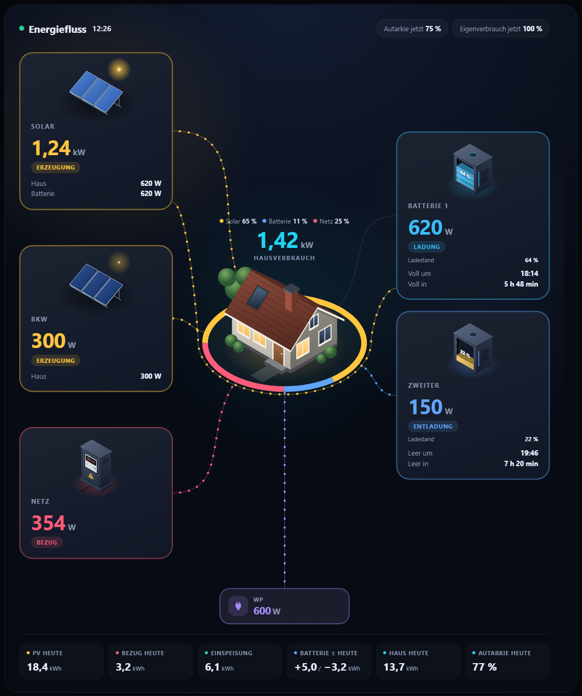

- **Das Haus** steht auf dem Ring mit dem Mix aus Solar, Batterie und Netz. Der Hausverbrauch steht darüber.
- **Solar:** Die Module sind zu sehen, bei `pv.strings` mit einer Reihe je String. Die Sonne leuchtet mit dem Ertrag.
- **Netz:** Der Zählerkasten zeigt die Leistung auf dem Display. Ein Bezug leuchtet rot, eine Einspeisung grün.
- **Speicher:** Der Füllstand steht auf der Front des Speichers. Mehrere Speicher stehen nebeneinander. Gestapelte Batterien mit einem gemeinsamen Sensor erscheinen als ein Turm mit beiden Ladeständen.
- **Linien nach den echten Wegen:** Die Linien laufen dort, wo die Energie fließt. Solar lädt einen Speicher vor dem Wechselrichter direkt (`pv_to_battery: direkt`), ein Speicher speist ins Netz, das Netz lädt den Batterie. Das Haus bekommt nur, was dort ankommt. Kann die Karte Solarstrom keinem Weg zuordnen, etwa weil Hausverbrauch-Sensor, Netz und PV zeitversetzt melden, zählt er zum Haus. So fehlt die Solar-Linie nicht.
- Die Kurzansicht (`compact`), das Handy-Layout und die Farbschemen funktionieren auch in 3D.

| Dach | Handy | Hell |
|---|---|---|
| 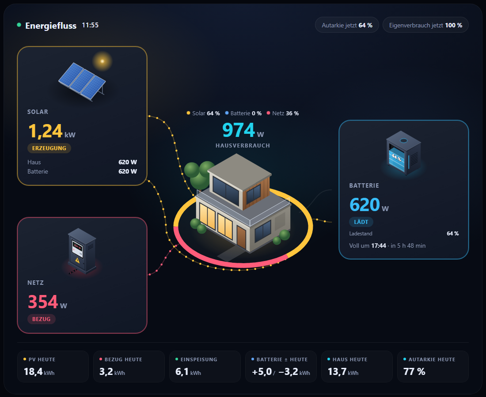 | 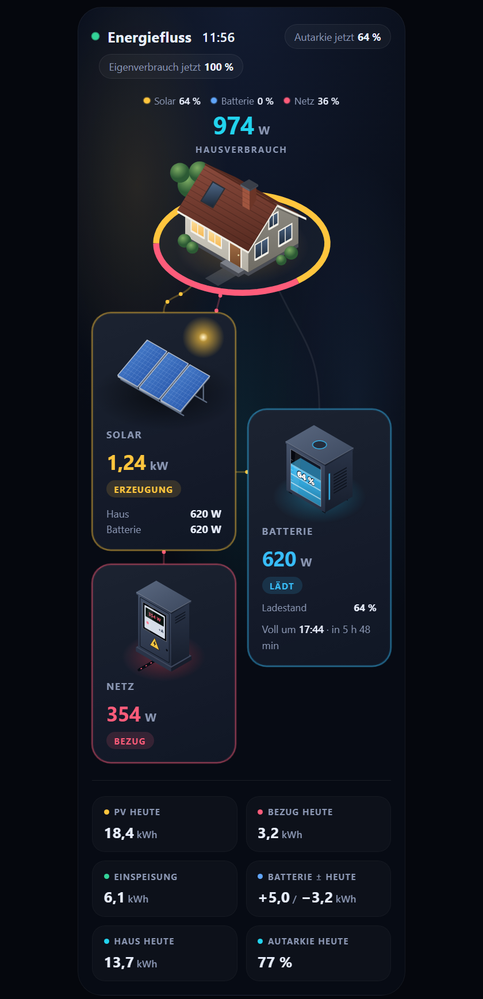 | 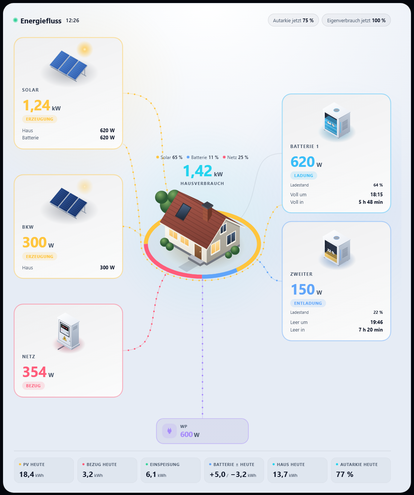 |

### Zweiter Netzzähler: `grid2`

Manche Haushalte haben einen zweiten Zähler mit eigenem Tarif, zum Beispiel für die Wärmepumpe. Er hängt nicht am Hauptzähler und kennt nur Bezug. Mit `grid2` zeigt der Energiefluss ihn als eigene Kachel bei den Verbrauchern, mit eigener Linie zum Haus und den Kosten pro Stunde zu seinem Preis.

```yaml
grid2:
  name: Wärmepumpe
  entity: sensor.waermepumpe_leistung_summe    # Leistung in Watt, bei drei Phasen die Summe
  price: input_number.preis_waermepumpe        # Preis pro kWh aus einem Sensor oder Helfer ...
  # price_ct: 25.45                            # ... oder fest in Cent pro kWh
```

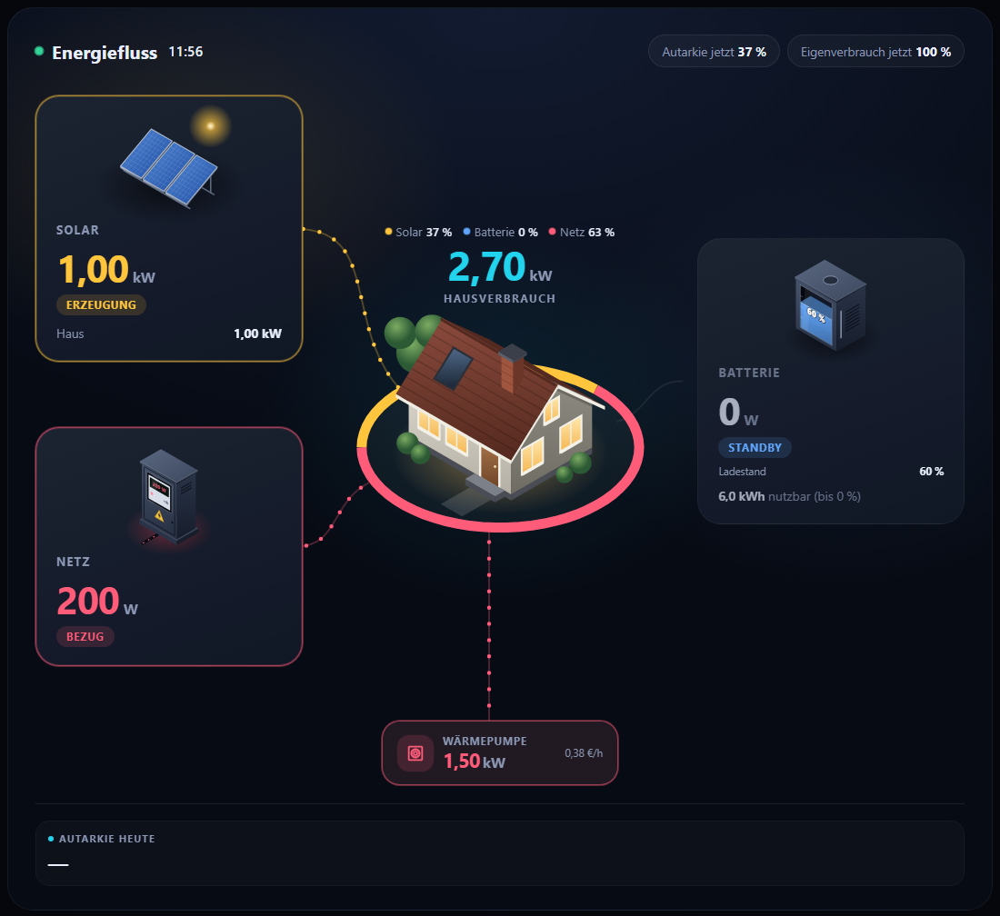

- **Hausverbrauch:** Der zweite Zähler steckt nicht im Hauptzähler. Deshalb zählt die Karte ihn zum Hausverbrauch dazu (Haus plus Wärmepumpe) und im Ring zum Netz. Die Netz-Kachel zeigt weiter nur den Hauptzähler.
- **Preis:** `price` (Sensor oder Helfer, Euro pro kWh) hat Vorrang vor `price_ct`. Ohne Preis zeigt die Kachel keine Kosten pro Stunde.
- **Mehrere Phasen:** `entity` ist ein einzelner Sensor. Bei einem dreiphasigen Zähler legst du dir in Home Assistant einen Summen-Sensor an (Helfer „Min/Max“ mit Typ „Summe“). Das Saldieren von Bezug und Einspeisung auf verschiedenen Phasen ist bei einem reinen Verbraucher wie einer Wärmepumpe nicht nötig.
- **Statistik:** Dort gibt es dazu `grid2_total` (kWh-Zähler), `grid2_name`, `grid2_price` und `grid2_price_ct`, siehe Statistik-Karte unten.
- Die Kachel steht in der Reihe der Verbraucher, nicht neben dem Netz. Ein Eintrag unter `consumers` ist dafür nicht nötig.

### Farbe der Zahl beim Haus: `home_color: source`

Standardmäßig ist die Zahl über dem Haus türkis. Mit `home_color: source` bekommt sie die Farbe der Quelle, die im Ring gerade den größten Anteil hat: gelb bei PV, blau beim Speicher, rot beim Netz. So siehst du auf einen Blick, woher der Strom gerade überwiegend kommt. Damit die Farbe nicht flackert, wechselt sie erst, wenn eine andere Quelle mindestens 5 Prozentpunkte vorn liegt. Das gilt in der flachen und in der 3D-Ansicht.

```yaml
home_color: source
```

| PV überwiegt | Netz überwiegt |
|---|---|
| 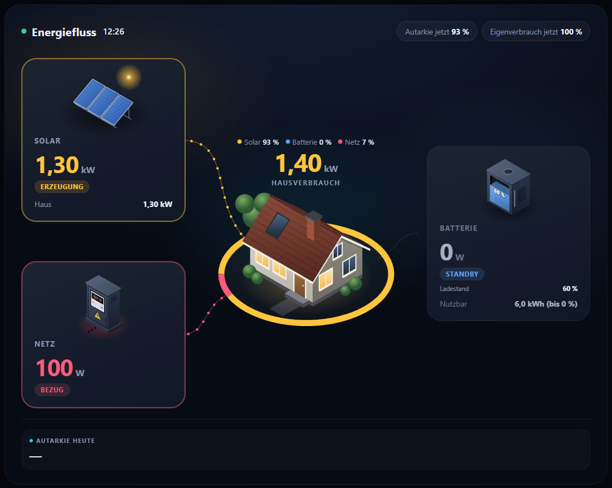 | 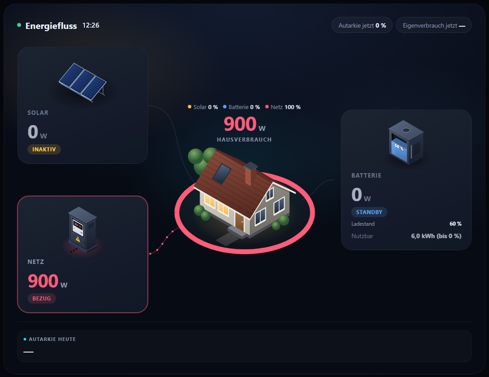 |

### Farbe des Haus-Symbols: `home_icon_color: autarkie`

Das Haus-Symbol im Ring steht in einer abgerundeten Kachel (wie die Symbole der anderen Kacheln). Standardmäßig ist es türkis. Mit `home_icon_color: autarkie` zeigt die Farbe auf einen Blick, wie unabhängig das Haus gerade vom Netz ist: **grün** bei 100 % Autarkie (kein Netzbezug), **gelb** von 50 bis 99 %, **rot** unter 50 %. Es ist dieselbe Autarkie wie „Autarkie jetzt“ oben. Ohne Verbrauch bleibt das Symbol türkis. Die Option ist aus, solange du sie nicht setzt. Anlass: [#93](https://github.com/msucimaker3112/energy-cockpit/issues/93).

```yaml
home_icon_color: autarkie
```

### Kurzansicht fürs Handy: `compact`

Eine Karte, zwei Ansichten: Mit `compact: auto` zeigt die Energiefluss-Karte auf dem Handy eine kompakte Übersicht und auf Tablet und PC weiter alle Details. Du brauchst dafür kein zweites Dashboard.

```yaml
type: custom:energy-cockpit-flow-card
compact: auto    # nur auf schmalen Bildschirmen (unter 600 px), z. B. iPhone
# compact: true  # Kurzansicht überall
```

| Handy: ausführlich (Standard) | Handy: `compact: auto` | Raum angetippt |
|---|---|---|
|  | 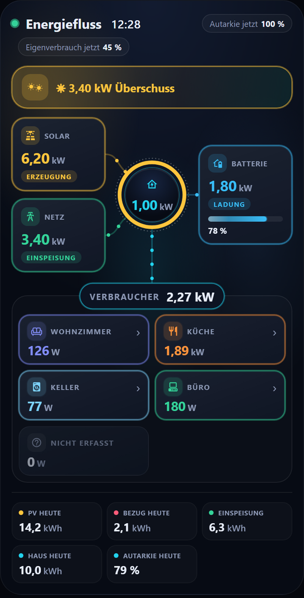 | 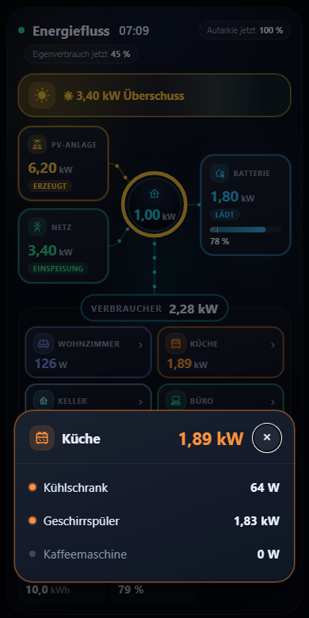 |

Was die Kurzansicht anders macht:

- Solar, Netz und Batterie stehen neben dem Ring statt darunter. Die Karte ist etwa halb so hoch.
- Gruppen zeigen nur Name und Summe. Ein **Tipp auf eine Gruppe** (Pfeil „›“) öffnet ein Fenster mit allen Geräten, ihren aktuellen Werten und der Summe. Die Werte laufen live mit, ein Tipp auf ein Gerät öffnet dessen Verlauf, „ד oder ein Tipp daneben schließt das Fenster.
- Zusatztexte entfallen: Aufteilung des Solarstroms, Prognose, Batterie-Prognose, Herkunft über dem Ring.
- Zu den Verbrauchern führt die Sammel-Linie, sofern `groups_lines` nicht gesetzt ist. `groups_columns` gilt in der Kurzansicht nicht, die Gruppen verteilen sich selbst auf die Breite.

Die Umschaltung richtet sich nach der Breite der Karte, nicht nach dem Gerätetyp. Sie gilt also auch für Android und für ein schmales Browserfenster.

### Linien zu den Verbrauchern: `groups_lines`

Mit vielen Verbrauchern laufen die einzelnen Linien eng nebeneinander und teils hinter anderen Kacheln. Die Option `groups_lines: sammel` ersetzt sie durch **eine** Linie zum ganzen Verbraucherbereich.

| Standard (`direkt`) | `sammel` |
|---|---|
| 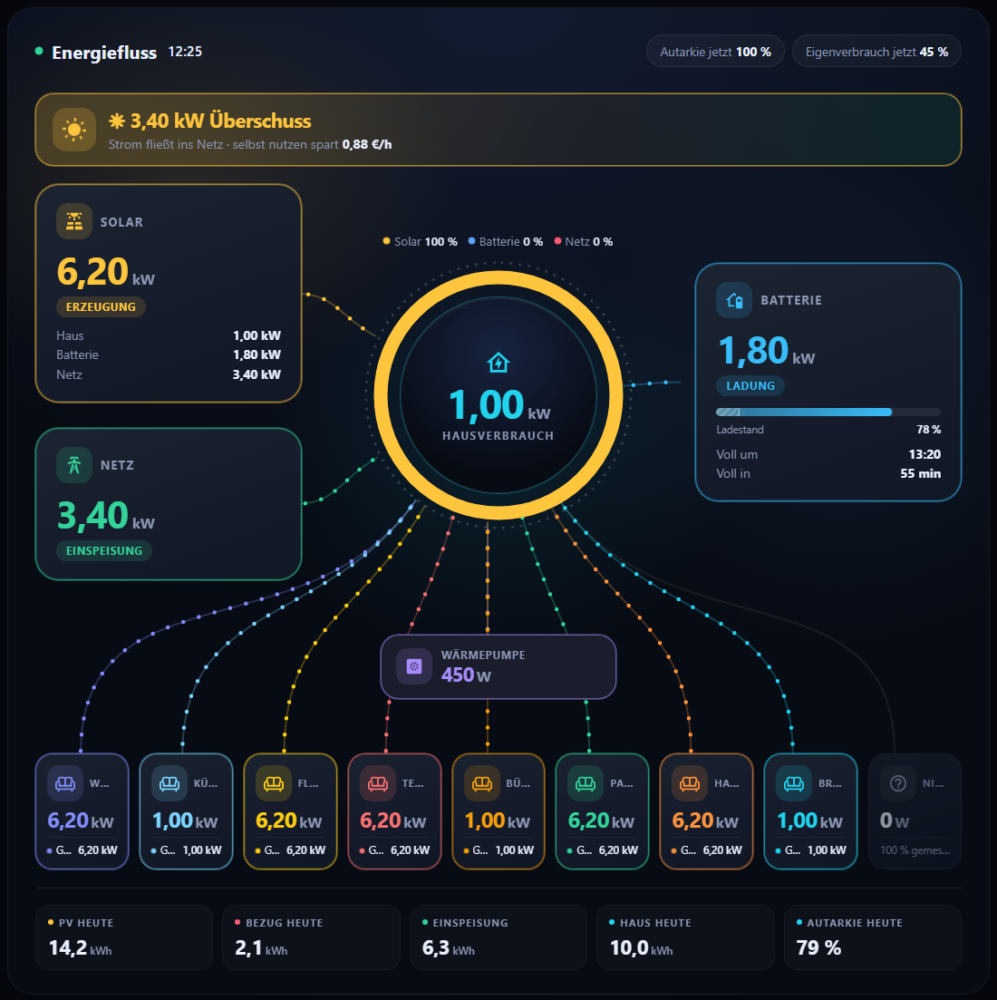 | 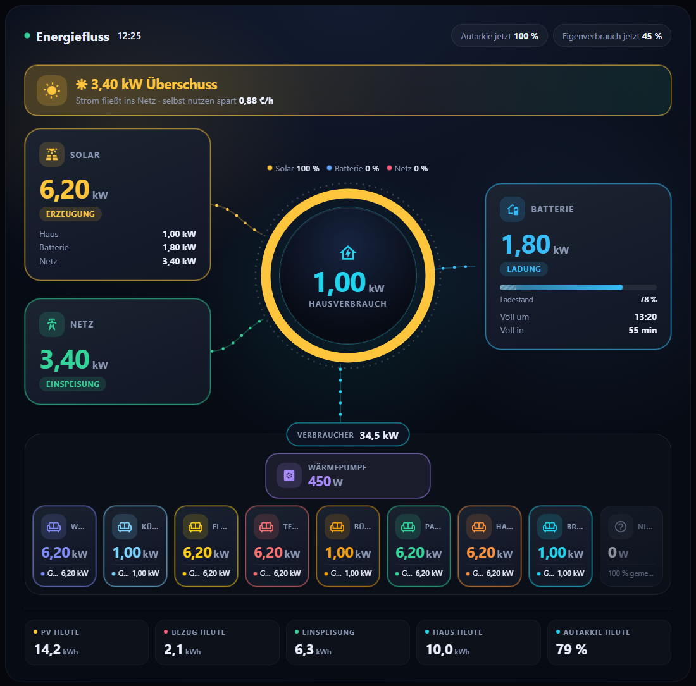 |

```yaml
type: custom:energy-cockpit-flow-card
groups_lines: sammel
```

Auf dem Handy bleibt die Linie in der Lücke zwischen den Kacheln:

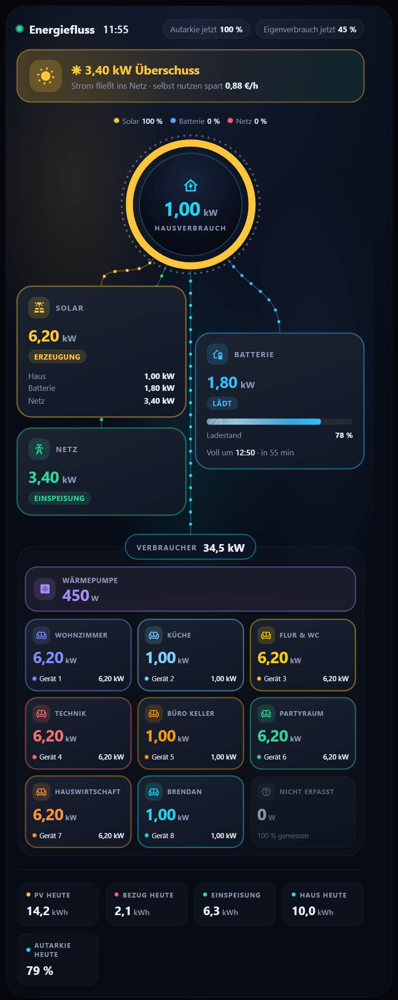

Die Summe in der Plakette ist die Summe der Messwerte der Einzelverbraucher und Gruppen. Der Anteil "nicht erfasst" ist nicht enthalten.

## Sprache, Zahlen und Uhrzeit

Die Karten sprechen **Deutsch, Englisch, Niederländisch, Französisch und Finnisch**. Englisch und Niederländisch sind vollständig. Bei **Französisch und Finnisch** fehlt noch etwa die Hälfte der Texte, sie erscheinen vorerst auf Deutsch. Welche Sprache sie zeigen, bestimmt die Sprache in deinem **Home-Assistant-Profil** (Profil → Allgemein). Jede andere Sprache zeigt Deutsch. Die Editoren und der Einrichtungsassistent bleiben deutsch.

Läuft dein Home Assistant auf Englisch, du möchtest die Karte aber auf Deutsch lesen, legst du die Sprache in der Karte fest:

```yaml
language: de        # auto (Standard), de, en, nl, fr oder fi
```

Im Assistenten steht das Feld im Schritt „Aussehen“ als **Sprache der Karte**. Jede Karte hat ihre eigene Einstellung. Mischst du Karten mit verschiedenen Sprachen auf einer Ansicht, sind Texte, die erst beim Antippen entstehen (zum Beispiel das „?“-Fenster), unter Umständen in der Sprache der zuletzt aktualisierten Karte.

**Zahlen und Uhrzeit** richten sich nach deinem Profil in Home Assistant: **Zahlenformat** („1.234,5“, „1,234.5“ oder „1 234,5“) und **Uhrzeitformat** (12 oder 24 Stunden). Steht dort „Sprache“, gilt das Format der Kartensprache. Ohne Eintrag ändert sich für dich nichts, wenn Home Assistant auf Deutsch läuft.

Die Übersetzungen sind ein erster Durchgang. Dank an [@aavdberg](https://github.com/aavdberg) (Umschaltung, Englisch, Niederländisch), [@bartjackbakker](https://github.com/bartjackbakker) (Prüfung Niederländisch), Shadowspocket (Französisch, [#39](https://github.com/msucimaker3112/energy-cockpit/pull/39)) und [@omcberry](https://github.com/omcberry) (Finnisch, [#30](https://github.com/msucimaker3112/energy-cockpit/issues/30)). Verbesserungen sind willkommen, am liebsten als kleiner Pull Request für die Dateien `src/i18n-en.js`, `src/i18n-nl.js`, `src/i18n-fr.js` und `src/i18n-fi.js`. Welche Texte in einer Sprache noch fehlen, zeigt `npm run missing -- fr` (oder `fi`).
