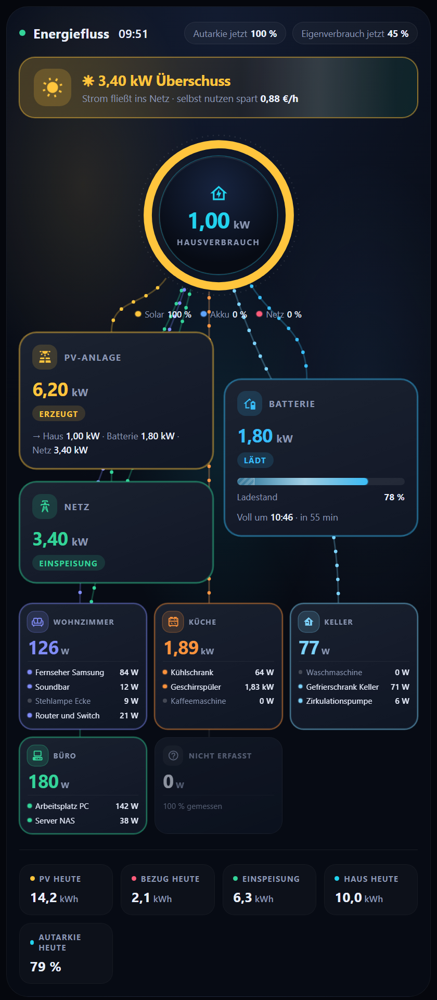
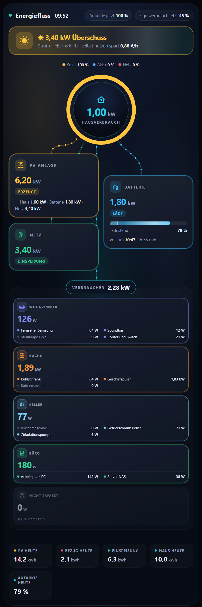
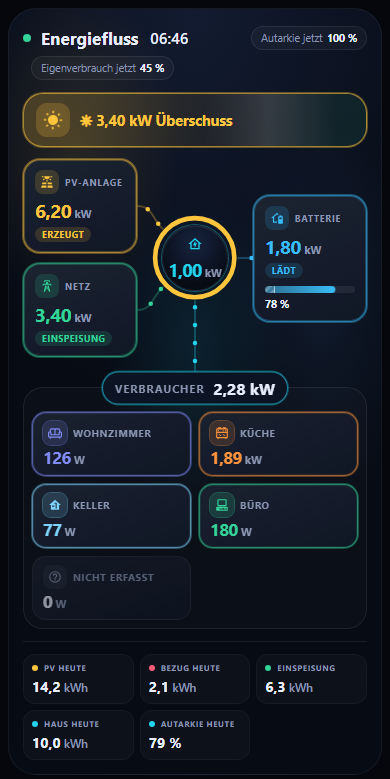
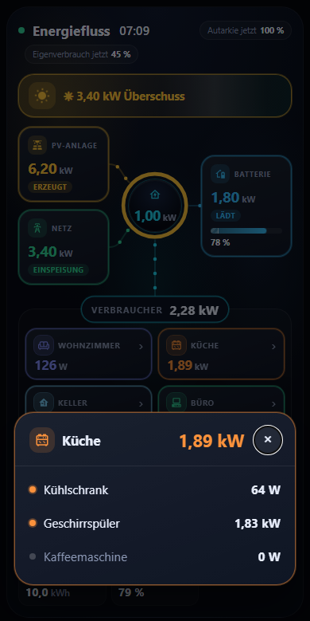
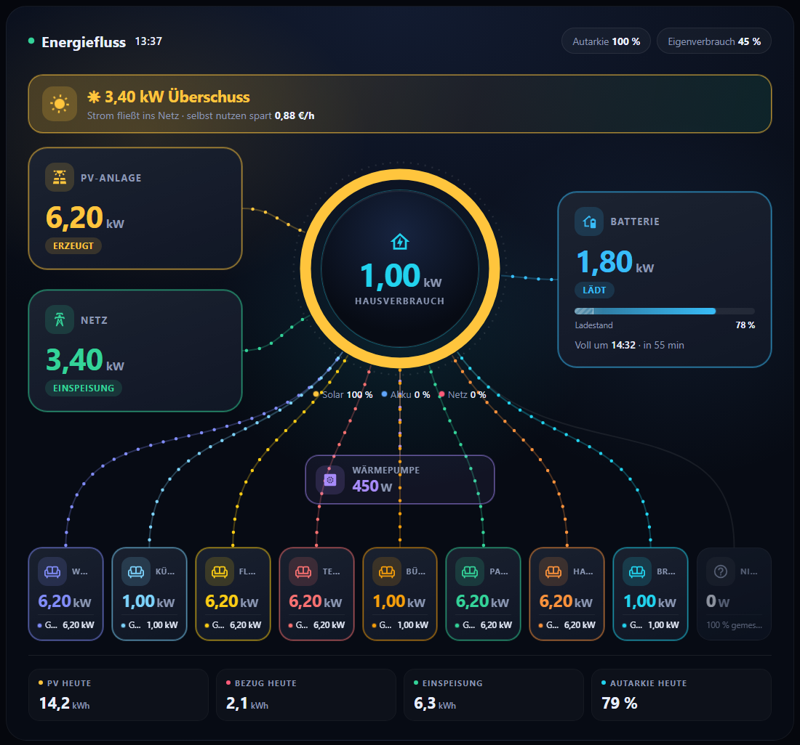
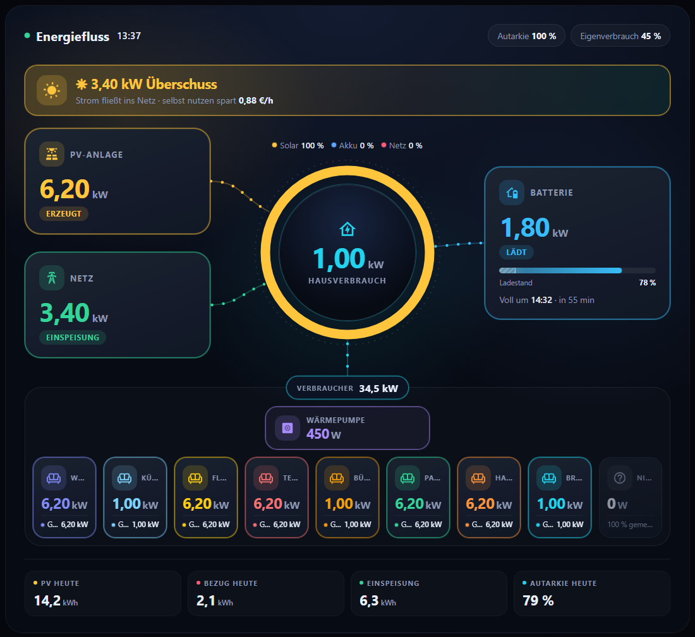
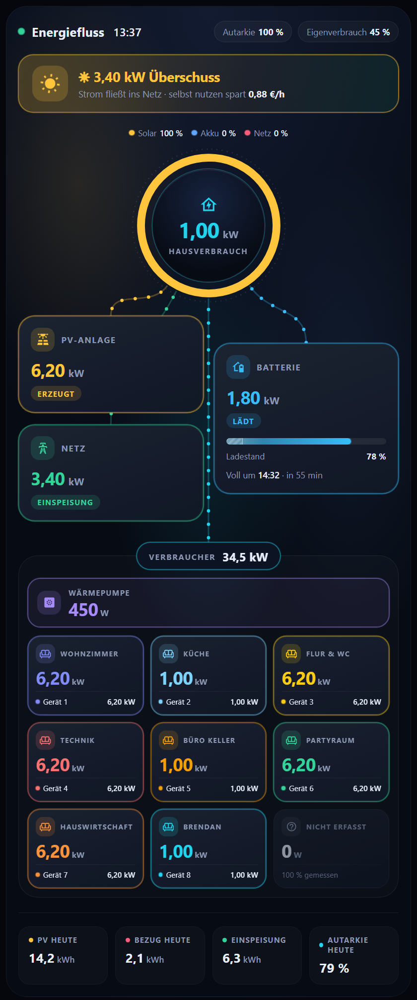

# Konfiguration

Alle Karten lassen sich im grafischen Editor einstellen. Erweiterte Optionen stehen nur im YAML-Editor. Beim Speichern aus dem Editor bleiben unbekannte YAML-Schlüssel erhalten.

Konventionen: `entity` = Sensor-ID (z. B. `sensor.pv_leistung`). Leistung in W, kW oder MW, Energie in Wh, kWh oder MWh: Die Karten lesen die Einheit des Sensors und rechnen selbst in W und kWh um. Sensoren ohne Einheit gelten als W bzw. kWh.

`energy_unit` (alle Karten, Standard `auto`): Mit `energy_unit: kwh` nimmt die Karte Energiewerte ungeprüft als kWh, wie vor Version 0.12.2. Nur nötig, wenn ein Sensor eine falsche Einheit meldet.

---

## Energiefluss: `custom:energy-cockpit-flow-card`

Mindestens `pv` **oder** `grid` ist nötig.

### Quellen

| Schlüssel | Typ | Beschreibung |
|---|---|---|
| `title` | Text | Überschrift (Standard "Energiefluss") |
| `pv.entity` | Sensor | PV-Leistung |
| `pv.name`, `pv.icon` | Text | Anzeigename, Symbol (`mdi:…`) |
| `pv.daily` | Sensor | Tagesertrag in kWh |
| `pv.daily_ac` | `true` / `false` (Standard) | Für Hybrid-Wechselrichter, deren Tagesertrag nur die Abgabe des Wechselrichters zählt: Was direkt aus den Modulen in den Akku geht, fehlt darin. Die Karte rechnet dann "PV heute" als Tagesertrag + Geladen heute − Entladen heute, und auch "Haus heute" und "Autarkie heute" stimmen. Zeichen für diesen Fall: "Autarkie heute" steht bei 0 % und "Haus heute" ist viel zu niedrig. Braucht `daily_charge` und `daily_discharge` beim Speicher und gilt für alle Speicher ohne `behind_meter` |
| `pv.forecast` | Sensor | Prognose-Leistung (z. B. Solcast) |
| `pv.strings` | Liste | Teilstränge `{entity, name}` |
| `grid.entity` | Sensor | Netzleistung (Bezug positiv) |
| `grid.invert` | Ja/Nein | Vorzeichen umkehren |
| `grid.daily_import`, `grid.daily_export` | Sensor | Bezug / Einspeisung heute (kWh) |
| `daily_from_total` | `true` / `false` (Standard) | Alle Tageswerte (`pv.daily`, `pv2.daily`, `grid.daily_import`, `grid.daily_export`, `daily_charge`, `daily_discharge`, `home.daily`) kommen aus **Gesamtzählern**, auch in Wh. Die Karte berechnet den Wert von heute aus der Langzeitstatistik, wie das Energie-Dashboard. Die Sensoren brauchen `state_class: total_increasing` (oder `total`). Ohne Statistik zeigt die Kachel "—". Fällt die Abfrage ganz aus, gilt der Sensorwert wie bisher |
| `batteries` | Liste von Speichern | Weitere Speicher: `battery` ist der erste Speicher, `batteries` enthält die weiteren (zweiter, dritter …). Wer alle Speicher in `batteries` führen will, lässt `battery` weg. Jeder Eintrag hat dieselben Felder wie `battery` (`name`, `power` oder `power_charge`/`power_discharge`, `soc`, `capacity_kwh`, `reserve_pct`/`max_pct`, `daily_charge`, `daily_discharge`, `invert`, `tap`, `soc_display`). Es erscheint **eine Kachel je Speicher** mit eigenem Status, Ladebalken und eigener Prognose. Ring, Autarkie, Banner und Tageswerte rechnen mit der Summe (Ladestand als nach Kapazität gewichteter Mittelwert). Ohne `batteries` gilt der einzelne Eintrag `battery` wie bisher. Im Assistenten (Schritt "Weitere Speicher") und im Formular (Alle Felder) einstellbar. Auf dem Handy: `compact: auto` zeigt die Speicher in der Kurzansicht übersichtlich |
| `battery.tap` | `power` (Standard) / `soc` | Was ein Klick auf die Kachel öffnet: Verlauf der Leistung oder des Ladestands. Ein Klick auf Balken und Prozentzahl öffnet immer den Ladestand |
| `battery.power` | Sensor | Laden positiv, Entladen negativ |
| `battery.power_charge`, `battery.power_discharge` | Sensoren | Statt `power`: zwei getrennte Sensoren für Laden und Entladen (beide positiv). Die Karte rechnet Laden minus Entladen |
| `pv_to_battery` | `direkt` / `aus` (Standard) | Speicher vor dem Wechselrichter (z. B. Marstek B2500): Die Solarmodule hängen am Speicher, der Strom läuft immer durch ihn. Siehe [Speicher vor dem Wechselrichter](#speicher-vor-dem-wechselrichter) |
| `battery.power_out` | Sensor | Nur mit `pv_to_battery: direkt`: Leistung, die der erste Speicher ans Haus abgibt |
| `pv.forecast` | Sensor | Prognose in W/kW (zeigt "Prognose 6,0 kW") oder Tagesprognose in kWh (zeigt "Prognose heute 6,0 kWh"), z. B. Solcast |
| `battery.soc` | Sensor | Ladestand in % |
| `battery.invert` | Ja/Nein | Vorzeichen umkehren |
| `battery.capacity_kwh` | Zahl | Kapazität für die Prognose "voll um / reicht bis" |
| `battery.reserve_soc`, `battery.max_soc` | Sensor oder Helfer (Zahl-Entität) | Entladegrenze und Maximalladung der Batterie in %. Der Sensor heißt bei jedem Wechselrichter anders, deshalb frei wählbar (zum Beispiel "Entlade-Ende-Ladestand") |
| `battery.reserve_pct`, `battery.max_pct` | Zahl | Alternative ohne Sensor: fester Wert in %, zum Beispiel `10`, wenn die Batterie nur bis 10 % entladen wird. Ein Sensor hat Vorrang |
| `animations` | `auto` (Standard), `always` | `auto`: Ist am Gerät "Bewegung reduzieren" eingeschaltet, stehen Linien, Ring und das Leuchten von Kacheln und Symbolen still, und die Zahlen zählen nicht hoch. `always`: immer animieren. Unabhängig davon rechnet die Karte höchstens einmal pro Sekunde neu, und Zahlen zählen nur bei großen Sprüngen hoch |
| `text_size` | `normal` (Standard), `gross`, `sehr_gross` | Vergrößert die kleinen Texte (Ladestand, Kennzahlen oben rechts, Beschriftungen). Gut für Handy und Tablet |
| `rest_min` | Zahl in % | Zeigt die Kachel "Nicht erfasst" erst, wenn mindestens so viel Prozent des Hausverbrauchs keiner Gruppe zugeordnet sind (zum Beispiel `10`). Standard: immer anzeigen |
| `hide_rest` | `true` / `false` | Blendet die Kachel "Nicht erfasst" unter den Gruppen aus. Sie zeigt den Hausverbrauch, der keiner Gruppe zugeordnet ist (Hausverbrauch minus Summe der Gruppen). Mit `rest.name` lässt sich ihre Beschriftung ändern |
| `groups_columns` | Zahl | Gruppen pro Reihe. Standard: alle Gruppen nebeneinander in einer Reihe (auf dem Handy drei). `1` stellt jede Gruppe in eine eigene Reihe über die volle Breite, die Einträge verteilen sich dann auf mehrere Spalten und die Namen bleiben lesbar. Stehen Gruppen untereinander und ist `groups_lines` nicht gesetzt, zeichnet die Karte die Sammel-Linie, damit keine Linie durch andere Gruppen läuft |
| `groups_lines` | `direkt` (Standard) oder `sammel` | Linien zu Einzelverbrauchern und Gruppen. `sammel` zeichnet nur **eine** Linie vom Ring zu einer Plakette "Verbraucher" mit der Summe und fasst den Bereich in einem Rahmen zusammen. Die Kacheln zeigen ihre Aktivität weiter mit Farbrand und Wert, bekommen aber keine eigene Linie. Gut bei vielen Geräten, auch auf dem Handy |
| `battery.soc_display` | `brutto` (Standard) oder `nutzbar` | `nutzbar` zeigt den Ladestand relativ zum nutzbaren Bereich (0 % = Entladegrenze, 100 % = Maximalladung). Mit `brutto` bleibt die Anzeige wie die Batterie, die Grenzen erscheinen als schraffierte Bereiche auf dem Balken |
| Gemeinsamer Sensor (gestapelte Akkus) | gleicher Sensor bei mehreren Speichern | Trage bei allen Speichern denselben Sensor ein, jeder mit eigenem `soc` und `capacity_kwh`. Die Leistung zählt nur einmal und steht beim ersten Speicher, die übrigen zeigen `—` und denselben Status. Die Prognose teilt die Leistung nach Kapazität auf, das ist eine Schätzung |
| `battery.daily_charge`, `battery.daily_discharge` | Sensor | geladen / entladen heute (kWh). Ohne diese Werte zählt der Akku bei "Autarkie heute" nicht als eigener Strom |
| `temp` (in `battery` oder je Eintrag in `batteries`) | Sensor | Temperatur des Speichers, frei wählbar. Steht in der Kachel unter dem Ladestand, ein Tipp öffnet den Verlauf. Ohne Eintrag erscheint keine Zeile |
| `behind_meter` (in `battery` oder je Eintrag in `batteries`) | `true` / `false` (Standard) | Speicher hinter dem Zähler, den der Wechselrichter oder Netzzähler nicht kennt, zum Beispiel an der Steckdose. Er behält seine Kachel, die Karte rechnet ihn aber nicht aus dem Hausverbrauch heraus. Seine Ladung zählt also als Verbrauch, seine Abgabe senkt ihn, sobald Netz- und Wechselrichterwerte das zeigen. Ring, Autarkie und die Tageswerte für Autarkie und Haus rechnen ohne ihn. Nicht zusammen mit `pv_to_battery: direkt` gedacht |
| `home.entity`, `home.name` | Sensor, Text | Hausverbrauch (sonst berechnet). Bei einem negativen Sensorwert rechnet die Karte den Verbrauch selbst |
| `home.daily` | Sensor | Hausverbrauch heute (kWh) für die Kachel "Haus heute". Ohne Angabe berechnet die Karte ihn aus PV-Ertrag, Bezug, Einspeisung und Batterie heute (sobald `pv.daily` und `grid.daily_import` gesetzt sind) |
| `grid_price`, `feed_in` | Sensor, `input_number` oder Zahl | Preis je kWh (Euro) für Kostenangaben |
| `theme` | Text | Farbschema: `dunkel` (Standard), `graphit`, `hell`, `warm`, `auto` (folgt dem Home-Assistant-Design hell/dunkel) oder `ha` (Farben des HA-Designs). Gilt für alle vier Karten |
| `accent` | Text | Nur Raum-Abrechnung: Akzentfarbe als `R,G,B` oder `#rrggbb` |
| `grid_price_ct`, `feed_in_ct` | Zahl | Alternative ohne Sensor: fester Preis in **Cent** pro kWh, zum Beispiel `34`. Gilt, wenn `grid_price` oder `feed_in` nicht gesetzt ist (Energiefluss, Geräte & Verbrauch, Statistik) |

### Tagesertrag von Hybrid-Wechselrichtern

Manche Hybrid-Wechselrichter zählen im Tagesertrag nur, was sie abgeben. Was direkt aus den Modulen in den Akku geht, fehlt darin. Standardmäßig zieht die Karte die Akku-Ladung vom Tagesertrag ab, bei diesen Anlagen also doppelt.

So erkennst du den Fall:

- "Autarkie heute" steht bei 0 % oder ist viel zu niedrig, obwohl die Anlage heute viel erzeugt hat.
- "Haus heute" ist viel zu niedrig, oft sogar kleiner als "Bezug heute", obwohl der Akku nicht aus dem Netz lädt.
- Der Tagesertrag ist kleiner als "Einspeisung" und "Geladen heute" zusammen.

Dann hilft diese Einstellung, im Assistenten im Schritt "Solar" unter "Tagesertrag zählt ohne Akku-Ladung":

```yaml
pv:
  entity: sensor.pv_leistung
  daily: sensor.pv_tagesertrag
  daily_ac: true
battery:
  daily_charge: sensor.akku_geladen_heute
  daily_discharge: sensor.akku_entladen_heute
```

Die Karte rechnet damit so:

| Kachel | Rechnung mit `daily_ac: true` |
|---|---|
| PV heute | Tagesertrag + Geladen heute − Entladen heute |
| Haus heute | Tagesertrag + Bezug heute − Einspeisung heute |
| Autarkie heute | 1 − Bezug heute / Haus heute |

Beispiel: Tagesertrag 7,2 kWh, Bezug 6,0 kWh, Einspeisung 3,3 kWh, Akku geladen 6,8 kWh. Ohne die Einstellung ergibt das 3,1 kWh im Haus und 0 % Autarkie. Mit ihr sind es 14,0 kWh PV, 9,9 kWh im Haus und 39 % Autarkie.

Die Einstellung gilt für alle Speicher ohne `behind_meter`. Ein weiterer Speicher mit eigenem Wechselrichter wird dabei nicht getrennt betrachtet. Ein eigener Sensor `home.daily` ersetzt nur die Kachel "Haus heute", nicht die Rechnung für die Autarkie.

### Speicher vor dem Wechselrichter

**Wofür:** Bei Balkonkraftwerken mit Speicher (zum Beispiel Marstek B2500) hängen die Solarmodule direkt am Speicher. Der Solarstrom geht immer zuerst durch den Speicher und von dort ins Haus, auch wenn er voll ist (Durchleitung). Mit `pv_to_battery: direkt` zeichnet die Karte den Weg **Solar → Speicher → Haus**. Ohne die Option bleibt alles wie bisher.

```yaml
type: custom:energy-cockpit-flow-card
pv_to_battery: direkt
pv:
  entity: sensor.speicher_solar_eingang      # Leistung der Module am Speicher
grid:
  entity: sensor.zaehler_wirkleistung        # Shelly, Bitshake o. Ä. im Zählerschrank
battery:
  name: Marstek B2500
  power_out: sensor.speicher_ausgangsleistung # was der Speicher ans Haus abgibt
  soc: sensor.speicher_ladestand
  capacity_kwh: 2.24
```

**Was die Karte daraus rechnet** (nur aus Solar-Eingang und Ausgang des Speichers):

- Laden = Solar-Eingang minus Ausgang, Entladen = Ausgang minus Solar-Eingang. Einen eigenen Leistungssensor (`power`) brauchst du nicht, du kannst ihn aber angeben, dann gilt er.
- Der Hausverbrauch ergibt sich ohne eigenen Sensor aus Netz plus Ausgang des Speichers.
- Die Herkunft des Hausstroms zählt als **Solar**, soweit der Ausgang vom Solar-Eingang gedeckt ist, den Rest als Batterie. Bei vollem Speicher mit Durchleitung steht dort also Solar und nicht null Prozent.
- Die Solar-Kachel zeigt `→ Speicher`, weil der ganze Solarstrom zuerst in den Speicher geht. Der Speicher zeigt Eingang und Ausgang, bei Einspeisung auch die Aufteilung des Ausgangs auf Haus und Netz, und `Durchleitung`, wenn er weder lädt noch entlädt.

**Wichtig:** Die Option gilt für den **ersten** Speicher (`battery`). Ohne `power_out` oder ohne `pv.entity` bleibt die normale Darstellung. Auf dem Handy ist die Kurzansicht (`compact: auto`) am übersichtlichsten. Die Annahme "Solar zuerst ins Haus, der Rest lädt" entspricht Speichern mit Durchleitung. Sie wurde an echten Anlagen mit Balkonkraftwerk und Speicher getestet ([#15](https://github.com/msucimaker3112/energy-cockpit/issues/15)). Trag `power` und `power_charge` nur ein, wenn die Sensoren wirklich Laden und Entladen messen: `power` hat Vorrang vor der Rechnung aus Eingang und Ausgang.

### Verbraucher

Im grafischen Editor findest du die Abschnitte **Einzelverbraucher** (bis zu 8) und **Gruppen** (bis zu 6 mit je bis zu 8 Verbrauchern). Gespeichert werden sie als Liste oder als nummerierte Einträge, beides funktioniert. Mehr Einträge sind im YAML-Editor möglich.

```yaml
consumers:
  - entity: sensor.waermepumpe_leistung
    name: Wärmepumpe
    icon: mdi:heat-pump
    color: "#a78bfa"
    secondary: sensor.waermepumpe_temperatur   # Zusatzwert
    secondary_decimals: 1
    on_w: 3                                    # aktiv (Rahmen, Linie) ab 3 W, Standard 10 W
```

`on_w` gibt es auch für Gruppen und ihre Einträge. Damit bekommt zum Beispiel eine Zirkulationspumpe mit 6 W einen Rahmen.

**Differenz-Verbraucher (optional, z. B. Zählerkaskade):** Mit `minus` rechnet die Karte `entity − minus`, nie negativ. `minus` darf auch eine **Liste** sein (mehrere Unterzähler). Mit `plus` (ebenfalls Sensor oder Liste) wird noch etwas dazugerechnet. `minus` und `plus` gibt es für Einzelverbraucher und für Einträge in Gruppen, im Assistenten als "Davon abziehen". Ohne `minus` ändert sich nichts. Beschreibung mit Aufbauten und Beispiel: [Zähler in Reihe](ZWEI-ZAEHLER.md#direkt-in-der-karte-option).

Zweite Solaranlage, zum Beispiel ein Balkonkraftwerk mit eigenem Sensor:

```yaml
pv:
  entity: sensor.pv_leistung        # große Anlage (lädt die Batterie)
  name: Dach
pv2:
  entity: sensor.bkw_leistung       # Balkonkraftwerk (speist direkt ins Hausnetz)
  name: Balkonkraftwerk
  daily: sensor.bkw_heute           # optional, wird zum Tagesertrag addiert
  add_to_home: false                # true, wenn dein Hausverbrauchs-Sensor das BKW NICHT enthält
```

Die Karte zeigt eine eigene Kachel mit eigener Linie. Autarkie, Eigenverbrauch und die Herkunft im Ring rechnen mit der Summe beider Anlagen. Die zweite Anlage deckt zuerst das Haus, die erste lädt danach die Batterie und speist ein.

Gruppen (mehrere Verbraucher je Raum) und der Rest "nicht erfasst":

```yaml
consumer_groups:
  - name: Keller
    icon: mdi:pipe-valve
    color: "#f87171"
    items:
      - entity: sensor.umwaelzpumpe_leistung
        name: Umwälzpumpe
      - name: Warmwasser            # nur Zusatzwert
        secondary: sensor.boiler_temperatur
rest:                               # false = ausblenden
  name: Nicht erfasst
```

Gruppen untereinander, eine pro Reihe (`groups_columns: 1`):

```yaml
groups_columns: 1      # 2 = zwei Gruppen pro Reihe; ohne Angabe alle nebeneinander
```

| Standard | `groups_columns: 1` |
|---|---|
|  |  |

Textgröße und Kachel "Nicht erfasst" (Bilder: `docs/img/text-*.png`, `docs/img/rest-ab-10.png`):

```yaml
text_size: gross       # normal | gross | sehr_gross
rest_min: 10           # "Nicht erfasst" erst ab 10 % des Hausverbrauchs
hide_rest: false       # true blendet die Kachel immer aus
```

Die Netz-Kachel zeigt "Bezug" oder "Einspeisung" ab 0,5 W Leistung und "Ausgeglichen" nur, wenn praktisch nichts fließt.

### Überschuss und Netzalarm

```yaml
surplus:
  enabled: true
  threshold: 1500      # W Überschuss, ab dem das Banner erscheint
  delay: 60            # Sekunden stabil, bevor es erscheint
  suggestions:
    - name: Waschmaschine
      icon: mdi:washing-machine
      power: 2000      # nur anzeigen, wenn genug Überschuss
    - name: Auto laden
      icon: mdi:car-electric
      entity: sensor.wallbox_leistung
      running: Auto lädt
grid_alert:
  enabled: true
  threshold: 1000
  delay: 120
```

### Abfallkalender-Hinweis

```yaml
waste:
  calendar: calendar.abfall
  day_switch: "10:00"     # ab dann Hinweis für morgen
  remind_from: "16:00"    # ab dann auffällig
  nav_path: /lovelace/abfall
  types:
    - { match: rest, name: Restmüll, color: "156,163,175" }
    - { match: gelb, name: Gelber Sack, color: "250,204,21" }
```

### Darstellung

| Schlüssel | Standard | Beschreibung |
|---|---|---|
| `show_clock` | `true` | Uhr im Kopf |
| `fit_screen` | `true` | auf Bildschirmhöhe skalieren (Statistik: nicht auf dem Handy) |
| `compact` | `false` | Kurzansicht für den schnellen Blick: Solar, Netz und Batterie stehen neben dem Ring, Gruppen ohne Geräteliste, ohne Zusatztexte (Aufteilung, Prognose, Herkunft). `auto`: nur auf schmalen Bildschirmen unter 600 px (Handy), Tablet und PC zeigen weiter alles. `true` (oder `immer`): überall. Ein Tipp auf eine Gruppe öffnet ein Fenster mit allen Geräten der Gruppe und ihren aktuellen Werten. Ist `groups_lines` nicht gesetzt, zeichnet die Kurzansicht die Sammel-Linie, `groups_columns` gilt in der Kurzansicht nicht |
| `watt_only` | `false` | `true`: Leistung immer in Watt (zum Beispiel 2.350 W) statt ab 1000 W in kW |
| `fit_margin` | `8` | Abstand unten in Pixel |
| `keep_awake` | `auto` | `true`/`false`/`auto`: Bildschirm wach halten (Echo Show, Silk) |
| `nav_path`, `nav_label` | | Schaltfläche zur nächsten Ansicht |

---

## Geräte & Verbrauch: `custom:energy-cockpit-devices-card`

```yaml
type: custom:energy-cockpit-devices-card
title: Geräte & Verbrauch
home: sensor.hausverbrauch
grid_price: input_number.strompreis
feed_in: input_number.einspeiseverguetung
surplus: sensor.pv_ueberschuss
standby_w: 15
home_energy:                       # für Strommix je Zeitraum
  pv: sensor.pv_gesamt_kwh
  import: sensor.netzbezug_gesamt_kwh
  export: sensor.einspeisung_gesamt_kwh
  charge: sensor.batterie_geladen_kwh
  discharge: sensor.batterie_entladen_kwh
rooms:
  - name: Küche
    icon: mdi:silverware-fork-knife
    devices:
      - name: Kühlschrank
        type: fridge
        entity: switch.kuehlschrank
        power: sensor.kuehlschrank_leistung
        energy: sensor.kuehlschrank_energie
        lock: true                 # nur Anzeige
```

### Geräteoptionen

| Schlüssel | Beschreibung |
|---|---|
| `name`, `icon`, `color` | Anzeige |
| `type` | `plug` (Standard), `light`, `pump`, `fridge`, `dryer`, `ac`, `strip`, `tv`, `media`, `console`, `coffee`, `heat` |
| `entity` | Schalter (`switch`, `light`, `input_boolean`) oder Binärsensor |
| `power`, `energy` | Leistungs- und Energiesensor (kWh) |
| `max_w` | Leistung für voll ausgeschlagenen Balken |
| `run_w` | ab dieser Leistung gilt das Gerät als laufend (Standard 3 W) |
| `run_state` | Sensor, dessen Zustand `run` bedeutet "läuft" |
| `lock` | `true`: nicht schaltbar |
| `shared` | `true`: nicht in die Summe aufnehmen |
| `since` | Startdatum des Zählers (ISO), falls die Steckdose früher etwas anderes maß |
| `pv_w` | Leistung, ab der "jetzt mit Sonne laufen lassen" angezeigt wird |
| `channels` | Mehrere Schalter hinter einem Gerät `[{name, entity}]` |
| `info`, `extra`, `extra_unit` | Zusatzzustände anzeigen |
| `on_w`, `toggle`, `mute`, `tv`, `players`, `ambilight` | Mediencenter-Funktionen (TV, Ambilight, Szenen) |

Zusätzliche Verbraucher ohne Kachel, die in Summe und Rangliste zählen:

```yaml
extra_consumers:
  - name: Wallbox
    entity: sensor.wallbox_leistung
    energy: sensor.wallbox_energie
    color: "167,139,250"
```

---

## Statistik: `custom:energy-cockpit-stats-card`

```yaml
type: custom:energy-cockpit-stats-card
title: Statistik
pv_total: sensor.pv_gesamt_kwh
grid_import_total: sensor.netzbezug_gesamt_kwh
grid_export_total: sensor.einspeisung_gesamt_kwh
battery_charge_total: sensor.batterie_geladen_kwh      # bei mehreren Speichern auch als Liste: [sensor.a, sensor.b]
battery_discharge_total: sensor.batterie_entladen_kwh
battery_capacity_kwh: 7.5
battery_temp: sensor.batterie_temperatur
pv_today: sensor.pv_heute
import_today: sensor.bezug_heute
export_today: sensor.einspeisung_heute
charge_today: sensor.batterie_geladen_heute
discharge_today: sensor.batterie_entladen_heute
home_power: sensor.hausverbrauch          # für die Grundlast nachts
grid_price: input_number.strompreis
feed_in: input_number.einspeiseverguetung
investment_eur: 18000                      # Anschaffungskosten in Euro für die Amortisation ...
# investment: input_number.anschaffung_pv  # ... oder aus einem Sensor oder Helfer
# earned_before_eur: 1200                  # vor Beginn der Zähler bereits erwirtschaftet (wird addiert)
# earned_before: input_number.pv_vorher     # ... oder aus einem Sensor oder Helfer
# long_term: true                           # Langzeit-Ansicht, siehe unten
```

Pflicht sind `pv_total`, `grid_import_total` und `grid_export_total`. Alles andere blendet die jeweilige Anzeige ein. Ohne Preise zeigt die Karte keine Geldwerte, ohne `investment_eur` (fester Betrag) oder `investment` (Sensor oder Helfer) keine Amortisation.

### Kosten je Verbraucher (optional)

Zeigt je Verbraucher die Netzkosten und was Solar und Akku gespart haben, in den Reitern Heute, Woche, Monat und Jahr. Einrichten geht im Assistenten im Schritt *Kosten* (bis zu vier Verbraucher), unter "Alle Felder" oder in YAML. Ohne Eintrag erscheinen weder der Bereich noch der Reiter Woche.

```yaml
pv_ac: true                     # nur bei Hybrid-Wechselrichtern, siehe unten
cost_consumers:
  - name: E-Auto
    icon: mdi:car-electric
    color: "#a78bfa"
    power: sensor.wallbox_leistung     # optional: zeigt die Leistung und die Kosten pro Stunde
    grid: sensor.ev_energie_netz       # gemessen: je ein Zähler für Netz, Akku und PV
    battery: sensor.ev_energie_akku
    pv: sensor.ev_energie_pv
  - name: Warmwasser
    icon: mdi:water-boiler
    color: "#38bdf8"
    power: sensor.boiler_leistung
    energy: sensor.boiler_energie      # ein Zähler: Aufteilung nach dem Mix des Hauses
```

| Feld | Bedeutung |
|---|---|
| `energy` | Zähler in kWh. Die Karte teilt den Verbrauch jeder Stunde so auf, wie das Haus in dieser Stunde versorgt wurde. Das ist eine Schätzung: Ein Gerät, das gezielt mit Überschuss läuft, hat in Wahrheit mehr PV-Anteil |
| `grid`, `battery`, `pv` | Eigene Zähler je Quelle in kWh. Dann misst die Karte statt zu schätzen |
| `power` | Leistung. Läuft das Gerät, steht dort die Leistung und "bis x €/h": die Kosten pro Stunde, wenn alles aus dem Netz käme |
| `on_w` | Ab welcher Leistung das Gerät als laufend gilt (Standard 10 W) |
| `name`, `icon`, `color` | Anzeige. Ohne `icon` und `color` wählt die Karte sie selbst, das Symbol nach dem Namen |

- **Netzkosten** = Anteil aus dem Netz × Strompreis (`grid_price` oder `grid_price_ct`). **Gespart** = Anteil aus Solar und Akku × Strompreis. Entgangene Einspeisevergütung ist darin nicht abgezogen.
- Der Reiter **Woche** zählt ab Montag. Er zeigt auch die Geldwerte und die Autarkie oben für diese Woche.
- **Preis je Stunde:** Hat der Sensor `grid_price` eine Langzeitstatistik, etwa bei einem dynamischen Tarif, nimmt die Karte den Mittelwert jeder Stunde. Sonst gilt `grid_price_history`, danach der heutige Preis. Ein Helfer (`input_number`) hat keine Langzeitstatistik:

  ```yaml
  grid_price_history:
    - until: 2025-12-31    # bis einschließlich, auch als 2025-12
      ct: 32.5
    - until: 2026-06-30
      ct: 36
  ```

  Das gilt nur für die Kosten je Verbraucher. Die Geldwerte oben und die Amortisation rechnen weiter mit dem heutigen Preis.
- Grundlage sind die Stundenwerte der Statistik: "Heute" hinkt deshalb bis zu einer Stunde hinterher. Für "Gesamt" und frühere Jahre erscheint der Bereich nicht.

**`pv_ac`:** Manche Hybrid-Wechselrichter zählen im Gesamtertrag nur ihre Abgabe: ohne die Ladung des Akkus aus den Modulen, dafür mit seiner Entladung. Mit `pv_ac: true` rechnet die Karte den Hausverbrauch als PV + Bezug − Einspeisung. Das gilt für die Autarkie und für die Aufteilung nach Haus-Mix.

### Langzeit-Ansicht (optional)

**Wofür:** Die Karte zeigt sonst nur das aktuelle Jahr und das Vorjahr. Mit `long_term: true` liest sie alle Jahre, die in der Langzeitstatistik von Home Assistant liegen. Einschalten im Assistenten (Schritt *Langzeit*) oder im YAML. Ohne die Option bleibt die Karte genau wie bisher.

```yaml
long_term: true
# nur für importierte Altdaten:
pv_history: sensor:deye_ac_historisch    # Statistik-ID, auch extern importiert
pv_history_until: 2026-04                # bis einschließlich diesem Monat gilt die Historie
pv_history_name: AC-Abgabe               # Bezeichnung in der Legende, sonst "Historie"
```

| Eingeschaltet | Verhalten |
|---|---|
| Jahre blättern | ‹ › im Diagramm. Der Jahres-Reiter und die Kacheln folgen dem gewählten Jahr |
| Reiter *Gesamt* | Summen über alle Monate mit vollständigen Daten |
| Fehlende Monate | Zählen nicht als 0: Sie sind im Diagramm schraffiert und werden genannt. Summen enthalten nur Monate mit PV, Bezug und Einspeisung |
| Unverändert | Amortisation (Lebensdauer), Grundlast (letzte Nächte), Rekordtag (aktuelles Jahr), *Heute* und der Monats-Reiter |

**`pv_history`:** Füllt nur die Monatsbalken und *PV gesamt*. Mit `pv_history_until` kommen die Monate bis einschließlich zum Stichtag aus der Historie, ohne Stichtag nur Monate, für die `pv_total` keine Werte hat. So hat jeder Monat genau eine Quelle. Historien-Balken sind blau. Geldwerte, Autarkie und Akku rechnen weiter nur mit `pv_total`, weil für alte Monate Netz- und Speicherdaten fehlen. Für die Amortisation gibt es `earned_before_eur`. Die Statistik muss Zählerwerte (`sum`) in kWh, Wh oder MWh enthalten.

**Altdaten importieren:** Die Karte hat keinen eigenen Import. Altdaten kommen als CSV aus InfluxDB, Grafana oder der Hersteller-Cloud und werden mit der HACS-Integration *Import Statistics* in die Langzeitstatistik übernommen. Vorher ein Backup machen. Die `sum`-Werte müssen fortlaufend hochzählen, sonst entstehen Sprünge.

**Grenzen:**
- Geldwerte älterer Zeiträume rechnen mit dem **heutigen** Preis, die Karte weist darauf hin.
- Home Assistant rechnet die älteste Zeile einer Statistik gegen 0. Liegt dieser Monat mehr als fünfmal über allen abgeschlossenen Monaten, gilt er als Zählerstand und wird ausgelassen.

---

## Raum-Abrechnung: `custom:energy-cockpit-room-card`

Zeigt Verbrauch und Kosten eines Raums für **Woche, Monat, Jahr und Vorjahr**, getrennt nach **Bereichen** (jeder Zähler kann beliebig viele Geräte versorgen) und nach **Herkunft der Energie (Netz, Batterie, PV)**, mit Tagesbalken, Tabellen und CSV-Export. Gedacht für die Abrechnung der Strommiete eines vermieteten oder getrennt zu bewertenden Raums.

```yaml
type: custom:energy-cockpit-room-card
title: Büro Keller
subtitle: Strommiete
image: /local/logo.png                 # optional, Bild-URL oder Data-URI
devices:
  - name: Arbeitsplätze
    energy: sensor.buero_1_energie
  - name: Chillecke
    energy: sensor.buero_2_energie
home_energy:                           # Zähler des ganzen Hauses (für die Herkunft)
  pv: sensor.pv_gesamt_kwh
  import: sensor.netzbezug_gesamt_kwh
  export: sensor.einspeisung_gesamt_kwh
  charge: sensor.batterie_geladen_kwh
  discharge: sensor.batterie_entladen_kwh
price: input_number.strompreis         # Bezugspreis in € pro kWh (Sensor/Helfer) ...
# price_ct: 34                         # ... oder fest in Cent pro kWh
feed_in: input_number.einspeiseverguetung
valuation: opportunity                 # opportunity | mix | grid
base_fee: 0                            # optional: Grundgebühr je Monat in €
```

### Wie die Herkunft ermittelt wird

Für jede Stunde wird aus den Haus-Zählern der **Mix** bestimmt:

- Hausverbrauch = PV + Netzbezug − Einspeisung − Batterie laden + Batterie entladen
- Netzanteil = Netzbezug ÷ Hausverbrauch, Batterieanteil = Batterie entladen ÷ Hausverbrauch, PV-Anteil = Rest

**Jeder Verbraucher bekommt in jeder Stunde denselben Mix wie das Haus.** Der Verbrauch des Raums wird entsprechend aufgeteilt. Die Werte werden pro Tag, Woche, Monat und Jahr aufsummiert.

### Bewertung (`valuation`)

| Wert | Bedeutung |
|---|---|
| `opportunity` (Standard) | **Entgangener Nutzen.** Netz, Batterie und PV-Strom, den das Haus selbst hätte verbrauchen können (Stunde ohne Einspeisung), kosten den **Bezugspreis**. Nur PV-Strom aus Stunden mit Einspeisung wird zur **Einspeisevergütung** bewertet, denn sonst wäre er eingespeist worden. |
| `mix` | Feste Preise je Quelle: Netz zum Bezugspreis, PV zu `price_pv` (Standard: Einspeisevergütung), Batterie zu `price_battery` (Standard: PV-Preis). |
| `grid` | Alles zum Bezugspreis. |

Unterhalb der Tabelle zeigt die Karte zum Vergleich immer auch den Betrag für "alles zum Netzpreis".

| Schlüssel | Beschreibung |
|---|---|
| `devices` | Liste der Bereiche mit je einem Energiezähler (kWh, mit Langzeitstatistik), zum Beispiel `Arbeitsplätze` oder `Chillecke`. `name` und `color` sind optional. |
| `home_energy` | Haus-Zähler für Netz, Batterie und PV. Ohne `import` wird alles zum Bezugspreis bewertet. |
| `price` / `price_ct` | Bezugspreis je kWh als Sensor/Helfer oder fester Wert in Cent. |
| `feed_in` | Einspeisevergütung je kWh. |
| `price_pv`, `price_battery` | Nur für `valuation: mix`. |
| `base_fee` | Grundgebühr je Monat; wird für alle Monate ab dem ersten Messwert addiert. |
| `advance` | Monatlicher Abschlag in Euro (Zahl oder `input_number`). Aktiviert Fortschrittsbalken, Saldo und Jahresbilanz. |
| `devices[].items` | Optional: Unterposten des Bereichs, zum Beispiel ein einzelnes Gerät in der "Chillecke". Je Eintrag `energy` (kWh-Zähler, mit Langzeitstatistik), optional `name` und `power`. Die Summe bleibt der Zähler des Bereichs, die Unterposten erscheinen als "↳"-Zeilen in der Tabelle "Je Bereich" mit kWh, Quellen und Kosten, dazu "↳ übrige Geräte" (Bereich minus Unterposten) und die Live-Leistung in der Kachel. Nur im YAML-Editor |
| `devices[].power` | Optional: Leistungssensor (W) des Bereichs für die Live-Anzeige. |
| `devices[].energy_minus`, `devices[].energy_plus` | Optional: Differenz-Zähler (kWh, mit Langzeitstatistik), zum Beispiel für eine Zählerkaskade. Beide dürfen Listen sein. Gerechnet wird je Stunde `energy − Summe(energy_minus) + Summe(energy_plus)`, nie negativ. Im Assistenten: Schritt "Zähler", "Davon abziehen". |
| `devices[].power_minus`, `devices[].power_plus` | Optional: dasselbe für die Live-Leistung in Watt (`power − power_minus + power_plus`). |
| `devices[].price_ct` oder `devices[].price` | Optional: eigener Bezugspreis für diesen Bereich (Cent pro kWh oder Sensor/Helfer in Euro pro kWh), zum Beispiel ein Wärmestromtarif. Unterposten (`items`) übernehmen den Preis ihres Bereichs, wenn sie keinen eigenen haben. Ohne Angabe gilt der allgemeine Bezugspreis. |
| `watt_warn`, `watt_high` | Schwellen der Live-Anzeige in Watt (Standard 300 und 800). |
| `standby_w` | Schwelle für die nächtliche Grundlast (0 bis 5 Uhr) in Watt (Zahl oder `input_number`, Standard 80). |
| `active_w` | Ab dieser Leistung gilt eine Stunde als aktiv (Standard 100 W). |
| `archive` | Optional: Sensor mit dem Attribut `monate` (Monatsarchiv). Siehe unten. |

**Hinweise:** Die Kosten werden mit den **aktuellen** Preisen berechnet. Ändert sich ein Preis, ändern sich auch die Werte vergangener Zeiträume. Für eine rechtssichere Abrechnung die Monatswerte (Tabelle oder CSV) am Monatsende festhalten und die Bewertungsregel mit dem Mieter schriftlich vereinbaren.


### Zusatzfunktionen der Raum-Abrechnung

- **Abrechnung und Hochrechnung:** Kosten des laufenden Monats gegen den Abschlag, Hochrechnung bis Monatsende, Saldo (Guthaben oder Nachzahlung), Vergleich mit Vormonat und gleichem Monat im Vorjahr, Jahresbilanz.
- **Jetzt und heute:** aktuelle Leistung je Bereich mit Ampelfarbe und Tageskurve je Stunde.
- **Herkunft heute:** Ring aus Netz, Batterie und PV und das Zeitfenster mit dem im Mittel geringsten Netzanteil (letzte 30 Tage).
- **Grundlast nachts:** mittlere Leistung zwischen 0 und 5 Uhr (letzte 14 Nächte), hochgerechnet auf kWh und Kosten pro Monat.
- **Betriebszeiten:** aktive Stunden heute, Woche und je Wochentag sowie eine Heatmap Wochentag mal Stunde (letzte 8 Wochen).
- **Monatsarchiv:** zeigt festgehaltene Monate mit Zählerständen, Mengen, Preisen und Saldo. Das Archiv füllt eine Automation; die Karte liest nur das Attribut `monate` (Liste mit `k` als `JJJJ-MM`, `kwh`, `g`, `b`, `p`, `cost`, `pg`, `pf`, `ab` und `dev` mit `n`, `a`, `e`, `kwh`).


### Kurzansicht fürs Handy: `compact`

Eine Karte, zwei Ansichten: Mit `compact: auto` zeigt die Energiefluss-Karte auf dem Handy eine kompakte Übersicht und auf Tablet und PC weiter alle Details. Du brauchst dafür kein zweites Dashboard.

```yaml
type: custom:energy-cockpit-flow-card
compact: auto    # nur auf schmalen Bildschirmen (unter 600 px), z. B. iPhone
# compact: true  # Kurzansicht überall
```

| Handy: ausführlich (Standard) | Handy: `compact: auto` | Raum angetippt |
|---|---|---|
|  |  |  |

Was die Kurzansicht anders macht:

- Solar, Netz und Batterie stehen neben dem Ring statt darunter. Die Karte ist etwa halb so hoch.
- Gruppen zeigen nur Name und Summe. Ein **Tipp auf eine Gruppe** (Pfeil „›“) öffnet ein Fenster mit allen Geräten, ihren aktuellen Werten und der Summe. Die Werte laufen live mit, ein Tipp auf ein Gerät öffnet dessen Verlauf, „ד oder ein Tipp daneben schließt das Fenster.
- Zusatztexte entfallen: Aufteilung des Solarstroms, Prognose, Akku-Prognose, Herkunft unter dem Ring.
- Zu den Verbrauchern führt die Sammel-Linie, sofern `groups_lines` nicht gesetzt ist. `groups_columns` gilt in der Kurzansicht nicht, die Gruppen verteilen sich selbst auf die Breite.

Die Umschaltung richtet sich nach der Breite der Karte, nicht nach dem Gerätetyp. Sie gilt also auch für Android und für ein schmales Browserfenster.

### Linien zu den Verbrauchern: `groups_lines`

Mit vielen Verbrauchern laufen die einzelnen Linien eng nebeneinander und teils hinter anderen Kacheln. Die Option `groups_lines: sammel` ersetzt sie durch **eine** Linie zum ganzen Verbraucherbereich.

| Standard (`direkt`) | `sammel` |
|---|---|
|  |  |

```yaml
type: custom:energy-cockpit-flow-card
groups_lines: sammel
```

Auf dem Handy bleibt die Linie in der Lücke zwischen den Kacheln:



Die Summe in der Plakette ist die Summe der Messwerte der Einzelverbraucher und Gruppen. Der Anteil "nicht erfasst" ist nicht enthalten.
