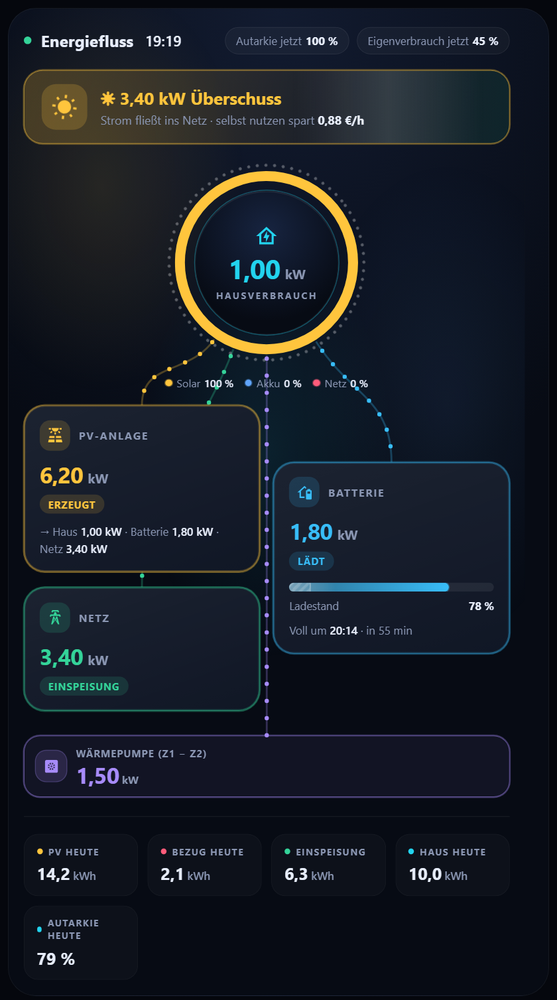

# Zwei Zähler in Reihe (zum Beispiel Z1 und Z2)

**Wofür:** Zwei Zähler hängen hintereinander. Z1 sitzt am Netzanschluss, danach hängen Wärmepumpe, Wallbox oder Klimaanlage, dann folgt Z2 für den Haushalt. Was zwischen Z1 und Z2 verbraucht wird, misst kein Zähler direkt, es ergibt sich aus der **Differenz**. Die Karten rechnen nicht selbst mit zwei Zählern. Du bildest die Differenz in Home Assistant und trägst sie als normalen Verbraucher in die Karte ein. Das geht ohne zusätzliche Software.

Diese Anleitung beschreibt ein Beispiel. Sie ist **nicht an einer echten Doppelzähler-Anlage geprüft**. Prüfe die Werte mit deinen Sensoren (Abschnitt "Prüfen"), bevor du dich darauf verlässt.

## Voraussetzungen

- Leistungssensor von **Z1** (Wirkleistung in W) und von **Z2** (in W).
- **Vorzeichen:** Beide Zähler müssen gleich melden, zum Beispiel Bezug positiv und Einspeisung negativ. Meldet einer anders herum, setze in den Formeln unten ein `-` davor.
- Ein Sensor für die **PV-Leistung** (für den Gesamtverbrauch, Schritt 4).

Die Sensornamen in den Beispielen sind Platzhalter. Ersetze sie durch deine.

## Schritt 1: Leistung zwischen Z1 und Z2

*Einstellungen → Geräte & Dienste → Helfer → Helfer erstellen → Template → Sensor.*

- Name: `Leistung zwischen Z1 und Z2`
- Einheit: `W`, Geräteklasse: `Leistung`, Zustandsklasse: `Messung`
- Zustandsvorlage:

```


{{ [0, a | float - b | float] | max
   if a not in ['unavailable', 'unknown'] and b not in ['unavailable', 'unknown'] else none }}
```

Das ist der Verbrauch von Wärmepumpe, Wallbox und Klima zusammen. Der Wert ist nie negativ.

## Schritt 2: Energie dazu (kWh)

*Helfer erstellen → Integral (Riemann-Summe).*

- Name: `Verbrauch zwischen Z1 und Z2`
- Eingangssensor: der Sensor aus Schritt 1
- Metrikpräfix: `k` (Kilo), Zeiteinheit: Stunden, Genauigkeit: 3
- Methode: trapezförmig

**Warum nicht einfach Z1 1.8.0 minus Z2 1.8.0 als Zähler nehmen?** Zwei getrennte Zählerstände ändern sich nie genau gleichzeitig. Die Differenz kann dadurch kurz zurückspringen, und Home Assistant wertet das als Zählerreset. Der Integrations-Helfer steigt dagegen immer.

## Schritt 3 (optional): PV-Strom, der zwischen Z1 und Z2 verbraucht wurde

Das ist die Einspeisung an Z2 minus die Einspeisung an Z1. Template-Sensor in W (Einstellungen wie in Schritt 1):

```


{{ [0, e2 - e1] | max }}
```

Dazu wieder einen Integrations-Helfer in kWh wie in Schritt 2.

## Schritt 4: Gesamtverbrauch für die Karte

Der Ring der Energiefluss-Karte zeigt den **gesamten** Verbrauch des Hauses. Der Zähler Z2 allein reicht dafür nicht: Er zeigt nur den **Netzbezug** des Haushalts, ohne den Strom, den der Haushalt direkt aus der PV nimmt.

Lege einen Template-Sensor an (W, Geräteklasse Leistung):

```
{{ [0, states('sensor.pv_leistung') | float(0) + states('sensor.z1_wirkleistung') | float(0)] | max }}
```

PV-Leistung plus Netzbezug an Z1 (Einspeisung zählt negativ). Hast du eine Batterie, ziehe die Ladeleistung ab und addiere die Entladeleistung.

## Schritt 5: In der Karte eintragen

```yaml
type: custom:energy-cockpit-flow-card
pv:
  entity: sensor.pv_leistung
grid:
  entity: sensor.z1_wirkleistung            # Z1 sitzt am Netzanschluss
home:
  entity: sensor.gesamtverbrauch            # aus Schritt 4
consumer_groups:
  - name: Wärmepumpe, Wallbox, Klima
    icon: mdi:heat-pump
    items:
      - entity: sensor.leistung_zwischen_z1_und_z2
        name: zwischen Z1 und Z2
```

Die Kachel "Nicht erfasst" zeigt dann den Teil, der nicht zwischen Z1 und Z2 liegt, also den Haushalt.

Im **Energie-Dashboard** von Home Assistant trägst du den Helfer aus Schritt 2 als Gerät ein (zum Beispiel "Wärmepumpe, Wallbox, Klima").

## Direkt in der Karte (Option)

Seit Version 0.15.0 kannst du die Differenz auch ohne eigene Helfer in der Karte eintragen. Das ist **optional**: Ohne `minus`, `energy_minus` und `price_ct` verhalten sich die Karten wie bisher.

**Energiefluss (Live in Watt):**

```yaml
consumers:
  - name: Wärmepumpe
    entity: sensor.z1_wirkleistung     # Z1 (Zweirichtungszähler am Hausanschluss), mit Vorzeichen
    minus: sensor.z2_wirkleistung      # Z2 (Haushalt), ebenfalls mit Vorzeichen
    # plus: sensor.pv_leistung          # nur wenn Z2 keinen Rückfluss anzeigt: Z2 = Haushalt - PV
```

Die Karte zeigt `Z1 − Z2 (+ plus)`, nie negativ. **Wichtig:** Das stimmt nur, wenn beide Werte ein Vorzeichen haben. Zeigt dein Z2 bei PV-Überschuss nur "0", fehlt der Rückfluss, dann gibst du bei `minus` den Hausverbrauch an und bei `plus` die PV-Leistung, oder du bildest Z2 als Helfer (Haushaltsverbrauch minus PV).

**Raum-Abrechnung (Energie, Kosten, eigener Tarif):**

```yaml
type: custom:energy-cockpit-room-card
price_ct: 34                       # allgemeiner Bezugspreis
devices:
  - name: Wärmepumpe (Netzbezug)
    energy: sensor.z1_bezug_kwh        # Z1 Bezug
    energy_minus: sensor.z2_bezug_kwh  # Z2
    price_ct: 24                       # Wärmepumpentarif
  - name: Haushalt
    energy: sensor.z2_bezug_kwh
```

Gerechnet wird je Stunde aus den Statistik-Änderungen beider Zähler, nie negativ. So gibt es kein Problem, wenn zwei Zähler nicht genau gleichzeitig weiterzählen. Der Wärmepumpen-Netzbezug entspricht der Definition der Netzbetreiber: **Bezug Z1 minus Bezug Z2**.

Hinweise:
- Die Zähler brauchen Langzeitstatistik (`state_class: total_increasing`).
- Die Bezeichnungen der Messkonzepte (zum Beispiel "Messkonzept 8") legt jeder Netzbetreiber selbst fest. Die Karte rechnet die Differenz, unabhängig vom Namen.
- Nicht an einer echten Anlage geprüft. Bitte vergleiche die Werte nach einem Monat mit der Abrechnung deines Netzbetreibers.



## Prüfen

- Läuft die Wärmepumpe, soll der Sensor aus Schritt 1 ungefähr ihrer Leistung entsprechen. Steht alles still, ist er nahe 0 W.
- Nach einem Monat soll der Integrations-Helfer nahe an **Z1 1.8.0 minus Z2 1.8.0** liegen. Ein großer Unterschied heißt, dass Vorzeichen oder Sensor nicht stimmen.

## Grenzen

- **Nur eine Differenz.** Du siehst nicht, wie sich Wärmepumpe, Wallbox und Klima untereinander aufteilen, es sei denn, jedes Gerät hat einen eigenen Zähler.
- **Verzögerung:** Aktualisieren sich die beiden Zähler nicht im selben Moment, entstehen kurze Spitzen. Das Integral glättet das. Für die Live-Anzeige hilft ein Filter-Helfer (Tiefpass).
- **Kein eigener Preis pro Zähler** (zum Beispiel ein Wärmepumpentarif). Die Karten rechnen mit einem Strompreis.
- **Keine Historie.** Der Integrations-Helfer beginnt bei null, wenn du ihn anlegst.
- **Aufteilung der Herkunft** (PV, Batterie, Netz) je Verbraucher berechnet die Karte aus der Gesamtmischung. Bei Anlagen, in denen die Batterie nur den Haushalt versorgt, stimmt diese Annahme nicht für Wärmepumpe und Wallbox.

Fragen oder Hinweise zu dieser Anleitung gern als [Issue](https://github.com/msucimaker3112/energy-cockpit/issues).
