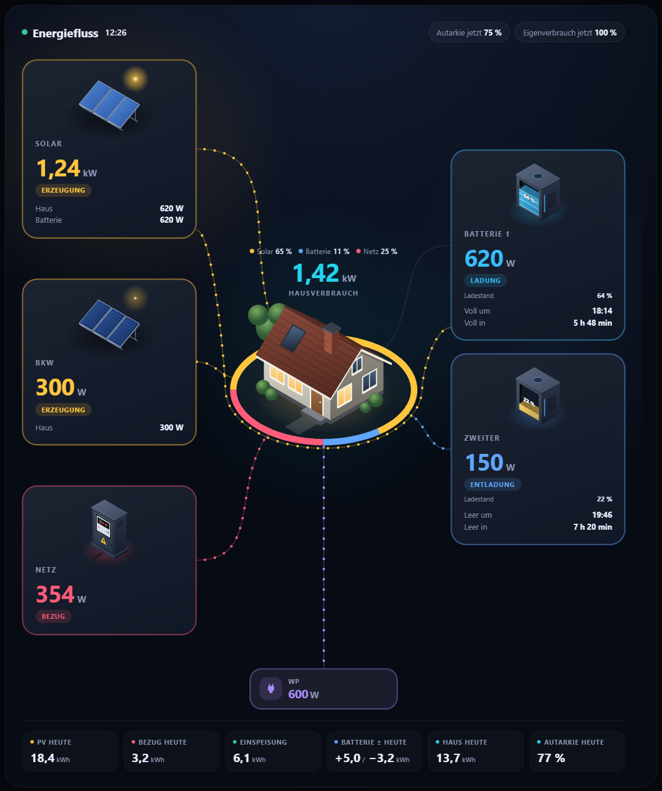
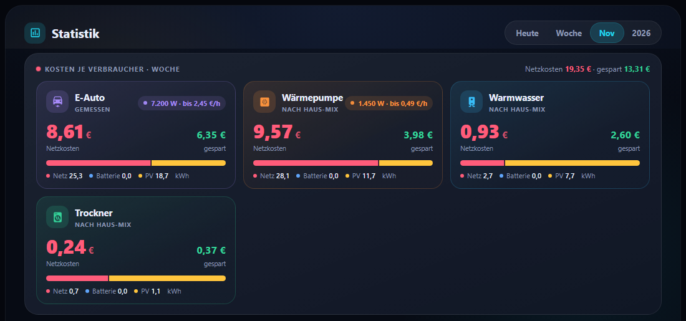

# Energy-Cockpit 0.19.0: Texte zum Release

Stand: Entwurf, nichts davon ist veröffentlicht.

---
## 1. GitHub-Release (Titel und Beschreibung)

**Titel:** 0.19.0: 3D-Ansicht und Kosten je Verbraucher

**Beschreibung:**

### Neu

**3D-Ansicht für den Energiefluss (optional)**
Mit `style: 3d` erscheinen Haus, Solar, Netz und Speicher als kleine 3D-Objekte statt als Kacheln mit Symbolen. Der Ladestand steht auf der Front des Speichers, das Netz zeigt die Leistung auf dem Display des Zählerkastens, die Sonne leuchtet mit dem Ertrag. Die Linien laufen nach den echten Wegen: Solar lädt den Speicher direkt, Solar speist direkt ein, das Netz lädt den Akku, der Speicher speist ein. Das Haus bekommt nur, was dort ankommt.
Mehrere Speicher, Balkonkraftwerk, PV-Strings, Gruppen, Kurzansicht, Handy-Layout und alle Farbschemen funktionieren auch in 3D. Das Haus gibt es mit Satteldach oder Flachdach (`house_style`).

```yaml
type: custom:energy-cockpit-flow-card
style: 3d
house_style: sattel   # oder flach
```



**Kosten je Verbraucher in der Statistik (optional)**
E-Auto, Wärmepumpe, Warmwasser, Trockner: Die Karte zeigt je Gerät die Netzkosten und was Solar und Akku gespart haben, für heute, die Woche, den Monat und das Jahr. Mit je einem Zähler für Netz, Akku und PV misst sie, mit nur einem Zähler teilt sie den Verbrauch jeder Stunde nach dem Mix des Hauses auf. Läuft das Gerät, steht die Leistung mit den Kosten pro Stunde dabei. Symbol und Farbe wählt die Karte selbst. Im Assistenten gibt es dafür den neuen Schritt "Kosten" (bis zu vier Verbraucher, weitere in YAML).



**Reiter "Woche"**: zählt ab Montag, mit Geldwerten und Autarkie oben für die Woche. Er erscheint nur, wenn Verbraucher eingetragen sind.

**Preisverlauf (`grid_price_history`)**: Jede Stunde rechnet mit ihrem eigenen Strompreis, aus der Langzeitstatistik des Preis-Sensors (dynamischer Tarif), aus einer Liste früherer Preise oder mit dem heutigen Preis.

**Hybrid-Wechselrichter (`pv_ac`)** in der Statistik: stimmige Autarkie und Aufteilung, wenn der Gesamtertrag nur die Abgabe des Wechselrichters zählt.

### Wichtig
- Alles Neue ist optional. Bestehende Einstellungen bleiben unverändert.
- Nach dem Update über HACS die App oder den Browser-Tab einmal ganz neu laden.
- Geldwerte oben in der Statistik und die Amortisation rechnen weiter mit dem heutigen Preis. Der Preisverlauf gilt nur für die Kosten je Verbraucher.
- Die 3D-Ansicht und die Kosten sind mit nachgestellten Sensoren getestet. Rückmeldungen von echten Anlagen sind willkommen.

Danke an alle, die Wünsche und Fehler gemeldet haben, besonders an Leo für die Idee zu den Kosten je Verbraucher (#19).

Alle Änderungen: [CHANGELOG](https://github.com/msucimaker3112/energy-cockpit/blob/main/CHANGELOG.md) · Einstellungen: [Konfiguration](https://github.com/msucimaker3112/energy-cockpit/blob/main/docs/KONFIGURATION.md)

---
## 2. Facebook: Hauptbeitrag (für Home-Assistant-Gruppen)

**Bilder (in dieser Reihenfolge):** `fb-teaser-1200x630.png`, `fb-3d-1080.png`, `fb-kosten-1080.png`

Energy-Cockpit 0.19 ist da: Dein Haus in 3D und was jedes Gerät wirklich kostet 🏠⚡

Ich baue seit ein paar Wochen an Energy-Cockpit, meinen Lovelace-Karten für Home Assistant (Energiefluss, Geräte, Statistik, Raum-Abrechnung). Alles auf Deutsch, kostenlos, per HACS installierbar. Das neue Update bringt zwei große Dinge:

🏠 **3D-Ansicht für den Energiefluss**
Mit einer Zeile (`style: 3d`) werden aus Kacheln ein kleines Haus mit Solarmodulen, Zählerkasten und Speicher. Der Ladestand steht auf dem Akku, das Netz zeigt die Watt auf dem Display, und die Linien laufen so, wie die Energie wirklich fließt. Mehrere Speicher, Balkonkraftwerk, Handy-Ansicht und alle Farbschemen gehen auch.

💶 **Kosten je Verbraucher**
Was kostet mich das E-Auto, was die Wärmepumpe? Die Karte zeigt je Gerät die Netzkosten und wie viel Solar und Akku gespart haben, für heute, die Woche, den Monat und das Jahr. Dazu ein Preisverlauf, damit alte Stunden zum alten Preis zählen (auch bei dynamischem Tarif).

Einrichten geht per Assistent, ohne YAML. Alles Neue ist optional, bestehende Karten bleiben unverändert.

👉 Download und Anleitung: https://github.com/msucimaker3112/energy-cockpit

Der Wunsch mit den Kosten kam aus der Community. Wenn dir etwas fehlt oder nicht stimmt, schreib mir gern ein Issue auf GitHub oder hier unten einen Kommentar.

#HomeAssistant #Smarthome #Photovoltaik #Balkonkraftwerk #Energiemanagement #HACS #Solar #Batteriespeicher

---
## 3. Facebook: Kurzfassung (Story, Balkonkraftwerk-/PV-Gruppen)

**Bild:** `fb-3d-1080.png`

Neu in Energy-Cockpit: Der Energiefluss in 3D 🏠☀️🔋
Haus, Solar, Zählerkasten und Speicher als kleine Objekte, die Linien zeigen den echten Weg des Stroms. Kostenlos für Home Assistant, ein Klick in den Einstellungen.
https://github.com/msucimaker3112/energy-cockpit

---
## 4. Facebook: Beitrag nur zu den Kosten

**Bild:** `fb-kosten-1080.png`

Was kostet eigentlich das E-Auto laden? ⚡🚗

Mit dem neuen Energy-Cockpit 0.19 zeigt die Statistik-Karte für Home Assistant je Gerät, was der Netzstrom gekostet hat und wie viel du durch Solar und Akku gespart hast. Heute, Woche, Monat, Jahr. Mit eigenen Zählern wird gemessen, sonst sauber geschätzt.

Kostenlos, per HACS: https://github.com/msucimaker3112/energy-cockpit

---
## 5. Bildunterschriften und Alt-Texte

| Datei | Bildunterschrift |
|---|---|
| `fb-teaser-1200x630.png` | Energy-Cockpit 0.19: 3D-Ansicht und Kosten je Verbraucher |
| `fb-3d-1080.png` | Der Energiefluss in 3D: Haus, Solar, Netz und zwei Speicher, die Linien folgen den echten Wegen |
| `fb-kosten-1080.png` | Kosten je Verbraucher: Netzkosten und Ersparnis durch Solar und Akku, hier für die Woche |

Alle Bilder liegen in `release-0.19/`. Die Screenshots der Doku liegen in `docs/img/` (`flow-3d*.png`, `kosten*.png`, `wiz-stats-2-kosten.png`).

---
## 6. Hinweise zum Posten
- Vor dem Posten das Release auf GitHub veröffentlichen, damit der Link zu den Bildern und zur Doku stimmt.
- Hashtag-Block je Gruppe anpassen, in manchen Gruppen sind Hashtags unerwünscht.
- Gruppenregeln für Eigenwerbung beachten, manche Gruppen erlauben Projekte nur an bestimmten Tagen.
